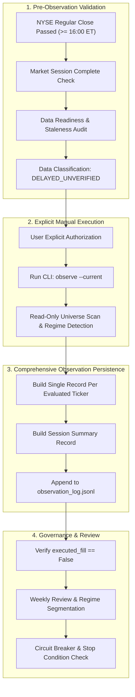
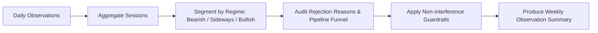
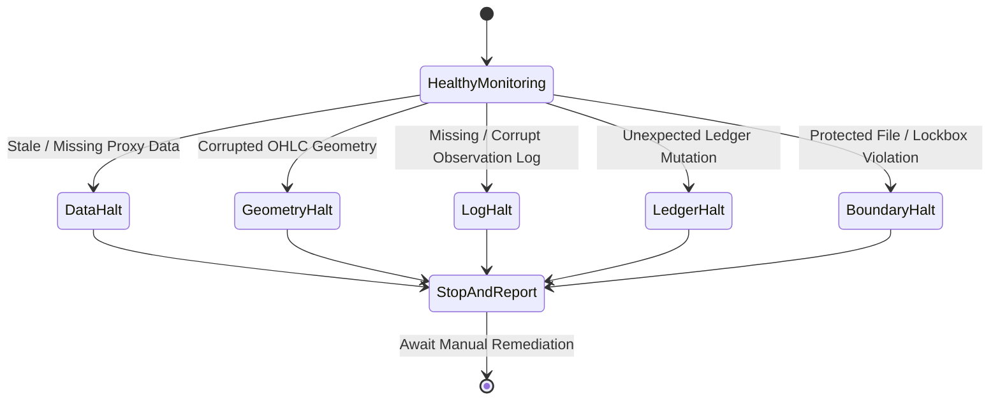

# Phase 6.4.6 — Forward Observation Monitoring Framework

## 1. Executive Summary & Operational Baseline

This document defines the formal, disciplined operational framework for collecting, recording, reviewing, and analyzing forward observations of the frozen **Trader-Swing** autonomous strategy.

The framework ensures that forward paper research is conducted systematically across multiple completed market sessions with complete auditability, zero live/paper capital risk, and strict adherence to governance boundaries.



### 1.1 Current Baseline State (Post-Phase 6.4.5)

| Dimension | Baseline Value / Status | Description |
| :--- | :--- | :--- |
| **Strategy State** | **FROZEN** | Rules, parameters, indicators, and risk limits frozen since Phase 5.10.3 / 6.1. |
| **First Observation Session** | **`2026-11-16`** | Initial forward research scan completed successfully. |
| **Candidate Observations** | **49 Records** | 49 unique equity records persisted in `observation_log.jsonl`. |
| **Session Summary** | **1 Record** | 1 session record persisted (`tickers_evaluated_count: 49`, `rejected_count: 49`). |
| **Detected Regime** | **`STRONG_BEARISH`** | Macro downtrend across SPY, QQQ, and IWM; new long setups disallowed by policy. |
| **Eligible Candidates** | **0** | All 49 evaluated stocks vetoed at scanner layer by regime policy. |
| **Data Classification** | **`DELAYED_UNVERIFIED`** | Yahoo Finance end-of-day daily candles (`UNVERIFIED_DELAY — NOT REAL-TIME`). |
| **Exclusion Log** | **1 Ticker (`CVX`)** | Excluded upstream due to anomalous raw data geometry (`Open > High`). |
| **Paper Account Capital** | **$5,000.00 USD** | Unchanged; zero capital committed. |
| **Open Positions / Fills** | **0 / 0** | Completely untouched; zero mutations to paper ledger. |

---

## 2. Daily Manual Monitoring Procedure

Every observation run must follow a strict, manual 6-step checklist. Automated execution, cron jobs, background daemons, and polling loops are strictly prohibited.

```mermaid
sequenceDiagram
    autonumber
    actor User as Operator / User
    participant Clock as MarketClock (ET)
    participant Data as Current Data (.planning/data/current_daily)
    participant WF as Observation Workflow (CLI)
    participant Log as observation_log.jsonl
    participant State as Paper State (TradingPaperState)

    User->>Clock: Verify current time >= 16:00 ET (regular session closed)
    User->>Data: Verify CURRENT_DAILY_MANIFEST.json & proxy session alignment
    User->>WF: Execute: python paper_cli.py observe --current (manual only)
    WF->>State: Inspect paper state (Read-Only; 0 mutations)
    WF->>Log: Append 49+ candidate records & 1 session record
    User->>Log: Verify executed_fill: false & file integrity
    User->>State: Verify SHA256 hashes unchanged
```

### Step 1: Completed Session Verification
- **Timing Requirement**: The observation scan must only be run after the regular NYSE session has closed (**16:00 ET**).
- **Session Eligibility**:
  - The trading session date must be a valid historical trading day per the NYSE calendar.
  - Weekend days and exchange holidays are strictly disallowed.
  - Intraday execution during an active session is disallowed.

### Step 2: Data Readiness & Delay Classification Audit
- **Proxy Alignment Check**:
  - Confirm `SPY`, `QQQ`, and `IWM` daily candle CSVs exist in `.planning/data/current_daily/`.
  - Confirm the latest candle date matches the expected latest completed session date.
- **Stock Universe Freshness**:
  - Verify that candidate equities have candles ending on the same session date as the proxies.
  - Inspect `CURRENT_DAILY_MANIFEST.json` for any excluded tickers.
- **Data Classification Disclosure**:
  - Confirm data mode is recorded as `CURRENT_DAILY_OBSERVATION`.
  - Confirm data classification is explicitly declared as `DELAYED_UNVERIFIED (UNVERIFIED_DELAY — NOT REAL-TIME)`.

### Step 3: Explicit Manual Invocation Only
- **Approved Invocation Command**:
  ```bash
  python .agents/skills/trader-swing/paper_cli.py observe --current
  ```
- **Operational Rules**:
  - Requires explicit user authorization per session.
  - Never execute with forbidden flags (`--live`, `--broker`, `--auto`, `--key`, etc.).
  - Never run background polling processes or automated watchers.

### Step 4: Record Session Summary and Candidate Observations
- **Persistence Target**: `.planning/data/observations/observation_log.jsonl`.
- **Candidate-Level Outcomes**:
  - Every evaluated ticker must generate exactly **one** `FORWARD_OBSERVATION` record.
  - Tickers vetoed by scanner: record `scanner_decision: "REJECTED"`, `signal: "REJECTED_SCANNER"`, complete `rejection_reasons`, and available `technical_metrics`.
  - Tickers reaching risk sizing: record `scanner_decision: "ELIGIBLE"`, `candidate_score`, and enrich with trade plan (`ENTRY_SIGNAL` or `REJECTED_RISK`).
- **Session-Level Summary**:
  - Exactly **one** `SESSION_RECORD` appended per completed scan.
  - Captures total evaluated, eligible count, rejected count, signal generation count, risk sizing count, and observation count.

### Step 5: Post-Scan Persistence & Ledger Integrity Verification
- **Log Verification**:
  - Verify that `observation_log.jsonl` parsed cleanly with zero JSON errors.
  - Confirm that `executed_fill: false` holds across 100% of newly appended lines.
  - Verify no duplicate tickers exist within the session batch.
- **Ledger Invariance Check**:
  - Confirm files in `C:\Users\mmano\Documents\TradingPaperState` remain byte-for-byte identical.
  - Confirm 0 fills, 0 open positions, and $5,000 cash balance.

### Step 6: Data-Quality and Upstream Anomaly Tracking
- **Exclusion Logging**:
  - Any ticker excluded by the feed adapter (e.g., OHLC geometry invalidity, insufficient bars, stale dates) must be noted in the monitoring review.
  - Never fabricate or guess missing candles.

---

## 3. Monitoring Metrics Reference

To assess strategy behavior across multiple sessions without altering parameters, the operator tracks 9 primary monitoring metrics:

| Metric Category | Metric Name | Definition & Formula | Interpretation / Purpose |
| :--- | :--- | :--- | :--- |
| **Observation Volume** | **Sessions Observed ($N_{sess}$)** | Cumulative number of distinct trading days scanned. | Tracks sample maturity. |
| **Macro Environment** | **Regime Distribution** | Proportion of sessions in each regime: $\frac{N_{regime}}{N_{sess}}$. | Monitors broad market climate (Bullish vs Bearish vs Sideways). |
| **Universe Breadth** | **Tickers Evaluated** | Count of valid equities passed to scanner per session. | Confirms screening universe consistency (nominally 49-50 stocks). |
| **Screening Selectivity** | **Eligible Candidates ($N_{elig}$)** | Candidates passing all 5-pillar filters and regime policies. | Measures candidate generation rate. |
| **Rejection Volume** | **Rejected Candidates ($N_{rej}$)** | Candidates failing one or more scanner criteria. | Measures filter restrictiveness. |
| **Filter Breakdown** | **Rejection Reason Distribution** | Histogram of specific rejection causes across all candidates. | Identifies binding screening hurdles (e.g. Regime veto, ADV, RSI, SMA). |
| **Risk Funnel** | **Signal & Sizing Throughput** | Count reaching signal engine and risk engine approvals. | Evaluates how many setups qualify for capital allocation. |
| **Hypothetical Tracking** | **Theoretical Signal Outcomes** | Measurable price paths of approved trade plans (Target vs Stop). | Evaluates paper edge hypothetically without placing trades. |
| **Data Integrity** | **Exclusion & Completeness Rate** | $\frac{N_{excluded}}{N_{universe}}$ and log continuity checks. | Monitors feed health and provider anomalies. |

### 3.1 Rejection Reason Taxonomy

Rejections must be classified into standard diagnostic categories:
1. **Regime Disallowance**: `Market regime 'STRONG_BEARISH' disallows new long positions`.
2. **Regime Minimum Score**: `Candidate score (X) is below regime minimum (Y)`.
3. **Liquidity / ADV**: `Average dollar volume ($X) is below minimum ($10,000,000)`.
4. **Price Level**: `Price ($X) is below minimum threshold ($10.00)`.
5. **Moving Average Alignment**: `Price ($X) is not above 20-day SMA ($Y)`.
6. **Volatility / ATR%**: `ATR% (X%) is outside swing boundary [1.0%, 15.0%]`.
7. **Momentum / RSI**: `RSI (X) outside swing boundary [35.0, 75.0]`.
8. **Risk Engine Constraints**: `MAX_POSITIONS_EXCEEDED`, `CAPITAL_EXCEEDED`, or `MINIMUM_RR_NOT_MET`.

---

## 4. Weekly Review & Synthesis Protocol

At the end of each trading week (or after every 5 completed observation sessions), the operator conducts a structured review using the following criteria:



### 4.1 Strict Non-Interference Guardrails
> [!IMPORTANT]
> **Weekly Review Guardrails**:
> 1. **Zero Parameter Tuning**: Under no circumstances should strategy parameters, screening thresholds, moving averages, or risk percentages be adjusted based on forward observation reviews.
> 2. **Rejection $\neq$ Trading Loss**: A scanner rejection is an intentional risk filter protecting capital, not a missed opportunity or financial loss.
> 3. **Statistical Significance Requirement**: Fewer than 30-50 completed observation sessions cannot provide statistical confidence. No claims of profitability or edge may be derived from small samples.
> 4. **Hypothetical vs Reality**: Any forward tracking of hypothetical candidate trajectories is purely observational and must never be recorded or reported as a paper ledger fill.

### 4.2 Regime-Conditional Segmentation
Weekly reviews must group sessions into three distinct macro buckets:
- **Bearish Regimes (`STRONG_BEARISH`, `BEARISH`)**: Verify that the strategy successfully suppresses long capital exposure during broad market drawdowns.
- **Neutral Regimes (`SIDEWAYS`)**: Check whether candidate selection tightens (min score 75.0, max 3 positions) to filter choppy market action.
- **Bullish Regimes (`BULLISH`, `STRONG_BULLISH`)**: Evaluate candidate setup generation, scoring distribution, and risk sizing efficiency when long setups are permitted.

---

## 5. Circuit Breakers & Stop Conditions

The observation workflow must be immediately suspended if any of the following 5 stop conditions are detected:



### 5.1 Trigger Matrix & Action Protocol

| Stop Condition | Trigger Event | Immediate Action | Remediation Path |
| :--- | :--- | :--- | :--- |
| **1. Data Freshness Failure** | SPY, QQQ, or IWM latest session date $<$ expected completed session date. | **HALT observation scan.** | Do not fabricate candles. Verify exchange calendar and upstream feed availability. |
| **2. Corrupted OHLC Geometry** | Candle violates $High \ge Low$, $High \ge Open/Close$, $Low \le Open/Close$, or volume $< 0$. | **HALT and exclude affected ticker.** | Exclude ticker at feed adapter; log anomaly in manifest. If proxy corrupted, halt entire session. |
| **3. Log Persistence Failure** | Scan completes but `observation_log.jsonl` fails to append records, has 0 bytes, or JSON syntax errors. | **HALT observation workflow.** | Inspect file write permissions and log serialization. Do not proceed to subsequent sessions. |
| **4. Unexpected Ledger Mutation** | SHA256 hashes of files in `TradingPaperState` change, or paper positions count $> 0$. | **CRITICAL HALT.** | Immediately inspect `audit_events.jsonl` and ledger. Revert unauthorized state changes. |
| **5. Governance Boundary Breach** | Any access, read, or modification of the 2026 lockbox, root `paper_journal.json`, or historical partitions. | **CRITICAL HALT.** | Terminate execution immediately. Report boundary breach to governance review. |

---

## 6. Document Metadata & Governance

- **Document Identifier**: `PHASE_6_4_6_FORWARD_OBSERVATION_MONITORING.md`
- **Applicable Skill**: `trader-swing`
- **Governing Phases**: Phase 5.10.3 (Freeze), Phase 6.1 (Integrity), Phase 6.4 (Forward Observation).
- **Modification Policy**: **LOCKED / READ-ONLY**. Any modification to monitoring rules requires explicit user request.
