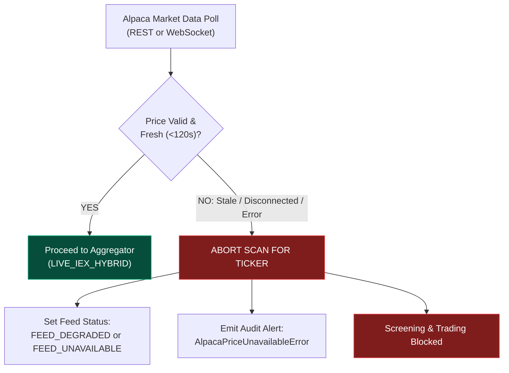
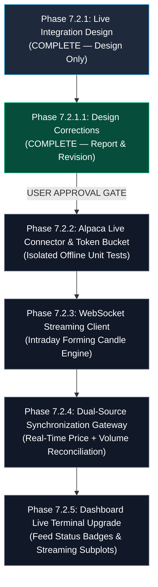

# Phase 7.2.1.1 — Live Data Integration Design Correction Report
## Dual-Source Market Data Contract Revision & Operational Guardrails

**Date:** 2026-11-17  
**Phase:** 7.2.1.1 (Live Data Design Correction)  
**Status:** COMPLETE — DESIGN AUDIT ONLY  
**Supercedes:** Initial Draft of `PHASE_7_2_1_LIVE_DATA_DESIGN.md`  
**Target Document Revised:** [.planning/PHASE_7_2_1_LIVE_DATA_DESIGN.md](file:///C:/Users/mmano/OneDrive/Desktop/trading/.planning/PHASE_7_2_1_LIVE_DATA_DESIGN.md)  
**Safety Classification:** STRICTLY OFFLINE & ARCHITECTURAL (No Live API Connections, Zero Live Network Calls, Zero Code Implemented)

---

## 1. Executive Summary

Phase 7.2.1.1 conducts a thorough, disciplined review and formal correction of the live market data integration architecture specified in `PHASE_7_2_1_LIVE_DATA_DESIGN.md`. 

While Phase 7.2.1 successfully established the dual-source paradigm (Alpaca IEX for price action, Yahoo Finance for consolidated composite volume), five critical architectural areas required revision to prevent subtle data contamination, silent provider failover, and accidental strategy mutation:

1. **Elimination of Automatic Yahoo Price Failover:** In the original draft, an automatic price fallback to Yahoo Finance was proposed if Alpaca price feeds failed. This violated the core Phase 7.1.2 isolation boundary. The revised architecture strictly enforces an **abort-on-failure policy**: if Alpaca price quotes are unavailable, stale, or invalid, the scan for that symbol is immediately aborted, the feed state transitions to `FEED_DEGRADED` or `FEED_UNAVAILABLE`, and no silent substitution occurs.
2. **Strict Daily vs. Intraday Volume Path Isolation:** Forming intraday candles and completed daily candles must never share volume semantics. Intraday forming candles represent partial-session volume and must **never** be populated with prior-day Yahoo volume, must **never** have intraday RVOL calculated against 20-day full-day averages, and are **strictly barred** from generating swing candidate eligibility. Completed daily candles must enforce exact session date alignment ($D_{Alpaca} == D_{Yahoo}$) before becoming eligible for daily ADV/RVOL screening.
3. **Diagnostic-Only Price Discrepancy Policy:** The proposed 1.5% cross-provider price divergence check is explicitly designated as **diagnostic telemetry only**, rather than an automated strategy quarantine filter. Structural causes of variance (split adjustments, corporate actions, regular vs. extended-hours trading) are documented, and a mandatory human-review gate is required before any quarantine is implemented.
4. **Formal 8-State Operational Matrix:** The system defines eight unambiguous operational states (`COMPLETE_BAR`, `FORMING_BAR`, `LIVE_IEX_HYBRID`, `LIVE_PRICE_UNVERIFIED`, `DELAYED_UNVERIFIED`, `FEED_DEGRADED`, `FEED_UNAVAILABLE`, and `VOLUME_UNVERIFIABLE`) with explicit permissions governing Display, Historical Analysis, and New-Long Screening.
5. **Absolute Strategy & Risk Engine Immutability:** Confirmation that all existing 5-pillar screening rules, 20-day ADV ($10M), 0.8x RVOL, regime filter, deterministic risk rules (0.50% risk, 4 positions, 20% cash), and broker isolation boundaries remain 100% frozen.

---

## 2. Detailed Section-by-Section Corrections & Diffs

### 2.1 Correction 1: Alpaca Price Failure — Removal of Automatic Yahoo Failover

#### Problem in Initial Design Draft
The preliminary draft of Phase 7.2.1 proposed an automated fallback mechanism: if Alpaca REST/WebSocket endpoints experienced an outage, the aggregator would dynamically route price lookups to Yahoo Finance quotes.

#### Architectural Vulnerability
Silent price failover introduces multiple severe risks:
- **Masks Upstream Infrastructure Failures:** Silent fallback prevents monitoring systems from detecting broken Alpaca credentials, WebSocket disconnects, or upstream rate limits.
- **Price-Basis Drift:** Yahoo real-time/delayed quotes represent composite SIP prints, whereas Alpaca provides IEX prints. Silently switching the price provider mid-session introduces tick inconsistencies, VWAP divergence, and unverified timestamp alignment.
- **Breaches Provider Contract:** Phase 7.1.2 explicitly designated Alpaca IEX as the sole authoritative price action source.

#### Revised Invariant & Resolution
- **Strict Abort Policy:** If Alpaca price data is unavailable, incomplete, stale, or invalid, the engine **immediately aborts candidate evaluation** for the affected symbol.
- **Explicit Feed State:** The ticker feed transitions to `FEED_DEGRADED` (for transient latency/backoff) or `FEED_UNAVAILABLE` (for hard connection failure).
- **No Provider Substitution:** Under no circumstances does the engine silently switch price providers.
- **Traceable Error Logging:** A structured exception (`AlpacaPriceUnavailableError`) is emitted to the audit log, notifying operations.



---

### 2.2 Correction 2: Daily vs. Intraday Volume Synchronization

#### Problem in Initial Design Draft
The initial draft lacked a crisp boundary between intraday partial-day volume and post-close composite daily volume. This created ambiguity regarding whether forming intraday bars could calculate RVOL or receive Yahoo daily volume estimates.

#### Mathematical Contamination Risk
The quantitative strategy relies on:
$$\text{ADV}_{20} = \frac{1}{20} \sum_{i=1}^{20} (\text{Close}_i \times \text{Volume}_i)$$
$$\text{RVOL} = \frac{\text{Volume}_{\text{today}}}{\text{SMA}_{20}(\text{Volume})}$$

If a forming intraday candle at 11:00 AM (representing only 1.5 hours of trading) has its RVOL computed against a 20-day average of full 6.5-hour sessions, the resulting RVOL will artificially appear near $0.23\text{x}$, falsely tripping the $0.8\text{x}$ volume threshold. Conversely, if prior-day Yahoo volume or projected volume were attached, fictitious liquidity would enter the decision engine.

#### Revised Two-Path Architecture

```
+-----------------------------------------------------------------------------------+
|                        ISOLATED VOLUME SYNCHRONIZATION PATHS                      |
+-----------------------------------------+-----------------------------------------+
|     PATH A: COMPLETED DAILY CANDLES     |     PATH B: FORMING INTRADAY CANDLES    |
+-----------------------------------------+-----------------------------------------+
| • Alpaca daily OHLC prices              | • Real-time streaming Alpaca IEX quotes |
| • Yahoo consolidated daily volume       | • Status: STRICTLY 'CandleStatus.FORMING' |
| • Exact session match (D_Alpaca==D_Yahoo)| • Volume: Unconsolidated / forming only |
| • Both sources confirmed session close  | • DO NOT attach daily Yahoo volume      |
| • Only verified completed bars enter    | • DO NOT calculate daily RVOL from      |
|   daily ADV / RVOL calculations         |   mismatched intraday periods           |
| • ELIGIBLE for swing candidate scan     | • BLOCKED from new-long screening       |
+-----------------------------------------+-----------------------------------------+
```

#### Detailed Path Specifications
1. **Path A (Completed Daily Candles):**
   - **Preconditions:** Scheduled session has concluded ($16:00$ ET regular, $13:00$ ET early close) + SIP composite consolidation complete ($16:15 - 17:00$ ET).
   - **Contract:** Exact session date match ($D_{Alpaca} == D_{Yahoo}$). Both bars verified complete. Yahoo composite volume $V_{Yahoo} > 0$. Split-adjustment basis matched.
   - **Downstream Permission:** Appended to historical series. Permitted for ADV/RVOL calculations, regime detection, and 5-pillar swing screening.
2. **Path B (Forming Intraday Candles):**
   - **Preconditions:** Active market session ($09:30 - 16:00$ ET).
   - **Contract:** Status is immutably `CandleStatus.FORMING`. Volume is unverified/unconsolidated IEX partial volume.
   - **Downstream Permission:** Strictly visualized on the Streamlit dashboard as a hollow/distinct forming candle. **Zero screening eligibility. Zero order generation.**

---

### 2.3 Correction 3: Diagnostic Price Discrepancy Policy

#### Problem in Initial Design Draft
The initial draft suggested a potential automated 1.5% price discrepancy quarantine that would discard tickers if Alpaca and Yahoo closing prices differed by $> 1.5\%$.

#### Strategy & Operational Risk
Introducing an automated price-divergence filter directly into the strategy engine creates substantial hidden risks:
- **Corporate Action Timing Asymmetry:** Different financial data vendors process stock splits, reverse splits, and stock dividends at different times between 16:00 ET and 04:00 ET. An automated 1.5% filter would trigger widespread false-positive halts on any morning following a 2-for-1 or 3-for-1 split.
- **Adjustment Basis Incompatibility:** Yahoo defaults to split-adjusted close, but unadjusted close or dividend-adjusted close may be inadvertently compared against Alpaca's split-adjusted quote.
- **Session Boundaries:** Alpaca 24-hour / extended-hours quotes must not be compared against Yahoo's official 16:00 closing auction print.

#### Revised Policy: Telemetry Only + Human Review
1. **Status:** Strictly diagnostic telemetry; **zero automated strategy filtering**.
2. **Formula:**
   $$\Delta_{\text{price}} = \frac{|Close_{\text{Alpaca}} - Close_{\text{Yahoo}}|}{Close_{\text{Yahoo}}}$$
3. **Operational Thresholds:**
   - $\Delta_{\text{price}} \in [0.5\%, 1.5\%]$: Informational audit log (`PRICE_VARIANCE_OBSERVED`).
   - $\Delta_{\text{price}} > 1.5\%$: Diagnostic alert log (`PRICE_DISCREPANCY_FLAGGED`).
4. **Mandatory Human-Review Gate:**
   - No ticker may be automatically blacklisted or quarantined from screening based solely on algorithmic price divergence.
   - Any elevated discrepancy ($> 1.5\%$) generates a telemetry incident record capturing the raw quotes, adjustment flags, and timestamps.
   - Exclusion requires human review and an explicit configuration update.

---

### 2.4 Correction 4: Operational Readiness & Failure State Matrix

#### Definitive 8-State Permission Matrix
To ensure predictable runtime behavior across the ingestion, adaptation, and visualization layers, eight mutually exclusive operational states are formalized:

| State Identifier | State Type | Permits Terminal Display? | Permits Historical Analysis? | Permits New-Long Screening? | Transition / Fallback Trigger |
| :--- | :--- | :---: | :---: | :---: | :--- |
| **`COMPLETE_BAR`** | Candle Lifecycle | **YES** (Solid bar) | **YES** | **YES** *(if volume consolidated)* | Bar fully concluded post-$16:00$ ET. |
| **`FORMING_BAR`** | Candle Lifecycle | **YES** (Hollow bar) | **NO** | **NO** *(Strictly Blocked)* | Active trading session ($09:30-16:00$ ET). |
| **`LIVE_IEX_HYBRID`** | Data Provenance | **YES** (Live Green Badge) | **YES** *(Completed bars)* | **YES** *(Completed bars only)* | Verified Alpaca price + Yahoo volume. |
| **`LIVE_PRICE_UNVERIFIED`** | Data Provenance | **YES** (Live Cyan Badge) | **NO** | **NO** *(Strictly Blocked)* | Real-time IEX quote awaiting volume. |
| **`DELAYED_UNVERIFIED`** | Data Provenance | **YES** (Delayed Badge) | **YES** | **YES** *(Baseline Workflow)* | Yahoo-only end-of-day delayed partition. |
| **`FEED_DEGRADED`** | Feed Health | **YES** (Yellow Warning) | **NO** | **NO** *(Strictly Blocked)* | Latency $> 120\text{s}$, rate limit backoff. |
| **`FEED_UNAVAILABLE`** | Feed Health | **YES** (Red Error Card) | **NO** | **NO** *(Scan Aborted)* | Network drop, 401/403 auth error. |
| **`VOLUME_UNVERIFIABLE`** | Feed Health | **YES** (Vol Warning) | **NO** | **NO** *(Strictly Blocked)* | Yahoo tape missing, 0, or non-composite. |

#### Screening Eligibility Invariant
A candle sequence is eligible for the 5-pillar swing scanner **if and only if**:
$$\text{Status} == \text{COMPLETE\_BAR} \quad \land \quad \text{Feed} \in \{\text{LIVE\_IEX\_HYBRID}, \text{DELAYED\_UNVERIFIED}\} \quad \land \quad \text{is\_consolidated\_volume} == \text{True}$$
All other combinations are hard-blocked by `MarketDataReadinessEvaluator`.

---

### 2.5 Correction 5: Immutability of Existing Strategy, Risk, & Paper State

The live data integration design operates strictly as an upstream data delivery system. It introduces **zero modifications** to the core quantitative trading system:

```
+-----------------------------------------------------------------------------------+
|                        FROZEN CORE QUANTITATIVE SPECIFICATION                     |
+-----------------------------------+-----------------------------------------------+
| System Component                  | Status & Governance Guarantee                 |
+-----------------------------------+-----------------------------------------------+
| 5-Pillar Swing Strategy           | 100% Frozen. (Trend, Pullback, RVOL, Key Level,|
|                                   | Catalyst). Logic in scanner.py unchanged.     |
| Liquidity Criteria                | 100% Frozen. ADV >= $10,000,000; RVOL >= 0.80. |
| Regime Detection Engine           | 100% Frozen. SPY/QQQ/IWM 200 SMA / 50 SMA.    |
| Market Regime Veto                | 100% Frozen. Blocks long scans in NEUTRAL/BEAR|
| Deterministic Risk Engine         | 100% Frozen. Max risk 0.50% ($25 on $5,000),   |
|                                   | max 4 positions, 20% cash reserve buffer.     |
| Order Size Rounding               | 100% Frozen. Exact floor whole shares.        |
| Target / Stop Geometry            | 100% Frozen. Asymmetric 2R profit target.     |
| Paper Portfolio Journal           | 100% Frozen. Initial $5,000 baseline locked.  |
| Broker Execution Boundary         | 100% Disconnected. Strictly air-gapped.       |
+-----------------------------------+-----------------------------------------------+
```

---

## 3. Phased Implementation Roadmap & Governance Gates

The implementation of live market data is structured into four sequential, test-driven phases following this design:



### 3.1 Strict Pre-Implementation Approval Gates
Before executing Phase 7.2.2 or creating code connecting to external endpoints, the following conditions must be satisfied:
1. **User Sign-Off:** Explicit user approval of `PHASE_7_2_1_LIVE_DATA_DESIGN.md` and this correction report.
2. **Affirmation of Abort Policy:** User confirmation of the strict no-price-failover policy (Alpaca failure aborts the scan).
3. **Affirmation of Forming Candle Policy:** User confirmation that intraday forming candles are purely visual and barred from candidate screening.
4. **Credential Isolation Protocol:** Agreement that credentials will reside exclusively in local process environment variables (`ALPACA_API_KEY_ID`, `ALPACA_API_SECRET_KEY`), never written to disk, committed to Git, or passed in chat prompts.

---

## 4. Design-Only Boundary Verification

To guarantee that Phase 7.2.1.1 adheres strictly to the design-only mandate, the system performed a comprehensive integrity audit:

### 4.1 Cryptographic Hash Verification of Protected State
All historical datasets, forward observation records, and manifest files were verified unchanged:

| File Path | Expected SHA-256 Hash | Verified SHA-256 Hash | Integrity Status |
| :--- | :--- | :--- | :---: |
| `.planning/data/observations/observation_log.jsonl` | `A8F5603652062A8D1E25DEC309CA046293D0733E02DAD5FA177C3F1727E75E34` | `A8F5603652062A8D1E25DEC309CA046293D0733E02DAD5FA177C3F1727E75E34` | **MATCH (Unmodified)** |
| `.planning/data/current_daily/CURRENT_DAILY_MANIFEST.json` | `C31A6AE4DE4F52FB55288D766C980D4BFB26D039281443E5A7005CBFABF35B51` | `C31A6AE4DE4F52FB55288D766C980D4BFB26D039281443E5A7005CBFABF35B51` | **MATCH (Unmodified)** |
| `.planning/data/current_daily/SPY_daily.csv` | `03F55CEA4EDCBB985723688E60224E812E67A2C0DCB32FE99728671F79835626` | `03F55CEA4EDCBB985723688E60224E812E67A2C0DCB32FE99728671F79835626` | **MATCH (Unmodified)** |

### 4.2 Protocol Attestation
- **Zero Live Network Calls:** No HTTP requests, socket connections, or external API pings were executed.
- **Zero Credentials Touched:** No API keys or authentication headers were stored, searched, or requested.
- **Zero Code Written:** Python source files (`.agents/skills/trader-swing/`, `dashboard/`, `tests/`) were untouched.
- **Zero Git Operations:** No commits, branches, or tags were generated.
- **Zero Paper Ledger Mutations:** Paper portfolio state remains at baseline ($5,000 cash, 0 positions).

---

## 5. Conclusion & Recommendation

The corrections articulated in this report fully resolve the vulnerabilities of the initial design draft. The revised architecture provides a safe, robust foundation for real-time market data integration while upholding the highest standards of data integrity and risk governance.

**Recommendation:** Present findings to the user for formal review and sign-off before proceeding to Phase 7.2.2.
