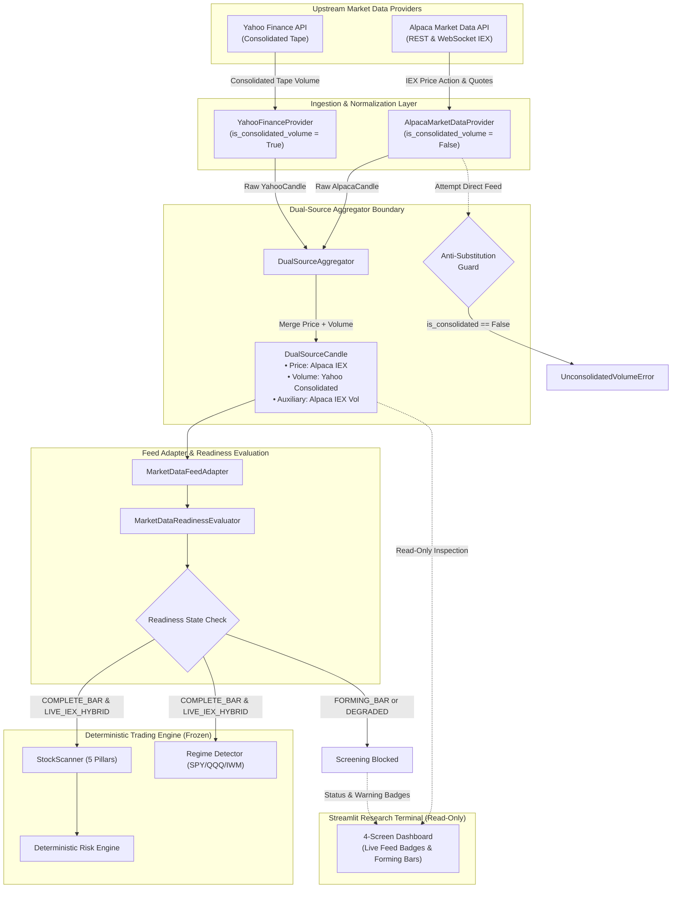
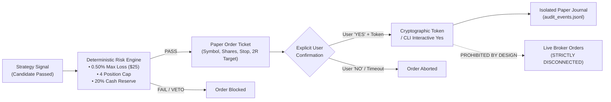
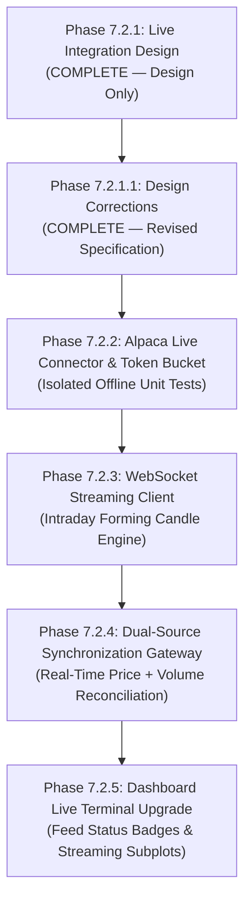

# Phase 7.2.1 — Live Market Data Integration Design (Revised)
## Dual-Source Alpaca/Yahoo Engine & Dashboard Architecture

**Date:** 2026-11-17  
**Phase:** 7.2.1 (Live Market Data Integration Design — Revised with Phase 7.2.1.1 Corrections)  
**Status:** DESIGN ONLY — ZERO CODE IMPLEMENTED  
**Safety Classification:** STRICTLY OFFLINE & ARCHITECTURAL (No Live API Connections, No Credentials, No Execution)

---

## 1. Executive Summary & Design Scope

Phase 7.2.1 defines the complete architectural design and implementation specification for integrating **Alpaca Market Data** into the Trader-Swing trading and research terminal.

The primary objective of this integration is to provide low-latency price-action updates (Open, High, Low, Close, VWAP, and tick counts) from Alpaca's IEX feed while strictly preserving the integrity of the quantitative strategy engine. Because Alpaca's free and basic tiers provide single-exchange IEX quotes ($\approx 1.5\% - 3.0\%$ of total US equity market volume), **IEX volume can never be used for liquidity screening**. 

This revised design formalizes a **Dual-Source Hybrid Architecture** adhering to the following strict governance principles:
1. **Alpaca IEX (Authoritative Price Action):** Authoritative for real-time and intraday price action (OHLC), VWAP, trade count, and candle lifecycle progression. **No automatic Yahoo-only price failover is permitted.** If Alpaca price data is unavailable, stale, or invalid, the affected scan is aborted.
2. **Yahoo Finance (Authoritative Consolidated Volume):** Authoritative for consolidated composite tape volume across all US exchanges, preserving the 20-day Average Dollar Volume ($10M ADV) and Relative Volume (0.8x RVOL) screening formulas without strategy drift.
3. **Dual-Path Volume Synchronization:**
   - *Completed Daily Path:* Alpaca daily OHLC merged with verified Yahoo daily consolidated volume on exact session dates ($D_{Alpaca} == D_{Yahoo}$). Only verified completed candles enter ADV/RVOL calculations.
   - *Forming Intraday Path:* Live intraday bars remain explicitly `CandleStatus.FORMING`. They never inherit prior daily volume, never calculate mismatched RVOL, and never generate new-long swing eligibility.
4. **Diagnostic-Only Price Discrepancy Policy:** Price divergence checks between providers are specified strictly as diagnostic monitoring telemetry, requiring human review before any hard quarantine threshold is adopted into strategy code.
5. **Explicit Readiness & Failure States:** Defines 8 granular operational states (`LIVE_PRICE_UNVERIFIED`, `LIVE_IEX_HYBRID`, `DELAYED_UNVERIFIED`, `FEED_DEGRADED`, `FEED_UNAVAILABLE`, `VOLUME_UNVERIFIABLE`, `FORMING_BAR`, `COMPLETE_BAR`) with rigorous permissions for display, historical analysis, and new-long screening.
6. **Streamlit Terminal:** A clean visual presentation layer showing live vs. historical candle distinctions, feed status badges, and data quality warnings, while remaining strictly read-only.
7. **Decoupled Paper Execution Boundary:** An air-gapped, multi-gate authorization pipeline designed for future paper trading without live broker connectivity.

> [!IMPORTANT]
> This phase is strictly design and architectural analysis. No live network connections are established, no external packages are installed, no API credentials are created or requested, and no trading parameters are modified.

---

## 2. Existing Architecture Audit & Integration Points

### 2.1 Component Inventory

The existing Trader-Swing market data and presentation subsystem consists of the following components:

```
.agents/skills/trader-swing/
├── providers/
│   ├── base.py                   # MarketDataProvider ABC (fetch_historical_bars, fetch_latest_bar)
│   ├── yfinance_provider.py      # Yahoo Finance provider with pacing coordinator and retry logic
│   └── alpaca_provider.py        # AlpacaMarketDataProvider foundation with AlpacaCandle model
├── market_data_models.py         # OHLCVCandle, MarketClock, CandleStatus, NYSE calendar
├── market_data_validation.py     # Invariant validators, resolve_candle_lifecycle, exception hierarchy
├── feed_adapter.py               # MarketDataFeedAdapter, MarketDataReadinessEvaluator, UnconsolidatedVolumeError
├── dual_source_aggregator.py     # DualSourceAggregator, DualSourceCandle, volume binding
└── dashboard/
    ├── app.py                    # 4-screen Streamlit terminal application
    ├── data_loader.py            # Read-only file loaders, technical indicator computers
    ├── charts.py                 # Plotly dark theme chart generators
    └── styles.py                 # Terminal CSS styling definitions
```

### 2.2 Current Data Flow

The current data pipeline operates in an offline batch model:
1. Historical daily partitions (`.planning/data/current_daily/*.csv`) are ingested by `MarketDataFeedAdapter`.
2. The adapter validates single-candle geometry (low $\le$ open/close $\le$ high), sequence continuity, and calendar session status using `MarketClock`.
3. In Phase 7.1.4, `MarketDataReadinessEvaluator` was upgraded to reject raw candles where `is_consolidated_volume is False` with `UnconsolidatedVolumeError`.
4. `DualSourceAggregator` was introduced in Phase 7.1.4 to accept an `AlpacaCandle` series and a `YahooCandle` series, producing `DualSourceCandle` instances where `.volume` is strictly populated by Yahoo consolidated volume, and Alpaca IEX volume is routed to `.auxiliary_iex_volume`.
5. The quantitative strategy engine (`StockScanner`, `TechnicalIndicatorsEngine`, `RiskEngine`) receives validated candle sequences from the adapter, evaluates the 5-pillar criteria, and logs outputs to `.planning/data/observations/observation_log.jsonl`.
6. The Streamlit dashboard (`dashboard/app.py`) reads the local observation log and daily CSVs via `dashboard/data_loader.py` and renders them with Plotly in `dashboard/charts.py`.

### 2.3 Exact Integration Touchpoints

Introducing live market data requires touching five decoupled integration points:

| Integration Point | Module | Role & Responsibility |
| :--- | :--- | :--- |
| **Point 1: Transport Client** | `providers/alpaca_provider.py` | Add live HTTPS REST and WebSocket (`wss://`) clients to replace the mock callable `alpaca_request_fn`. |
| **Point 2: Volume Synchronizer** | `dual_source_aggregator.py` | Implement dual-path volume synchronization (completed daily vs forming intraday). |
| **Point 3: Readiness Gateway** | `feed_adapter.py` | Extend `MarketDataReadinessEvaluator` with the 8-state readiness and failure matrix. |
| **Point 4: Observation Coordinator**| `observation_workflow.py` | Allow scheduled execution of forward scans triggered exclusively by verified completed sessions. |
| **Point 5: Terminal Feed Bridge** | `dashboard/data_loader.py` | Provide cached real-time readers that poll local memory buffers or streaming state without locking files or triggering recalculations. |

---

## 3. Target Architecture & Dual-Source Data Flow

### 3.1 Division of Responsibilities

```
+-----------------------------------------------------------------------------------+
|                              DUAL-SOURCE HYBRID MODEL                             |
+-----------------------------------------+-----------------------------------------+
|              ALPACA IEX                 |             YAHOO FINANCE               |
+-----------------------------------------+-----------------------------------------+
| • Sole Authoritative Price Provider     | • Sole Authoritative Volume Provider    |
| • Open, High, Low, Close, VWAP          | • Consolidated composite tape volume    |
| • Per-bar trade / tick count            | • Historical composite volume series    |
| • Sub-minute intraday price updates     | • ADV (20-day Average Dollar Volume)    |
| • Live candle forming status            | • RVOL (Relative Volume vs 20-day mean) |
| • NO SILENT PRICE FAILOVER PERMITTED    | • Composite liquidity qualification     |
+-----------------------------------------+-----------------------------------------+
```

### 3.2 Target Data-Flow Diagram



### 3.3 Alpaca Price Failure & Strict No-Failover Invariant

In alignment with Phase 7.1.2:
- **No Automatic Yahoo Price Failover:** If Alpaca price data is unavailable, incomplete, stale, or invalid, the system **must abort the affected scan**.
- Under no circumstances will the system silently fall back to Yahoo Finance price quotes. Silent provider substitution violates provider isolation, masks upstream Alpaca connectivity issues, and risks silent price-basis discrepancies.
- The pipeline transitions the ticker feed state to `FEED_DEGRADED` or `FEED_UNAVAILABLE`, halts candidate evaluation, and logs an explicit diagnostic error.

---

## 4. Daily vs Intraday Volume Synchronization

To prevent cross-period volume contamination, the architecture establishes two strictly isolated processing paths:

```
+-----------------------------------------------------------------------------------+
|                     TWO ISOLATED VOLUME SYNCHRONIZATION PATHS                     |
+-----------------------------------------+-----------------------------------------+
|     PATH A: COMPLETED DAILY CANDLES     |     PATH B: FORMING INTRADAY CANDLES    |
+-----------------------------------------+-----------------------------------------+
| • Alpaca daily OHLC prices              | • Real-time streaming Alpaca IEX quotes |
| • Yahoo consolidated daily volume       | • Status: STRICTLY 'CandleStatus.FORMING' |
| • Exact session match (D_Alpaca==D_Yahoo)| • Volume: Unconsolidated / forming only |
| • Both sources confirmed session close  | • DO NOT attach daily Yahoo volume      |
| • Only verified completed bars enter    | • DO NOT calculate daily RVOL from      |
|   daily ADV / RVOL calculations         |   mismatched intraday periods           |
| • ELIGIBLE for swing candidate scan     | • BLOCKED from new-long screening       |
+-----------------------------------------+-----------------------------------------+
```

### 4.1 Path A — Completed Daily Candles
1. **Trigger:** Occurs post-session close ($16:00$ ET, or $13:00$ ET on scheduled early closes).
2. **Volume Publication:** Between $16:15$ and $17:00$ ET, composite tape closing prints are consolidated by the SIP, and Yahoo Finance publishes the finalized composite daily volume ($V_{Yahoo}$).
3. **Synchronization Contract:**
   - The aggregator fetches Alpaca's completed daily bar for date $D$.
   - The aggregator fetches Yahoo's completed daily bar for date $D$.
   - Enforces exact session date matching: $D_{Alpaca} == D_{Yahoo}$.
   - Validates that both bars have fully elapsed their scheduled session close.
   - Validates that Yahoo volume $V_{Yahoo} > 0$.
   - Enforces compatible split-adjustment metadata (`SPLIT_ADJUSTED`).
4. **Strategy Eligibility:** Once merged into a `DualSourceCandle` with `is_consolidated_volume = True` and `status = COMPLETE`, the bar is appended to the 20-day historical sequence and becomes fully eligible for 5-pillar candidate screening and ADV/RVOL calculations.

### 4.2 Path B — Forming Intraday Candles
1. **Intraday Status:** During active market hours ($09:30 - 16:00$ ET), incoming streaming bars represent an incomplete session and are hardcoded as `CandleStatus.FORMING`.
2. **Volume Isolation Invariants:**
   - **Never Attach Prior Daily Volume:** Forming bars must never be populated with prior-day or estimated daily Yahoo volume.
   - **Never Compute Mismatched RVOL:** Relative volume (RVOL) compares completed session volume to the 20-day average. Computing RVOL by comparing an incomplete intraday bar against a 20-day full-day average produces mathematically invalid results.
   - **Zero Screening Eligibility:** Forming candles are strictly prohibited from entering scanner candidate evaluation or generating new-long signals.
3. **Permitted Intraday Scope:** Forming bars are permitted **only for read-only terminal visualization**, intraday price monitoring, and displaying live tick/VWAP telemetry.

### 4.3 Post-Close Eligibility Transition Timeline

```mermaid
sequenceDiagram
    participant NYSE as NYSE Regular Session
    participant ALP as Alpaca IEX Provider
    participant YAH as Yahoo Finance Provider
    participant AGG as DualSourceAggregator
    participant STRAT as Quantitative Strategy Engine

    Note over NYSE: 09:30 - 16:00 ET Active Trading
    ALP->>AGG: Stream Intraday Bars (FORMING)
    AGG-->>STRAT: BLOCKED from Screening (Forming Bar)
    
    Note over NYSE: 16:00:00 ET Session Close
    ALP->>AGG: Publishes Official 1d Bar (Closing Auction Print)
    Note over YAH: 16:15 - 17:00 ET SIP Tape Consolidation
    YAH->>AGG: Publishes Final Consolidated Daily Volume
    
    rect rgb(15, 23, 42)
        Note over AGG: Post-Close Verification Gateway
        AGG->>AGG: Verify D_Alpaca == D_Yahoo
        AGG->>AGG: Verify Both Bars COMPLETE
        AGG->>AGG: Verify Volume > 0 & Basis SPLIT_ADJUSTED
        AGG->>AGG: Construct DualSourceCandle (is_consolidated=True)
    end

    AGG->>STRAT: Deliver Validated Series
    STRAT->>STRAT: Compute 20-day ADV & RVOL
    STRAT->>STRAT: Execute 5-Pillar Swing Scan
```



---

## 5. Diagnostic Price Discrepancy Policy

### 5.1 Diagnostic Specification (Not a Strategy Logic Change)
To prevent accidental strategy drift, cross-source price comparisons between Alpaca IEX and Yahoo Finance are defined **strictly as diagnostic telemetry**, not an automated strategy filter or hardcode.

### 5.2 Key Factors Governing Price Variance
Before evaluating price differences, the system accounts for three structural causes of variance:
1. **Adjusted vs. Unadjusted Basis:** Alpaca prices must use `adjustment=split`, matching Yahoo's split-adjusted close. Unadjusted raw prices or dividend-adjusted (total return) series will show artificial drift and must not be compared directly.
2. **Corporate Action Processing:** Stock splits and spin-offs may be applied at different hours by different data vendors. If a corporate action occurred on session $D$, price comparison must account for the split multiplier.
3. **Session vs. Extended Hours Prints:** Alpaca 24-hour or extended-hours quotes must be stripped to regular market hours ($09:30 - 16:00$ ET) so closing prices represent the 16:00 official closing auction, aligning with Yahoo's 16:00 close print.

### 5.3 Diagnostic Formula & Proposed Telemetry Thresholds

$$\Delta_{\text{price}} = \frac{|Close_{\text{Alpaca}} - Close_{\text{Yahoo}}|}{Close_{\text{Yahoo}}}$$

- **Telemetry Log Band (Informational):** $\Delta_{\text{price}} \in [0.5\%, 1.5\%]$ $\rightarrow$ Emits informational audit log `PRICE_VARIANCE_OBSERVED`.
- **Diagnostic Alert Band (Elevated):** $\Delta_{\text{price}} > 1.5\%$ $\rightarrow$ Emits diagnostic warning `PRICE_DISCREPANCY_FLAGGED` in data health logs.

### 5.4 Mandatory Human-Review Gate
- Hard automated ticker quarantine based on price divergence **is prohibited** until a formal empirical audit of divergence frequency across universe stocks is conducted.
- When an elevated discrepancy ($> 1.5\%$) is flagged in telemetry, the data quality monitor records the disparity for human review, documenting:
  - Exact Alpaca close vs. Yahoo close.
  - Split adjustment status from both providers.
  - Exchange print timestamps.
- Only an authorized engineer may decide to exclude a ticker based on price discrepancy evidence.

---

## 6. Granular Readiness & Failure States

The system establishes eight mutually exclusive operational states governing market data feeds and candle lifecycle:

```
+-------------------------------------------------------------------------------------------------------+
|                                    OPERATIONAL PERMISSION MATRIX                                      |
+--------------------------+---------------------+--------------------------+---------------------------+
| State Identifier         | Permits Display?    | Historical Analysis?     | New-Long Screening?       |
+--------------------------+---------------------+--------------------------+---------------------------+
| 1. COMPLETE_BAR          | YES (Solid Candle)  | YES                      | YES (if consolidated vol) |
| 2. FORMING_BAR           | YES (Hollow/Forming)| NO                       | NO (Strictly Blocked)     |
| 3. LIVE_IEX_HYBRID       | YES (Live Badge)    | YES (Completed bars)     | YES (Completed bars only) |
| 4. LIVE_PRICE_UNVERIFIED | YES (Quote Only)    | NO                       | NO (Strictly Blocked)     |
| 5. DELAYED_UNVERIFIED    | YES (Delayed Badge) | YES                      | YES (Research Baseline)   |
| 6. FEED_DEGRADED         | YES (Warning Banner)| NO                       | NO (Strictly Blocked)     |
| 7. FEED_UNAVAILABLE      | YES (Error State)   | NO                       | NO (Scan Aborted)         |
| 8. VOLUME_UNVERIFIABLE   | YES (Vol Warning)   | NO                       | NO (Strictly Blocked)     |
+--------------------------+---------------------+--------------------------+---------------------------+
```

### 6.1 State Definitions
1. **`COMPLETE_BAR`:** A candle representing a fully concluded exchange session after regular closing time ($16:00$ ET) with complete OHLCV geometry.
2. **`FORMING_BAR`:** An intraday candle representing an active, incomplete session ($09:30 - 16:00$ ET).
3. **`LIVE_IEX_HYBRID`:** Verified dual-source candle combining authoritative Alpaca IEX prices with authoritative Yahoo consolidated tape volume.
4. **`LIVE_PRICE_UNVERIFIED`:** An incoming Alpaca price bar that has not yet been merged with verified consolidated volume.
5. **`DELAYED_UNVERIFIED`:** Standard end-of-day delayed data partition from Yahoo Finance (Phase 6 baseline).
6. **`FEED_DEGRADED`:** Network latency $> 120\text{s}$, rate-limit backoff in progress, or missing secondary proxy.
7. **`FEED_UNAVAILABLE`:** Upstream connection dropped, HTTP 401/403 authentication failure, or endpoint down.
8. **`VOLUME_UNVERIFIABLE`:** Yahoo volume tape is missing, zero, or declares unconsolidated provenance.

---

## 7. Dashboard Integration Architecture

### 7.1 View-by-View Integration Plan

```
+---------------------------------------------------------------------------------------------------+
| SCREEN 1: TERMINAL DEEP-DIVE                                                                      |
| • Live Feed Badge: [LIVE_IEX_HYBRID] / [DELAYED_UNVERIFIED] / [FEED_DEGRADED]                     |
| • Dynamic Header: Latest Price, Feed Latency, Last Print Timestamp                                |
| • Candlestick Subplot: Solid completed bars; distinct hollow/lower-opacity active forming bar    |
| • Volume Subplot: Solid consolidated bars; forming bar clearly labeled "PENDING CLOSE"           |
| • Overlays: SMAs & RSI(14) anchored to last completed session (zero repainting)                  |
+---------------------------------------------------------------------------------------------------+
| SCREEN 2: MARKET & SCREENER OVERVIEW                                                              |
| • Candidate Ranking: Displays only evaluated completed session candidates                         |
| • Status Disclosures: Explicit 'REJECTED (VETOED)' badge preserved                                 |
| • Market Breadth: Breadth indicators derived exclusively from completed session data             |
+---------------------------------------------------------------------------------------------------+
| SCREEN 3: PORTFOLIO COMMAND CENTER                                                                |
| • Baseline Preservation: Frozen $5,000 cash, 0 positions, 0 fills                                |
| • Equity Curve: Verified baseline flatline; explicit "NO RECORDED PORTFOLIO PERFORMANCE YET"     |
| • Zero Live Broker Connection: Broker execution disconnected by design                            |
+---------------------------------------------------------------------------------------------------+
| SCREEN 4: OBSERVATION HISTORY & AUDIT                                                             |
| • Forward Scan Audit: Logs completed observation sessions                                         |
| • Exclusions Audit: Quarantined tickers (e.g. CVX Open > High) and diagnostic price discrepancy   |
+---------------------------------------------------------------------------------------------------+
```

---

## 8. Security & Credential Configuration

1. **Environment Variables Only:**
   ```bash
   ALPACA_API_KEY_ID="your_key_id"
   ALPACA_API_SECRET_KEY="your_secret_key"
   ALPACA_API_BASE_URL="https://data.alpaca.markets"
   ```
2. **Zero In-Chat or Repository Credentials:**
   - Keys must never be pasted into chat or written to configuration files.
   - If keys are missing, the provider automatically operates in offline mock mode.
   - `.gitignore` protects against accidental credential commit.

---

## 9. Future Paper Execution Boundary



- Mandatory pre-approval by deterministic risk engine (`risk.py`).
- Explicit interactive user confirmation required for every paper order.
- Completely air-gapped from live broker order execution.

---

## 10. Phased Implementation Roadmap & Approval Gates



### 10.1 Explicit Approval Gates for Subsequent Phases
Prior to writing code for Phase 7.2.2 or connecting to any external network endpoint:
1. **User Sign-Off on Revised Design:** User must review and approve `PHASE_7_2_1_LIVE_DATA_DESIGN.md` and `PHASE_7_2_1_1_CORRECTION_REPORT.md`.
2. **Confirmation of No Yahoo Price Fallback:** Confirm agreement that Alpaca price failure aborts the scan rather than silently switching to Yahoo.
3. **Confirmation of Diagnostic Discrepancy Policy:** Confirm that price discrepancy checks remain diagnostic telemetry only.
4. **Environment Variable Protocol:** Confirm credentials will be provided via local environment variables only.
