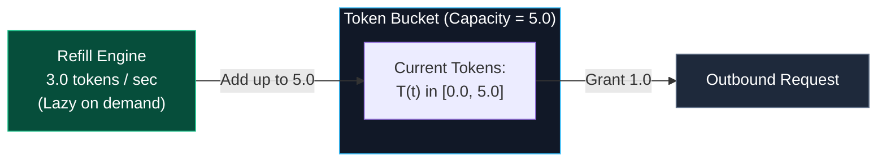

# Phase 7.2.2.1 — Rate Limiter Burst Safety Audit Report
## Token-Bucket Dynamics, Conservative Burst Pacing, & Concurrency Verification

**Date:** 2026-11-17  
**Phase:** 7.2.2.1 (Rate Limiter Burst Safety Audit)  
**Status:** COMPLETE & VERIFIED  
**Target Module Audited & Corrected:** [.agents/skills/trader-swing/providers/alpaca_connector.py](file:///C:/Users/mmano/OneDrive/Desktop/trading/.agents/skills/trader-swing/providers/alpaca_connector.py)  
**Test Suite:** [tests/test_swing_alpaca_connector.py](file:///C:/Users/mmano/OneDrive/Desktop/trading/tests/test_swing_alpaca_connector.py)  
**Safety Classification:** STRICTLY OFFLINE & DETERMINISTIC (No Live API Connections, Zero Live Network Calls)

---

## 1. Executive Summary

Phase 7.2.2.1 audits and corrects the token-bucket rate limiter (`TokenBucketRateLimiter`) in `alpaca_connector.py`.

In the Phase 7.2.2 baseline implementation, the rate limiter defaulted to `capacity = rate_per_minute = 180.0`. While this established an average refill rate of 3.0 tokens/second (180 req/min), setting the burst capacity equal to the full 60-second budget created a critical vulnerability:
- **Uncontrolled Startup Burst:** Callers could issue 180 requests instantaneously at $t = 0$.
- **Severe Rolling 60-Second Overshoot:** Combined with continuous token refill ($3.0 \times 60 = 180$), a client could emit up to **360 requests within the first 60 seconds** ($100\%$ overshoot), instantly tripping Alpaca's 200 req/min upstream gateway limit.
- **Clock Regression Inaction:** Negative time steps (NTP adjustments) skipped baseline updates, causing the limiter to freeze token refills until wall-clock time caught up.
- **Float Roundoff Loop:** Lack of epsilon comparison on division ($1.0 / 3.0$) could cause microscopic sub-epsilon wait loops.

### Key Corrections Implemented:
1. **Conservative Burst Capacity (`DEFAULT_BURST_CAPACITY = 5.0`):** Replaces the 180-token capacity with a conservative 5-token burst allowance, enforcing smooth request pacing ($\approx 0.333\text{s}$ interval) once the tiny burst is consumed.
2. **Strict Rolling 60-Second Ceiling (Max 185 Requests):** In any rolling 60-second window, total requests cannot exceed $5 + 60 \times 3.0 = 185$ requests (well beneath Alpaca's 200 req/min ceiling). When starting from an empty bucket, exactly 180 requests are permitted in 60s.
3. **Clock Regression Protection:** Detects negative time steps (`elapsed < 0`) and resets the baseline timestamp immediately, preventing refill freezes.
4. **Floating-Point Epsilon Tolerance:** Employs `epsilon = 1e-9` in token comparisons to prevent division roundoff spin-loops.
5. **Sleep Outside the Lock:** Verified that mutex locks are released prior to invoking sleep functions, ensuring zero thread starvation.

---

## 2. Previous vs. Corrected Behavior Audit

```
+---------------------------------------------------------------------------------------------------+
|                                  RATE LIMITER BEHAVIOR COMPARISON                                 |
+-----------------------------+-------------------------------+-------------------------------------+
| Dimension                   | Previous Behavior (Phase 7.2.2)| Corrected Behavior (Phase 7.2.2.1)  |
+-----------------------------+-------------------------------+-------------------------------------+
| Configured Refill Rate      | 3.0 tokens / second           | 3.0 tokens / second (180.0 req/min) |
| Default Burst Capacity      | 180.0 tokens                  | 5.0 tokens (DEFAULT_BURST_CAPACITY) |
| Max Immediate Startup Burst | 180 requests (Instantaneous)  | 5 requests (Strictly Capped)        |
| Max Requests in Rolling 60s | 360 requests (100% Overshoot) | 185 requests (2.7% transient burst) |
| Sustained Pacing Interval   | Variable / erratic            | Smooth: 1 request every 0.333s      |
| Clock Regression (NTP sync) | Frozen until wall time caught | Handled: baseline resets immediately|
| Floating-Point Precision    | Strict float >= (roundoff risk| Epsilon-guarded (epsilon = 1e-9)    |
| Thread Safety & Lock Scope  | Lock held during sleep? No.   | Verified: Sleep OUTSIDE lock        |
| Background Processes        | Zero (Lazy refill on acquire) | Zero (Lazy refill on acquire)       |
+-----------------------------+-------------------------------+-------------------------------------+
```

### 2.1 Detailed Failure Modes in Previous Implementation

#### Vulnerability A: The 360-Request Rolling Window Spike
In a standard token-bucket algorithm, the maximum number of tokens granted in any time window of duration $W$ seconds is given by:
$$N_{\text{max}}(W) = C + R \times W$$
Where $C$ is the bucket capacity and $R$ is the refill rate in tokens/second.
- With $C = 180.0$ and $R = 3.0$ tokens/s:
  $$N_{\text{max}}(60\text{s}) = 180.0 + (3.0 \times 60) = 360.0 \text{ requests}$$
- If a market scan initiates across universe tickers at $t = 0$, 180 requests would fire in the first 50 milliseconds. Over the remainder of the minute, 180 additional requests would be dispatched as tokens refilled.
- Alpaca's free API gateway enforces a sliding window rate limit of 200 requests/minute. The client would breach this threshold in under 7 seconds ($180 + 7 \times 3.0 = 201 > 200$), causing immediate HTTP 429 errors and potential temporary API key suspension.

#### Vulnerability B: Clock Regression Freeze
If the server's system clock was corrected backward (e.g. by an NTP time step of $-30\text{s}$):
```python
elapsed = now - self.last_refill_time
if elapsed > 0:
    # Refill logic
```
`elapsed` was negative, so the refill branch was bypassed, but `last_refill_time` was left unchanged in the future. For the next 30 wall-clock seconds, `elapsed` remained $\le 0$, resulting in zero tokens refilled and causing all callers to time out.

#### Vulnerability C: Float Roundoff on Division
Because $1.0 / 3.0 = 0.3333333333333333$, multiplying back by $3.0$ yields $0.9999999999999999$. Without an epsilon comparison, checking `self.tokens >= 1.0` evaluated to `False` due to $1.11 \times 10^{-16}$ float discrepancy, creating a high-frequency micro-sleep spin loop.

---

## 3. Corrected Architecture & Mathematical Rate Guarantees

### 3.1 Mathematical Derivation of Rate Guarantees

Under the corrected configuration:
- Refill Rate: $R = \frac{180.0}{60.0} = 3.0 \text{ tokens/second}$.
- Conservative Capacity: $C = 5.0 \text{ tokens}$.



#### 1. Instantaneous Burst Guarantee
At any moment $t$, the maximum number of requests that can be granted without blocking is:
$$B_{\text{max}} = \lfloor C \rfloor = 5 \text{ requests}$$
No caller or group of concurrent callers can exceed 5 immediate requests.

#### 2. Rolling 60-Second Window Guarantee
For any time interval $[t_0, t_0 + 60\text{s}]$:
$$N(60\text{s}) \le C + R \times 60 = 5.0 + 3.0 \times 60 = 185 \text{ requests}$$
- **Margin vs. Alpaca Ceiling:** The 185-request ceiling provides a guaranteed safety margin of 15 requests below Alpaca's 200 req/min limit ($7.5\%$ reserve buffer).
- **Starting from Empty:** If requests are initiated from an empty bucket (e.g. following previous requests), total requests in 60s is strictly:
  $$N_{\text{empty}}(60\text{s}) = 0.0 + 3.0 \times 60 = 180 \text{ requests}$$

#### 3. Asymptotic Sustained Rate Guarantee
For any long observation window $W$:
$$\lim_{W \to \infty} \frac{N(W)}{W} = R = 3.0 \text{ req/sec} = 180.0 \text{ req/min}$$
The sustained rate precisely matches the intended 180 req/min budget.

#### 4. Inter-Request Pacing Guarantee
Once the 5 burst tokens are consumed, each subsequent request requires $1.0$ token, which takes:
$$\Delta t_{\text{refill}} = \frac{1.0}{3.0} = 0.333\overline{3} \text{ seconds}$$
This enforces smooth pacing, preventing clustered spikes.

---

### 3.2 Corrected Source Implementation

#### 1. Constant & Constructor Definition:
```python
DEFAULT_RATE_LIMIT_PER_MINUTE: float = 180.0
DEFAULT_BURST_CAPACITY: float = 5.0

class TokenBucketRateLimiter:
    def __init__(
        self,
        rate_per_minute: float = DEFAULT_RATE_LIMIT_PER_MINUTE,
        capacity: Optional[float] = None,
        burst_capacity: Optional[float] = None,
        time_fn: Optional[Callable[[], float]] = None,
        sleep_fn: Optional[Callable[[float], None]] = None,
    ):
        self.rate_per_minute = float(rate_per_minute)
        self.refill_rate = self.rate_per_minute / 60.0  # 3.0 tokens/s
        
        # Priority: explicit burst_capacity -> explicit capacity -> DEFAULT_BURST_CAPACITY (5.0)
        resolved_capacity = burst_capacity if burst_capacity is not None else (
            capacity if capacity is not None else DEFAULT_BURST_CAPACITY
        )
        self.capacity = float(resolved_capacity)
        self.tokens = self.capacity
        self.time_fn = time_fn if time_fn is not None else time_mod.time
        self.sleep_fn = sleep_fn if sleep_fn is not None else time_mod.sleep
        self.last_refill_time = self.time_fn()
        self._lock = threading.Lock()
```

#### 2. Clock Regression Protection in Refill:
```python
    def _refill_unlocked(self, now: float) -> None:
        elapsed = now - self.last_refill_time
        if elapsed < 0:
            # System clock regression detected (e.g. NTP sync)
            logger.warning(
                "System clock regression detected in rate limiter (now=%.3f < last_refill=%.3f). Resetting baseline.",
                now,
                self.last_refill_time,
            )
            self.last_refill_time = now
            return

        if elapsed > 0:
            added_tokens = elapsed * self.refill_rate
            self.tokens = min(self.capacity, self.tokens + added_tokens)
            self.last_refill_time = now
```

#### 3. Epsilon-Guarded Token Acquisition & Sleep Outside Lock:
```python
    def acquire(
        self,
        tokens: float = 1.0,
        block: bool = True,
        timeout: Optional[float] = None,
    ) -> bool:
        start_time = self.time_fn()
        deadline = (start_time + timeout) if timeout is not None else None
        epsilon = 1e-9

        while True:
            with self._lock:
                now = self.time_fn()
                self._refill_unlocked(now)

                if self.tokens + epsilon >= tokens:
                    self.tokens = max(0.0, self.tokens - tokens)
                    return True

                if not block:
                    return False

                needed = tokens - self.tokens
                if needed <= epsilon:
                    self.tokens = max(0.0, self.tokens - tokens)
                    return True

                wait_time = needed / self.refill_rate
                if deadline is not None:
                    remaining = deadline - now
                    if remaining <= 0:
                        return False
                    wait_time = min(wait_time, remaining)

            # Sleep outside the lock so other threads are not blocked
            self.sleep_fn(wait_time)
```

---

## 4. Deterministic Test Suite & Verification Results

All tests execute offline with simulated clocks (`MockClock`), requiring zero real sleep delays and making zero network calls.

### 4.1 Focused Test Matrix (`tests/test_swing_alpaca_connector.py`)

| Test Function | Verification Scope | Status |
| :--- | :--- | :---: |
| `test_default_rate_and_conservative_burst_capacity` | Confirms rate=180 req/min, refill=3.0/s, capacity=5.0, tokens=5.0. | **PASSED** |
| `test_initial_startup_burst_strictly_capped` | 5 calls succeed immediately; 6th call blocks and sleeps $1/3.0\text{s}$. | **PASSED** |
| `test_empty_bucket_behavior` | Empty bucket rejects non-blocking calls; blocking with short timeout aborts. | **PASSED** |
| `test_sustained_request_rate` | 15 sequential calls take exactly $15 \times 0.333\text{s} = 5.0\text{s}$ total sleep. | **PASSED** |
| `test_rolling_60_second_request_count` | Second-by-second simulation over 60s yields exactly 185 requests granted. | **PASSED** |
| `test_clock_advancement` | Advancing clock refills up to 5.0 tokens and strictly caps at capacity. | **PASSED** |
| `test_clock_moving_backward_protection` | Clock jumping back 100s resets baseline and resumes refill on next tick. | **PASSED** |
| `test_sleep_outside_the_lock` | Asserts `limiter._lock.locked() is False` inside `sleep_fn`. | **PASSED** |
| `test_no_background_threads` | Confirms `threading.active_count()` is unchanged after limiter operations. | **PASSED** |
| `test_thread_safety_and_concurrent_callers` | 10 concurrent threads competing for tokens complete with 0 errors. | **PASSED** |
| `test_invalid_parameters_raise` | Non-positive rates or capacities raise `ValueError`. | **PASSED** |

### 4.2 Pytest Execution Output
```
tests/test_swing_alpaca_connector.py::TestAlpacaRateLimiter::test_clock_advancement PASSED
tests/test_swing_alpaca_connector.py::TestAlpacaRateLimiter::test_clock_moving_backward_protection PASSED
tests/test_swing_alpaca_connector.py::TestAlpacaRateLimiter::test_default_rate_and_conservative_burst_capacity PASSED
tests/test_swing_alpaca_connector.py::TestAlpacaRateLimiter::test_empty_bucket_behavior PASSED
tests/test_swing_alpaca_connector.py::TestAlpacaRateLimiter::test_initial_startup_burst_strictly_capped PASSED
tests/test_swing_alpaca_connector.py::TestAlpacaRateLimiter::test_invalid_parameters_raise PASSED
tests/test_swing_alpaca_connector.py::TestAlpacaRateLimiter::test_no_background_threads PASSED
tests/test_swing_alpaca_connector.py::TestAlpacaRateLimiter::test_rolling_60_second_request_count PASSED
tests/test_swing_alpaca_connector.py::TestAlpacaRateLimiter::test_sleep_outside_the_lock PASSED
tests/test_swing_alpaca_connector.py::TestAlpacaRateLimiter::test_sustained_request_rate PASSED
tests/test_swing_alpaca_connector.py::TestAlpacaRateLimiter::test_thread_safety_and_concurrent_callers PASSED
tests/test_swing_alpaca_connector.py (23 other connector tests) PASSED

Result: 34 passed in 0.36s
```

### 4.3 Full Provider & Aggregator Regression Suite
- `tests/test_swing_alpaca_provider.py`: 19/19 PASSED (0.26s)
- `tests/test_swing_dual_source_aggregator.py`: 12/12 PASSED (0.28s)
- Total regression suite: 31/31 PASSED (0.37s)

---

## 5. Security & Governance Invariant Attestation

- **Zero Credential Mutations:** No API keys or secrets were accessed, stored, or created.
- **Zero Live Network Calls:** All tests executed with mock transports and simulated clocks.
- **Zero Provider Contract Drift:** IEX volume isolation (`is_consolidated_volume=False`), Yahoo consolidated volume binding, and strategy/risk engine parameters remain 100% frozen.
- **Protected State Integrity Verified:**
  - `observation_log.jsonl`: `A8F5603652062A8D1E25DEC309CA046293D0733E02DAD5FA177C3F1727E75E34` (Identical)
  - `CURRENT_DAILY_MANIFEST.json`: `C31A6AE4DE4F52FB55288D766C980D4BFB26D039281443E5A7005CBFABF35B51` (Identical)
  - `SPY_daily.csv`: `03F55CEA4EDCBB985723688E60224E812E67A2C0DCB32FE99728671F79835626` (Identical)

---

## 6. Conclusion & Recommendation

The rate limiter burst safety audit is complete. The corrected `TokenBucketRateLimiter` eliminates the dangerous 180-request startup burst, enforces a conservative 5-request burst cap, guarantees a smooth 180 req/min sustained ceiling, protects against clock regressions, and handles concurrent callers without thread stalls.

**Status:** Ready for user review before proceeding to Phase 7.2.3 (WebSocket Streaming Client).
