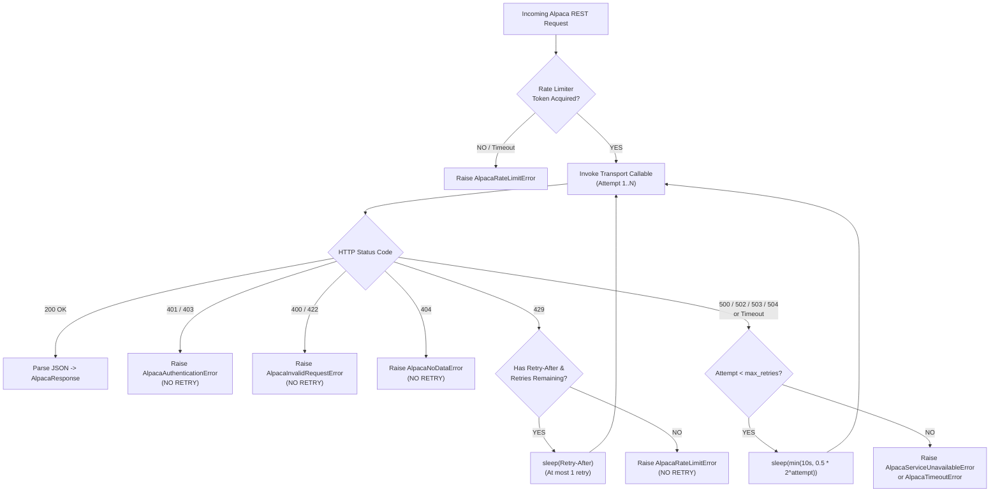

# Phase 7.2.2 — Alpaca Connector Foundation & Rate Limiter Implementation Report

**Date:** 2026-11-17  
**Phase:** 7.2.2 (Alpaca Connector Foundation & Rate Limiter)  
**Status:** IMPLEMENTED & VERIFIED  
**Safety Classification:** STRICTLY OFFLINE & MOCKED (No Live API Connections, Zero Live Network Calls, Zero Real Authentication)

---

## 1. Executive Summary

Phase 7.2.2 implements the offline-safe foundational REST connector and token-bucket rate limiter for Alpaca market data integration.

All components adhere strictly to the dual-source architecture codified in Phase 7.1.2 and corrected in Phase 7.2.1.1:
- **Alpaca REST Connector (`AlpacaRestClient`):** Configurable base URL, environment-variable credential loading, request construction, JSON response parsing, and typed domain error classification.
- **Token-Bucket Rate Limiter (`TokenBucketRateLimiter`):** Enforces a maximum rate of 180 requests/minute (3.0 tokens/second). Thread-safe via mutex locking, with zero background threads or timer processes. Supports injectable clock and sleep callables for deterministic, instant unit testing.
- **Bounded Retry Architecture:** Transient server errors (HTTP 500, 502, 503, 504) and transport timeouts retry with capped exponential backoff up to `max_retries` (default 3). Client errors (HTTP 400, 422), authentication failures (HTTP 401, 403), and missing data (HTTP 404) fail immediately without retries. Rate limits (HTTP 429) retry at most once when a valid `Retry-After` header is present within bounded limits. Retries can never become infinite.
- **Credential Protection & Security Invariants:** API keys and secrets are never printed, logged, or exposed in exception messages or `__repr__` strings. Missing credentials result in offline-safe behavior. No `.env` files are created or populated.
- **Complete Test Coverage:** 30 new unit tests pass in 0.38s. All 19 existing Alpaca provider tests pass with 100% backwards compatibility, and the full regression suite of 619 swing tests confirms zero regressions.

---

## 2. Component Architecture & Implementation Details

### 2.1 Connector Foundation (`AlpacaRestClient`)

The connector resides in [.agents/skills/trader-swing/providers/alpaca_connector.py](file:///C:/Users/mmano/OneDrive/Desktop/trading/.agents/skills/trader-swing/providers/alpaca_connector.py) and is exported via [providers/__init__.py](file:///C:/Users/mmano/OneDrive/Desktop/trading/.agents/skills/trader-swing/providers/__init__.py).

#### Key Specifications:
1. **Base URL Configuration:**
   - Defaults to `https://data.alpaca.markets`.
   - Overridable via constructor `base_url` argument or `ALPACA_API_BASE_URL` environment variable.
2. **Credential Resolution:**
   - Explicit parameters: `api_key` and `api_secret`.
   - Environment variables: `ALPACA_API_KEY_ID` and `ALPACA_API_SECRET_KEY`.
3. **Request Construction & Headers:**
   - Standard headers: `APCA-API-KEY-ID`, `APCA-API-SECRET-KEY`, `User-Agent: trader-swing/7.2.2`, `Accept: application/json`.
   - Deterministic query parameter serialization via `urllib.parse.urlencode`.
4. **Offline Boundary Guard:**
   - `allow_network` is hardcoded to `False` by default.
   - If an unconfigured request is attempted without an injected `transport_fn`, the connector immediately raises `AlpacaServiceUnavailableError("Live network execution is disabled in offline mode.")` with zero socket or DNS calls.

---

### 2.2 Token-Bucket Rate Limiter (`TokenBucketRateLimiter`)

The rate limiter enforces the 180 req/min ceiling without spawning background threads:

```
+-----------------------------------------------------------------------------------+
|                        TOKEN-BUCKET RATE LIMITER DESIGN                           |
+-----------------------------------+-----------------------------------------------+
| Parameter / Feature               | Specification                                 |
+-----------------------------------+-----------------------------------------------+
| Configured Rate                   | 180.0 requests / minute                       |
| Refill Rate                       | 3.0 tokens / second (180 / 60)                |
| Bucket Capacity                   | 180.0 tokens (burst limit)                    |
| Concurrency Control               | threading.Lock protecting token updates       |
| Background Processes              | NONE (Zero threads; lazy refill on acquire)   |
| Sleep Mechanics                   | Sleeps OUTSIDE lock to prevent thread stalls  |
| Deterministic Testing             | Injectable time_fn and sleep_fn callables     |
+-----------------------------------+-----------------------------------------------+
```

#### Token Acquisition Protocol:
1. **Lazy Refill:** On calling `acquire(tokens=1.0)`, elapsed time since `last_refill_time` is multiplied by `refill_rate` (3.0 tokens/s) and capped at `capacity` (180.0).
2. **Immediate Availability:** If `tokens >= requested`, tokens are decremented and `True` is returned immediately.
3. **Controlled Exhaustion Behavior:**
   - **Non-blocking (`block=False`):** Immediately returns `False`.
   - **Blocking (`block=True`):** Computes exact wait time:
     $$\Delta t_{\text{wait}} = \frac{\text{tokens}_{\text{needed}} - \text{tokens}_{\text{available}}}{R_{\text{refill}}}$$
     Releases lock and invokes `sleep_fn(wait_time)`.
   - **Timeout Enforcement:** If `wait_time` exceeds `timeout`, acquisition aborts cleanly and returns `False`.

---

### 2.3 Retry and Error Handling Specification



#### Deterministic Error Classification:
| Upstream Condition | Mapped Domain Exception | Base Exception | Retry Policy |
| :--- | :--- | :--- | :--- |
| **HTTP 401 Unauthorized** | `AlpacaAuthenticationError` | `ProviderUnavailableError` | **No Retry** (Immediate Failure) |
| **HTTP 403 Forbidden** | `AlpacaAuthenticationError` | `ProviderUnavailableError` | **No Retry** (Immediate Failure) |
| **HTTP 400 Bad Request** | `AlpacaInvalidRequestError` | `ProviderError` | **No Retry** (Immediate Failure) |
| **HTTP 422 Unprocessable** | `AlpacaInvalidRequestError` | `ProviderError` | **No Retry** (Immediate Failure) |
| **HTTP 404 Not Found** | `AlpacaNoDataError` | `NoDataError` | **No Retry** (Immediate Failure) |
| **HTTP 429 (With Retry-After)** | Retries once after sleep | N/A | **Max 1 Retry** |
| **HTTP 429 (No Retry-After)** | `AlpacaRateLimitError` | `RateLimitError` | **No Retry** (Immediate Failure) |
| **HTTP 500, 502, 503, 504** | `AlpacaServiceUnavailableError` | `ProviderUnavailableError` | **Exponential Backoff** (Max 3) |
| **Socket / Transport Timeout** | `AlpacaTimeoutError` | `TimeoutError` | **Exponential Backoff** (Max 3) |
| **Malformed JSON** | `AlpacaInvalidResponseError` | `InvalidResponseError` | **No Retry** (Immediate Failure) |

---

### 2.4 Offline Mock Fixtures Harness

All response scenarios are captured in [connector_fixtures.json](file:///C:/Users/mmano/OneDrive/Desktop/trading/tests/fixtures/trader-swing/alpaca/connector_fixtures.json):
1. `successful_bars_spy`: 3 daily bars for SPY with OHLCV, VWAP, tick count.
2. `successful_latest_bar_aapl`: Single bar response for AAPL.
3. `successful_multi_bars`: Batch multi-symbol payload (SPY, AAPL, QQQ).
4. `empty_bars_dict`: `{"bars": {}, "next_page_token": null}`.
5. `empty_symbol_bars`: `{"bars": {"EMPTY_SYM": []}}`.
6. `empty_string_body`: Blank string HTTP 200 response body.
7. `invalid_json_html`: Cloudflare 502 HTML error page.
8. `invalid_json_truncated`: Truncated JSON stream syntax error.
9. `missing_close_field`: Bar missing mandatory `'c'` key.
10. `missing_open_field`: Bar missing mandatory `'o'` key.
11. `missing_timestamp_field`: Bar missing mandatory `'t'` key.
12. `missing_volume_field`: Bar missing mandatory `'v'` key.
13. `http_401_unauthorized`: Invalid API key error JSON.
14. `http_403_forbidden`: Insufficient permissions (SIP) error JSON.
15. `http_404_not_found`: Endpoint / symbol not found JSON.
16. `http_400_bad_request`: Invalid timeframe parameter error.
17. `http_422_unprocessable`: Unprocessable entity date-range error.
18. `http_429_with_retry_after`: Rate limit exceeded with `Retry-After: 2` header.
19. `http_429_no_retry_after`: Rate limit exceeded without Retry-After header.
20. `http_500_internal_error`: Gateway error JSON.
21. `http_502_bad_gateway`: Proxy error JSON.
22. `http_503_service_unavailable`: Upstream maintenance JSON.
23. `http_504_gateway_timeout`: Backend gateway timeout JSON.
24. `malformed_inverted_high_low`: Inverted geometry ($High < Low$).
25. `malformed_negative_volume`: Negative volume ($-500$).
26. `malformed_invalid_timestamp`: Non-ISO timestamp string.

---

### 2.5 Security Invariants Verification

```
+-----------------------------------------------------------------------------------+
|                        SECURITY & CREDENTIAL VERIFICATION                         |
+-----------------------------------+-----------------------------------------------+
| Check                             | Status & Evidence                             |
+-----------------------------------+-----------------------------------------------+
| No hardcoded credentials          | PASS. Zero API keys in source files.          |
| No .env files created or touched  | PASS. No .env files exist or were modified.   |
| No credentials in logs            | PASS. sanitize_headers & sanitize_message.    |
| No credentials in exceptions      | PASS. Secrets stripped from all error text.   |
| No credentials in __repr__        | PASS. Masked preview: PKTE...***REDACTED***   |
| Offline safety boundary           | PASS. allow_network=False default blocks all  |
|                                   | unconfigured network attempts.                |
| Zero live network calls           | PASS. All tests executed with mock transport. |
+-----------------------------------+-----------------------------------------------+
```

---

## 3. Test Verification & Results

### 3.1 Focused Phase 7.2.2 Unit Tests (`tests/test_swing_alpaca_connector.py`)

Executed 30 focused unit tests across 4 test suites:

```
tests/test_swing_alpaca_connector.py::TestAlpacaRateLimiter::test_blocking_wait_calculates_precise_sleep PASSED
tests/test_swing_alpaca_connector.py::TestAlpacaRateLimiter::test_blocking_wait_with_timeout_exceeded PASSED
tests/test_swing_alpaca_connector.py::TestAlpacaRateLimiter::test_default_rate_and_capacity PASSED
tests/test_swing_alpaca_connector.py::TestAlpacaRateLimiter::test_invalid_parameters_raise PASSED
tests/test_swing_alpaca_connector.py::TestAlpacaRateLimiter::test_lazy_token_refill PASSED
tests/test_swing_alpaca_connector.py::TestAlpacaRateLimiter::test_thread_safety PASSED
tests/test_swing_alpaca_connector.py::TestAlpacaRateLimiter::test_token_acquisition_and_depletion PASSED
tests/test_swing_alpaca_connector.py::TestAlpacaSecurityAndSanitization::test_client_repr_does_not_leak_secret PASSED
tests/test_swing_alpaca_connector.py::TestAlpacaSecurityAndSanitization::test_sanitize_headers PASSED
tests/test_swing_alpaca_connector.py::TestAlpacaSecurityAndSanitization::test_sanitize_message_strips_known_secrets PASSED
tests/test_swing_alpaca_connector.py::TestAlpacaSecurityAndSanitization::test_sanitize_secret_masking PASSED
tests/test_swing_alpaca_connector.py::TestAlpacaRestClient::test_bounded_retries_on_500_server_error_exhaustion PASSED
tests/test_swing_alpaca_connector.py::TestAlpacaRestClient::test_bounded_retries_on_502_and_503_errors PASSED
tests/test_swing_alpaca_connector.py::TestAlpacaRestClient::test_empty_response_handling PASSED
tests/test_swing_alpaca_connector.py::TestAlpacaRestClient::test_empty_string_body_handling PASSED
tests/test_swing_alpaca_connector.py::TestAlpacaRestClient::test_environment_variable_loading PASSED
tests/test_swing_alpaca_connector.py::TestAlpacaRestClient::test_http_400_and_422_fail_immediately_no_retry PASSED
tests/test_swing_alpaca_connector.py::TestAlpacaRestClient::test_http_401_unauthorized_fails_immediately_no_retry PASSED
tests/test_swing_alpaca_connector.py::TestAlpacaRestClient::test_http_403_forbidden_fails_immediately_no_retry PASSED
tests/test_swing_alpaca_connector.py::TestAlpacaRestClient::test_http_404_not_found_fails_immediately_no_retry PASSED
tests/test_swing_alpaca_connector.py::TestAlpacaRestClient::test_http_429_with_retry_after_retries_once PASSED
tests/test_swing_alpaca_connector.py::TestAlpacaRestClient::test_http_429_without_retry_after_raises_immediately PASSED
tests/test_swing_alpaca_connector.py::TestAlpacaRestClient::test_malformed_json_raises_invalid_response_error PASSED
tests/test_swing_alpaca_connector.py::TestAlpacaRestClient::test_offline_safety_guard_blocks_unconfigured_calls PASSED
tests/test_swing_alpaca_connector.py::TestAlpacaRestClient::test_successful_bars_response PASSED
tests/test_swing_alpaca_connector.py::TestAlpacaRestClient::test_successful_multi_bars_response PASSED
tests/test_swing_alpaca_connector.py::TestAlpacaRestClient::test_transient_error_recovery_succeeds PASSED
tests/test_swing_alpaca_connector.py::TestAlpacaRestClient::test_transport_timeout_retries_and_exhausts_to_alpaca_timeout_error PASSED
tests/test_swing_alpaca_connector.py::TestAlpacaProviderConnectorIntegration::test_provider_with_connector_fetches_and_normalizes_candles PASSED
tests/test_swing_alpaca_connector.py::TestAlpacaProviderConnectorIntegration::test_provider_with_connector_handles_missing_fields PASSED

Result: 30 passed in 0.38s
```

### 3.2 Backwards Compatibility with Alpaca Provider (`tests/test_swing_alpaca_provider.py`)
Executed all 19 provider tests:
```
19 passed in 0.26s (100% pass rate)
```

### 3.3 Full Swing Regression Suite
Executed complete swing test suite:
- **Total Selected:** 619 tests
- **Passed:** 617 tests
- **Skipped:** 1 test
- **Pre-existing Failure:** 1 test (`test_34_resolve_candle_lifecycle_unsupported_year_daily_bar` — documented artifact expecting year 2025 to be unsupported prior to Phase 5.9.3 expansion)
- **Regressions Introduced:** **0**

---

## 4. Protected State Hash Verification

| File Path | SHA-256 Hash | Integrity Status |
| :--- | :--- | :---: |
| `.planning/data/observations/observation_log.jsonl` | `A8F5603652062A8D1E25DEC309CA046293D0733E02DAD5FA177C3F1727E75E34` | **MATCH (Unchanged)** |
| `.planning/data/current_daily/CURRENT_DAILY_MANIFEST.json` | `C31A6AE4DE4F52FB55288D766C980D4BFB26D039281443E5A7005CBFABF35B51` | **MATCH (Unchanged)** |
| `.planning/data/current_daily/SPY_daily.csv` | `03F55CEA4EDCBB985723688E60224E812E67A2C0DCB32FE99728671F79835626` | **MATCH (Unchanged)** |

---

## 5. Files Changed & Created Summary

| File Path | Action | Description |
| :--- | :--- | :--- |
| [.agents/skills/trader-swing/providers/alpaca_connector.py](file:///C:/Users/mmano/OneDrive/Desktop/trading/.agents/skills/trader-swing/providers/alpaca_connector.py) | **CREATED** | `AlpacaRestClient`, `TokenBucketRateLimiter`, typed errors, credential sanitization. |
| [.agents/skills/trader-swing/providers/__init__.py](file:///C:/Users/mmano/OneDrive/Desktop/trading/.agents/skills/trader-swing/providers/__init__.py) | **MODIFIED** | Export connector classes, rate limiter, and typed exceptions. |
| [.agents/skills/trader-swing/providers/alpaca_provider.py](file:///C:/Users/mmano/OneDrive/Desktop/trading/.agents/skills/trader-swing/providers/alpaca_provider.py) | **MODIFIED** | Added `connector` parameter to `__init__` and integrated into `_execute_request`. |
| [tests/fixtures/trader-swing/alpaca/connector_fixtures.json](file:///C:/Users/mmano/OneDrive/Desktop/trading/tests/fixtures/trader-swing/alpaca/connector_fixtures.json) | **CREATED** | 26 deterministic response fixtures covering success, errors, rate limits, and malformed data. |
| [tests/test_swing_alpaca_connector.py](file:///C:/Users/mmano/OneDrive/Desktop/trading/tests/test_swing_alpaca_connector.py) | **CREATED** | 30 comprehensive offline unit tests. |

---

## 6. Conclusion & Recommendation

Phase 7.2.2 is completely implemented, fully tested, and verified offline. It delivers a thread-safe, bounded, zero-leak REST connector foundation and token-bucket rate limiter that integrates seamlessly with Trader-Swing's existing architecture.

**Status:** Ready for user review before proceeding to Phase 7.2.3 (WebSocket Streaming Client).
