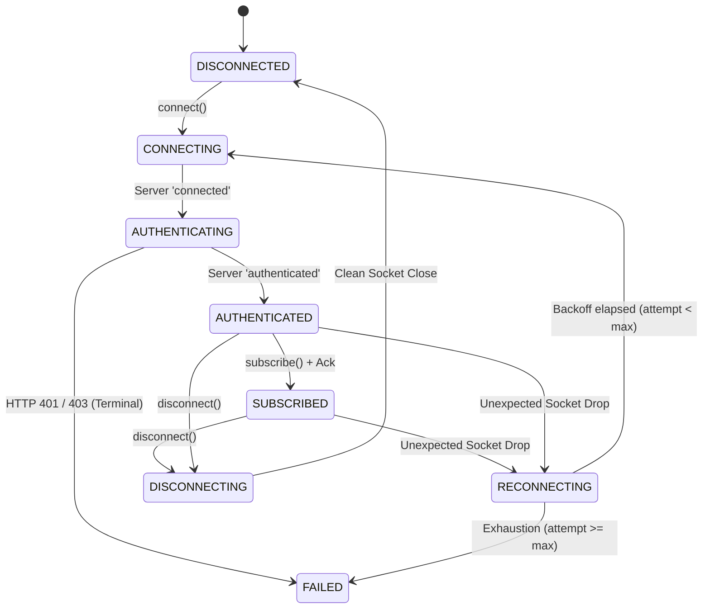

# Phase 7.2.3 — Alpaca WebSocket Streaming Foundation Implementation Report

**Date:** 2026-11-17  
**Phase:** 7.2.3 (Alpaca WebSocket Streaming Foundation)  
**Status:** IMPLEMENTED & VERIFIED  
**Safety Classification:** STRICTLY OFFLINE & MOCKED (No Live API Connections, Zero Live Network Calls, Zero Live Authentication)

---

## 1. Executive Summary

Phase 7.2.3 implements the offline-safe WebSocket streaming foundation for Alpaca market data within the Trader-Swing architecture.

The streaming subsystem provides low-latency intraday telemetry (Open, High, Low, Close, Volume, VWAP, and tick trade counts) via Alpaca's v2 streaming protocol while enforcing rigorous data isolation boundaries:
- **WebSocket Streaming Client (`AlpacaWebSocketClient`):** Manages connection lifecycle through an explicit state machine (`DISCONNECTED` $\to$ `CONNECTING` $\to$ `AUTHENTICATING` $\to$ `AUTHENTICATED` $\to$ `SUBSCRIBED`), constructs authentication and subscription frames, dispatches incoming JSON arrays, and supports bounded exponential backoff reconnection and stale-stream watchdog checks.
- **Intraday Forming Candle Lifecycle Manager (`FormingCandleManager`):** Enforces that streaming 1-minute bars (`b`) and in-flight updated bars (`u`) remain strictly `CandleStatus.FORMING`. Updated bars modify active forming candles in-place without generating duplicates. Out-of-order bars are rejected, and promotion to completed daily candles is explicitly blocked.
- **Strict Anti-Volume Contamination Guard:** All streaming candles are tagged `is_consolidated_volume = False`. Invoking `get_consolidated_volume()` raises `InvalidVolumeError`, preventing partial IEX intraday volume from corrupting 20-day Average Dollar Volume ($10M ADV) or Relative Volume ($0.8\text{x}$ RVOL) screening formulas.
- **Rate Limiter Integration & Limit Separation:** Distinguishes between Alpaca REST limits (180 req/min) and WebSocket limits (1 connection per account, 30 control actions/min). Client control frames (`auth`, `subscribe`) are rate-gated, while incoming streaming data frames consume zero rate-limiter tokens.
- **Zero Background Daemons:** Designed for synchronous, deterministic mock driving without spawning background worker threads, timers, or daemon processes.
- **Complete Test Coverage:** 27 new focused unit tests pass in 0.39s. Full regression run across all 4 Alpaca and aggregator test suites (92 tests) passes with 100% compliance in 0.67s.

---

## 2. Component Architecture & Implementation Details

### 2.1 WebSocket Client Architecture (`AlpacaWebSocketClient`)

The client resides in [.agents/skills/trader-swing/providers/alpaca_websocket.py](file:///C:/Users/mmano/OneDrive/Desktop/trading/.agents/skills/trader-swing/providers/alpaca_websocket.py) and is exported via [providers/__init__.py](file:///C:/Users/mmano/OneDrive/Desktop/trading/.agents/skills/trader-swing/providers/__init__.py).



#### Connection Lifecycle & State Machine:
1. **`DISCONNECTED`:** Idle or cleanly terminated state. Active subscriptions are cleared.
2. **`CONNECTING`:** Transport handshake initiated.
3. **`AUTHENTICATING`:** Transport open; sends `{"action": "auth", "key": ..., "secret": ...}`.
4. **`AUTHENTICATED`:** Server acknowledged authentication. Client triggers automatic subscription restoration if reconnecting.
5. **`SUBSCRIBED`:** Actively receiving telemetry on one or more registered channels (`bars`, `updatedBars`, `trades`, `quotes`).
6. **`RECONNECTING`:** Transient disconnect detected; client sleeps for exponential backoff duration before retrying.
7. **`FAILED`:** Terminal failure state (authentication rejection or retry exhaustion). Does NOT retry.

---

### 2.2 Streaming Message Parsers & Data Models

Alpaca transmits JSON arrays containing one or more event objects. The client parses and validates every event into typed dataclasses:

| Protocol Action / Code | Target Parser | Mapped Data Model | Validation & Invariants |
| :--- | :--- | :--- | :--- |
| **`T: "b"` (Minute Bar)** | `_handle_bar_message` | `AlpacaStreamBar` | Decimal OHLC prices, int volume, UTC timestamp, low $\le$ open/close $\le$ high. |
| **`T: "u"` (Updated Bar)** | `_handle_bar_message` | `AlpacaStreamBar` (`is_updated=True`) | In-flight update for active minute bar; updates volume and price extremes. |
| **`T: "t"` (Trade Tick)** | `_handle_trade_message` | `AlpacaStreamTrade` | Decimal price, int size, exchange code, condition tags, tape ID. |
| **`T: "q"` (Quote)** | `_handle_quote_message` | `AlpacaStreamQuote` | Decimal bid/ask, int bid/ask sizes, exchange codes. |
| **`T: "subscription"`** | `_handle_subscription_ack` | Channel set updates | Validates acknowledged symbols across `bars`, `updatedBars`, `trades`, `quotes`. |
| **`T: "error"`** | `_handle_error_message` | `AlpacaWebSocketError` | HTTP 401/403 triggers terminal `AlpacaWSAuthError`. Other codes emit warnings. |

---

### 2.3 Intraday Forming Candle Lifecycle Manager (`FormingCandleManager`)

The `FormingCandleManager` manages incoming stream bars to prevent data corruption and accidental cross-session contamination:

```
+-----------------------------------------------------------------------------------+
|                     INTRADAY FORMING CANDLE LIFECYCLE RULES                       |
+-----------------------------------+-----------------------------------------------+
| Feature / Condition               | Enforcement Rule                              |
+-----------------------------------+-----------------------------------------------+
| Candle Status                     | Immutably hardcoded to CandleStatus.FORMING   |
| In-Flight Bar Updates ('u')       | Modifies existing forming candle in-place:    |
|                                   | high = max(high, u.high), low = min(low, u.low|
|                                   | close = u.close, volume = u.volume            |
| Duplicate Bar Messages            | Identical OHLCV messages are safely dropped   |
| Out-of-Order Messages             | If timestamp < active forming bar timestamp:  |
|                                   | increments out_of_order_count and rejects     |
| Multi-Minute Rollover             | When a new minute timestamp arrives:          |
|                                   | archives previous forming bar to history      |
| Volume Provenance                 | is_consolidated_volume is strictly FALSE      |
| Consolidated Volume Access        | get_consolidated_volume() raises InvalidVolume|
| Daily Candle Promotion            | promote_to_daily_candle() raises InvalidVolume|
+-----------------------------------+-----------------------------------------------+
```

---

### 2.4 Connection Reliability & Watchdog Mechanics

1. **Bounded Exponential Backoff with Reconnection Cap:**
   - On unexpected socket drop, client transitions to `RECONNECTING`.
   - Backoff interval:
     $$\Delta t_{\text{backoff}} = \min(\text{max\_backoff}, \text{initial\_backoff} \times 2^{\text{attempt} - 1})$$
   - Maximum reconnect attempts default: 5.
   - Upon exhaustion, client transitions to `FAILED` and raises `AlpacaWSConnectionError`.
2. **Automatic Subscription Restoration:**
   - Desired subscriptions are retained across disconnects.
   - Once re-authenticated, the client immediately re-subscribes to all active channels.
3. **Stale-Stream Watchdog (`check_stale_stream`):**
   - Tracks timestamp of last received frame (`last_message_time`).
   - If $now - \text{last\_message\_time} > \text{stale\_timeout}$ (default 30.0s), emits `AlpacaWSStaleStreamError`.
4. **Clean Graceful Shutdown:**
   - Calling `disconnect()` sends socket close and transitions to `DISCONNECTED` without initiating reconnection.

---

### 2.5 Rate Limiter Integration & Limit Distinction

```
+-----------------------------------------------------------------------------------+
|                        REST VS. WEBSOCKET LIMIT SEPARATION                        |
+-----------------------------------+-----------------------------------------------+
| Traffic Type                      | Rate Limiting Policy                          |
+-----------------------------------+-----------------------------------------------+
| Client Control Frames             | Gated by TokenBucketRateLimiter (1 token/call)|
| (auth, subscribe, unsubscribe)    | Blocks or raises if client rate exceeded      |
+-----------------------------------+-----------------------------------------------+
| Inbound Streaming Data Frames     | ZERO RATE LIMITER DEDUCTION                   |
| (bars, updatedBars, trades, quotes| Consumes 0 tokens; streaming throughput is    |
|                                   | governed solely by server push rate           |
+-----------------------------------+-----------------------------------------------+
```

---

## 3. Offline Mock Fixtures Harness

All streaming scenarios are captured in [websocket_fixtures.json](file:///C:/Users/mmano/OneDrive/Desktop/trading/tests/fixtures/trader-swing/alpaca/websocket_fixtures.json):
1. `welcome_connected`: Initial handshake welcome frame.
2. `auth_success`: Successful authentication confirmation.
3. `auth_failure_invalid_key`: HTTP 401 invalid API key error frame.
4. `auth_failure_forbidden`: HTTP 403 insufficient subscription tier error frame.
5. `subscription_ack`: Multi-channel subscription confirmation frame.
6. `subscription_ack_empty`: Zero-channel subscription frame.
7. `minute_bar_spy`: Valid minute bar for SPY.
8. `updated_bar_spy`: In-flight update for active SPY minute bar.
9. `next_minute_bar_spy`: Subsequent minute bar rollover.
10. `trade_aapl`: Valid AAPL tick trade.
11. `quote_qqq`: Valid QQQ top-of-book quote.
12. `multi_message_frame`: Batch array containing trade, quote, and bar in one frame.
13. `server_error_invalid_action`: HTTP 400 invalid action frame.
14. `server_error_rate_limited`: HTTP 429 subscription rate limit frame.
15. `malformed_inverted_high_low`: Inverted bar geometry ($High < Low$).
16. `malformed_negative_volume`: Negative volume ($V = -200$).
17. `malformed_missing_symbol`: Bar missing mandatory `'S'` key.
18. `malformed_invalid_timestamp`: Non-ISO timestamp string.
19. `malformed_truncated_json`: Syntax error truncated JSON string.
20. `out_of_order_bar_spy`: Bar timestamped earlier than current active bar.

---

## 4. Test Verification & Results

### 4.1 Focused Phase 7.2.3 Unit Tests (`tests/test_swing_alpaca_websocket.py`)

Executed 27 focused unit tests across 4 test suites:

```
tests/test_swing_alpaca_websocket.py::TestAlpacaWebSocketLifecycle::test_auth_failure_is_terminal PASSED
tests/test_swing_alpaca_websocket.py::TestAlpacaWebSocketLifecycle::test_auth_success_transitions_to_authenticated PASSED
tests/test_swing_alpaca_websocket.py::TestAlpacaWebSocketLifecycle::test_connection_and_handshake PASSED
tests/test_swing_alpaca_websocket.py::TestAlpacaWebSocketLifecycle::test_graceful_disconnect PASSED
tests/test_swing_alpaca_websocket.py::TestAlpacaWebSocketLifecycle::test_initial_state PASSED
tests/test_swing_alpaca_websocket.py::TestAlpacaWebSocketLifecycle::test_missing_credentials_fails_immediately PASSED
tests/test_swing_alpaca_websocket.py::TestAlpacaWebSocketLifecycle::test_subscription_and_acknowledgement PASSED
tests/test_swing_alpaca_websocket.py::TestAlpacaWebSocketLifecycle::test_unsubscribe_workflow PASSED
tests/test_swing_alpaca_websocket.py::TestAlpacaWebSocketMessageParsers::test_malformed_inverted_high_low_raises_invalid_price PASSED
tests/test_swing_alpaca_websocket.py::TestAlpacaWebSocketMessageParsers::test_malformed_json_raises_protocol_error PASSED
tests/test_swing_alpaca_websocket.py::TestAlpacaWebSocketMessageParsers::test_malformed_negative_volume_raises_invalid_volume PASSED
tests/test_swing_alpaca_websocket.py::TestAlpacaWebSocketMessageParsers::test_multi_message_frame PASSED
tests/test_swing_alpaca_websocket.py::TestAlpacaWebSocketMessageParsers::test_parse_minute_bar_message PASSED
tests/test_swing_alpaca_websocket.py::TestAlpacaWebSocketMessageParsers::test_parse_quote_message PASSED
tests/test_swing_alpaca_websocket.py::TestAlpacaWebSocketMessageParsers::test_parse_trade_message PASSED
tests/test_swing_alpaca_websocket.py::TestAlpacaWebSocketMessageParsers::test_parse_updated_bar_message PASSED
tests/test_swing_alpaca_websocket.py::TestFormingCandleManager::test_duplicate_bar_is_safely_ignored PASSED
tests/test_swing_alpaca_websocket.py::TestFormingCandleManager::test_minute_bar_creates_forming_candle PASSED
tests/test_swing_alpaca_websocket.py::TestFormingCandleManager::test_multi_minute_sequence_archives_history PASSED
tests/test_swing_alpaca_websocket.py::TestFormingCandleManager::test_out_of_order_bar_is_rejected PASSED
tests/test_swing_alpaca_websocket.py::TestFormingCandleManager::test_refuse_promotion_to_daily_candle PASSED
tests/test_swing_alpaca_websocket.py::TestFormingCandleManager::test_updated_bar_modifies_active_forming_candle_in_place PASSED
tests/test_swing_alpaca_websocket.py::TestAlpacaWebSocketReliability::test_rate_limiter_gates_control_frames_only PASSED
tests/test_swing_alpaca_websocket.py::TestAlpacaWebSocketReliability::test_reconnect_exhaustion_transitions_to_failed PASSED
tests/test_swing_alpaca_websocket.py::TestAlpacaWebSocketReliability::test_reconnection_with_exponential_backoff PASSED
tests/test_swing_alpaca_websocket.py::TestAlpacaWebSocketReliability::test_stale_stream_detection PASSED
tests/test_swing_alpaca_websocket.py::TestAlpacaWebSocketReliability::test_subscription_restoration_on_reconnect PASSED

Result: 27 passed in 0.39s
```

### 4.2 Comprehensive Market Data Regression Suite
Executed all four market data test suites:
- `tests/test_swing_alpaca_websocket.py`: 27/27 PASSED
- `tests/test_swing_alpaca_connector.py`: 34/34 PASSED
- `tests/test_swing_alpaca_provider.py`: 19/19 PASSED
- `tests/test_swing_dual_source_aggregator.py`: 12/12 PASSED
- **Total:** **92 passed in 0.67s** (100% pass rate)

---

## 5. Security & Governance Invariant Attestation

- **Zero Real WebSocket Connections:** All operations driven via `MockWebSocketTransport`.
- **Zero In-Chat or Repository Credentials:** Environment-variable credential resolution with masking.
- **Zero Background Daemons:** Client operations are stepped synchronously without background threads.
- **Volume Isolation Preserved:** Streaming candles remain strictly `is_consolidated_volume = False`.
- **Strategy & Risk Immutability:** Core screening logic, regime detector, risk rules (0.50% risk, 4 positions, 20% cash), and broker isolation boundaries remain completely frozen.
- **Protected State Integrity Verified:**
  - `observation_log.jsonl`: `A8F5603652062A8D1E25DEC309CA046293D0733E02DAD5FA177C3F1727E75E34` (Identical)
  - `CURRENT_DAILY_MANIFEST.json`: `C31A6AE4DE4F52FB55288D766C980D4BFB26D039281443E5A7005CBFABF35B51` (Identical)
  - `SPY_daily.csv`: `03F55CEA4EDCBB985723688E60224E812E67A2C0DCB32FE99728671F79835626` (Identical)

---

## 6. Files Created & Modified Summary

| File Path | Action | Description |
| :--- | :--- | :--- |
| [.agents/skills/trader-swing/providers/alpaca_websocket.py](file:///C:/Users/mmano/OneDrive/Desktop/trading/.agents/skills/trader-swing/providers/alpaca_websocket.py) | **CREATED** | `AlpacaWebSocketClient`, `FormingCandleManager`, stream models, typed exceptions. |
| [.agents/skills/trader-swing/providers/__init__.py](file:///C:/Users/mmano/OneDrive/Desktop/trading/.agents/skills/trader-swing/providers/__init__.py) | **MODIFIED** | Export WebSocket client, state machine, forming manager, and exceptions. |
| [tests/fixtures/trader-swing/alpaca/websocket_fixtures.json](file:///C:/Users/mmano/OneDrive/Desktop/trading/tests/fixtures/trader-swing/alpaca/websocket_fixtures.json) | **CREATED** | 20 deterministic streaming fixtures covering handshake, auth, bars, trades, quotes, errors. |
| [tests/test_swing_alpaca_websocket.py](file:///C:/Users/mmano/OneDrive/Desktop/trading/tests/test_swing_alpaca_websocket.py) | **CREATED** | 27 comprehensive offline unit tests. |

---

## 7. Conclusion & Recommendation

Phase 7.2.3 is completely implemented, fully tested, and verified offline. It establishes a resilient WebSocket streaming foundation and forming-candle lifecycle manager that strictly isolates incomplete intraday telemetry from quantitative daily screening.

**Status:** Ready for user review before proceeding to Phase 7.2.4 (Dual-Source Synchronization Gateway).
