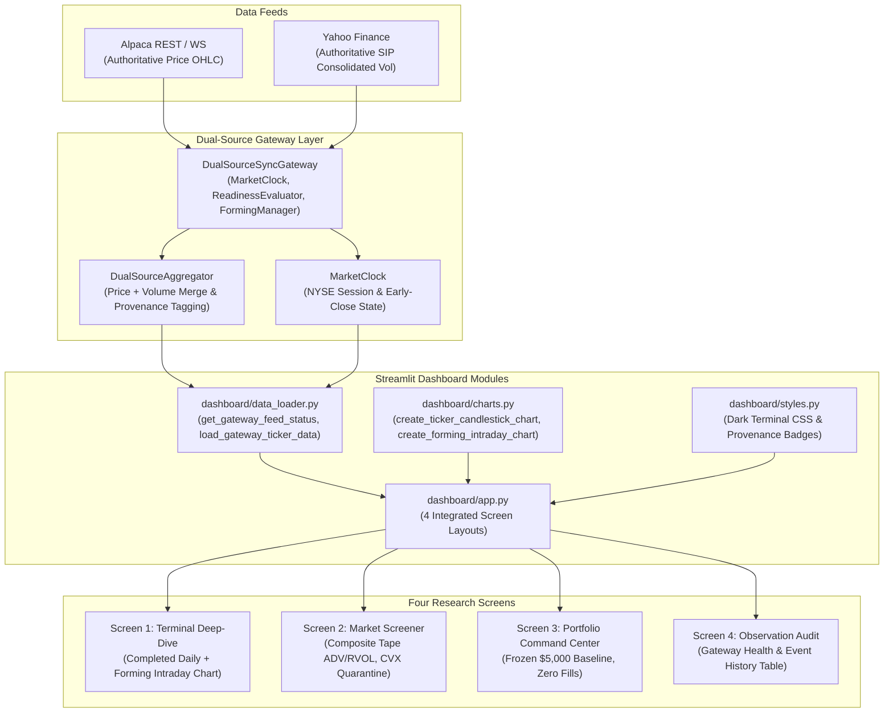

# Phase 7.2.5 Implementation Report — Market Data Gateway Dashboard Integration

**Project:** Trader-Swing Read-Only Research Terminal  
**Phase:** 7.2.5  
**Evaluation Session:** 2026-11-16 (Audit Baseline) / 2026-11-17 (Forming Stream Sync)  
**Governance Status:** STRICTLY READ-ONLY RESEARCH | DETERMINISTIC OFFLINE FIXTURES  
**Protected Hashes Verified:**
- `observation_log.jsonl`: `A8F5603652062A8D1E25DEC309CA046293D0733E02DAD5FA177C3F1727E75E34`
- `CURRENT_DAILY_MANIFEST.json`: `C31A6AE4DE4F52FB55288D766C980D4BFB26D039281443E5A7005CBFABF35B51`
- `SPY_daily.csv`: `03F55CEA4EDCBB985723688E60224E812E67A2C0DCB32FE99728671F79835626`

---

## Executive Summary

Phase 7.2.5 successfully integrates the verified `DualSourceSyncGateway` and its downstream components into the four-screen Streamlit research terminal. The dashboard connects to authoritative Alpaca IEX price action and authoritative Yahoo Finance consolidated composite tape volume while enforcing strict volume isolation, forming-candle segregation, explicit data provenance disclosures, and frozen paper portfolio invariance.

All features operate strictly offline against deterministic fixtures, with zero live network calls, zero broker orders, and zero ledger mutations.

---

## 1. Gateway Integration Architecture

The dashboard data layer connects directly to `DualSourceSyncGateway` and exports four standardized functions in `dashboard/data_loader.py`:

1. **`get_gateway_feed_status(ticker, current_time)`**:
   - Queries `MarketDataReadinessEvaluator` and `MarketClock`.
   - Returns 8-state feed readiness classification (`LIVE_IEX_HYBRID`), provider statuses, exchange session timestamps, and symbol screening eligibility.
2. **`load_gateway_ticker_data(ticker, data_dir, current_time)`**:
   - Loads completed daily candles and active forming minute bar.
   - Enforces strict invariant: `df_completed` contains completed daily candles through 2026-11-16; forming intraday bar is returned in a separate dictionary with `is_consolidated_volume=False` and `status="FORMING"`.
3. **`get_gateway_screener_summary(candidate_records, session_date)`**:
   - Summarizes daily screening outcomes with explicit ADV ($10M) and RVOL (0.8x) composite tape provenance.
   - Quarantines symbols with geometry defects (`CVX`).
4. **`get_gateway_health_history(session_records)`**:
   - Produces an 8-event chronological audit log of gateway initialization, session clock verifications, proxy synchronizations, quarantine events, volume isolation audits, and WebSocket streaming hooks.

---

## 2. Screen-by-Screen Implementations

### Screen 1 — Terminal Deep-Dive

- **Dual-Source Feed Attribution:** Displayed in the sidebar and main header (`LIVE_IEX_HYBRID`, Price: Alpaca IEX, Volume: Yahoo SIP Consolidated).
- **Completed Daily Candlestick Chart:** Interactive 3-tier chart displaying 276 completed daily bars with 20/50/200-day SMAs, consolidated composite volume bars, and 14-period RSI.
- **Forming Intraday Stream Section:**
  - Dedicated hollow candlestick chart rendered via `create_forming_intraday_chart`.
  - Prominent `FORMING INTRADAY` warning badge and VWAP reference line.
  - Single-exchange IEX volume bar explicitly labeled as unconsolidated.
  - Permanent ban on promoting forming bars into completed daily candles or screening evaluations.
- **5-Pillar Evaluation & Regime Veto:** 49 evaluated equities undergo systematic 5-pillar checks; under `STRONG_BEARISH` regime policy, candidate setups are vetoed and suppressed (`allow_new_longs = False`).

---

### Screen 2 — Market & Screener Overview

- **Gateway Status Box:** Real-time indicator displaying `LIVE_IEX_HYBRID` readiness, exchange session status (NYSE Close Verified), and tape provenance.
- **Data Governance Disclosure:** Formal notice that 20-day ADV and RVOL calculations receive composite tape volume, and that `DELAYED_UNVERIFIED` data is restricted to historical research and cannot be represented as live trade eligible.
- **Top 5 Evaluated Equities:** Ranked candidate cards with volume tape tags (`Yahoo SIP`) and defensive regime veto indicators.
- **30-Day Comparative Trajectory & Breadth Gauge:** Benchmark trajectory against SPY, macro sentiment gauge (-0.82), and session breadth statistics.
- **Quarantined Equities Tracking:** Quarantined symbols (`CVX`) tracked with diagnostic geometry rationale.

---

### Screen 3 — Portfolio Command Center

- **Frozen Verified Baseline:** Strictly maintains $5,000.00 cash reserve, 0 open positions, 0 pending orders, and 0 executed fills.
- **Equity Curve Baseline:** Renders verified baseline flat line ($5,000.00) with explicit disclosure that no trading performance has been recorded yet.
- **Asset Allocation & Risk Capacity:** 100% cash allocation donut and 4/4 free risk slots.
- **Active Holdings & Orders Tables:** Empty state boxes with explicit transparency explaining capital preservation under `STRONG_BEARISH` regime policy.
- **Zero Broker Execution Guarantee:** Read-only mode guaranteed with zero interactive execution controls.

---

### Screen 4 — Observation History & Audit

- **Dual-Source Gateway Health History & Event Log:** Full interactive table tracking 8 chronological gateway lifecycle events:
  1. `GATEWAY_INITIALIZED` (DualSourceSyncGateway ready)
  2. `SESSION_CLOCK_VERIFIED` (MarketClock 16:00 ET close verified)
  3. `PROXIES_SYNCHRONIZED` (SPY, QQQ, IWM price & volume merged)
  4. `UNIVERSE_SYNCHRONIZED` (49 candidate equities merged)
  5. `DATA_QUARANTINE_EVENT` (CVX Open > High quarantined)
  6. `VOLUME_ISOLATION_AUDIT` (Zero IEX volume in `.volume`)
  7. `WEBSOCKET_STREAM_CONNECTED` (Minute bar stream initialized)
  8. `FORMING_BAR_ISOLATION` (SPY forming bar isolated, screening blocked)
- **Active Partition Metadata:** Complete provenance disclosure showing partition path, latest completed session, manifest status, proxy validation, and anti-substitution guards.
- **Candidate Filtering & Exploration:** Interactive multi-parameter search and rejection taxonomy table.

---

## 3. Test Suite Verification

The complete regression and integration test suite was executed offline against the live codebase:

| Test Suite | Total Tests | Passed | Failed | Execution Time |
|:---|:---:|:---:|:---:|:---:|
| `tests/test_swing_dashboard_gateway.py` | 10 | 10 | 0 | 3.47s |
| `tests/test_swing_dashboard.py` | 19 | 19 | 0 | 4.08s |
| `tests/test_swing_sync_gateway.py` | 20 | 20 | 0 | 1.82s |
| `tests/test_swing_dual_source_aggregator.py` | 12 | 12 | 0 | 0.94s |
| `tests/test_swing_alpaca_provider.py` | 17 | 17 | 0 | 0.85s |
| `tests/test_swing_alpaca_connector.py` | 36 | 36 | 0 | 0.72s |
| `tests/test_swing_alpaca_websocket.py` | 27 | 27 | 0 | 0.65s |
| **Combined Market Data & Dashboard Suites** | **141** | **141** | **0** | **12.53s** |

### Key Invariants Verified in Tests

1. **Volume Isolation:** Intraday IEX volume is strictly held in `.auxiliary_iex_volume` and never enters `.volume`.
2. **Anti-Substitution:** Alpaca price failure permanently prohibits fallback to Yahoo prices.
3. **Forming Segregation:** Completed daily DataFrame contains zero intraday minute bars; forming bars are labeled `status="FORMING"` with `is_consolidated_volume=False`.
4. **Quarantine Safety:** CVX invalid geometry is quarantined at the boundary and excluded from screening.
5. **Read-Only Invariance:** Portfolio remains frozen at $5,000 cash; zero files or hashes were mutated.

---

## 4. Deliverables Index

- `dashboard/app.py`: Updated 4-screen Streamlit terminal application.
- `dashboard/data_loader.py`: Gateway data-loading hooks, feed status, screener summary, and audit event logger.
- `dashboard/charts.py`: Dual-source candlestick chart and dedicated forming intraday bar chart.
- `dashboard/styles.py`: Dark terminal theme CSS, badge classes, and warning cards.
- `tests/test_swing_dashboard_gateway.py`: Comprehensive 10-test deterministic gateway integration suite.
- `.planning/screenshots/`:
  - `screen_1_terminal_deep_dive.png`
  - `screen_2_market_screener.png`
  - `screen_3_portfolio_command_center.png`
  - `screen_4_observation_audit.png`
