# Phase 7.3.3.1 — Live Research Integration Design Safety Review

**Project:** Trader-Swing Live Research Integration Safety Audit  
**Phase:** 7.3.3.1 (Safety Review & Compliance Audit)  
**Target Document:** `PHASE_7_3_3_INTEGRATION_DESIGN.md`  
**Execution Context:** Strictly Read-Only Audit (Zero Code Mutation, Zero Network Calls, Zero State Modification)  
**Deliverable Path:** `PHASE_7_3_3_1_DESIGN_SAFETY_REVIEW.md` (mirrored to `.planning/PHASE_7_3_3_1_DESIGN_SAFETY_REVIEW.md`)  
**Audit Timestamps:**
- **UTC:** `2026-11-19T15:58:30Z`
- **America/New_York (ET):** `2026-11-19T10:58:30-05:00` (NYSE Regular Market Session Active)  
**Overall Review Verdict:** **PASS (WITH 3 IDENTIFIED HARDENING RECOMMENDATIONS)**

---

## 1. Executive Summary

This document constitutes an independent, rigorous, read-only safety review of the architectural blueprint proposed in `PHASE_7_3_3_INTEGRATION_DESIGN.md`. The design specifies how the empirically validated Alpaca IEX + Yahoo Finance Consolidated Volume gateway (Phases 7.3.1 and 7.3.2) is to be integrated into Trader-Swing's existing research workflow (`SwingTradingStrategyService`, `observation_workflow.py`, and Streamlit `dashboard/`).

The review audited six core safety dimensions:
1. **Historical Data Isolation:** Verifies backtesting integrity, offline partition immutability, and zero silent fallback to stale fixtures while claiming live status.
2. **Screening vs. Execution Boundaries:** Audits `LIVE_IEX_HYBRID` operational permissions, absolute prohibition of order generation, and strict display-only isolation of forming candles.
3. **Indicator & Strategy Consistency:** Audits mathematical invariance across SMA, ATR, RSI, ADV, RVOL, and confirms zero drift in strategy thresholds or risk sizing rules.
4. **Observation & Paper State Isolation:** Confirms `OBSERVE_ONLY` compliance, `executed_fill=False`, paper ledger cash freeze ($5,000.00), and defines duplicate observation prevention.
5. **Failure-Handling & Fail-Closed Protocols:** Evaluates gateway reactions to missing Yahoo volume, Alpaca REST errors, date divergence, rate limits, and socket drops.
6. **Implementation Boundaries & Staging:** Audits the proposed phased sequence, blast-radius containment, test coverage, and rollback triggers.

### Summary Scorecard

| Review Area | Target Invariant / Requirement | Verdict | Critical File / Function Reference |
| :--- | :--- | :---: | :--- |
| **1. Historical Data Isolation** | Historical backtests & offline observation unchanged; zero dataset contamination | **PASS** | `backtest_engine.py`, `observation_workflow.py:load_daily_candles_from_dir` |
| **2. Screening vs Execution** | `LIVE_IEX_HYBRID` permits screening only; zero execution; forming bars display-only | **PASS** | `dual_source_sync_gateway.py:STATE_PERMISSIONS`, `scanner.py:scan_universe` |
| **3. Indicator Consistency** | Exact mathematical invariance for SMA, ATR, RSI, ADV, RVOL; zero parameter drift | **PASS** | `indicators.py`, `feed_adapter.py:MarketDataReadinessEvaluator` |
| **4. Observation & State Isolation**| Strictly `OBSERVE_ONLY`; zero ledger mutation; duplicate prevention defined | **PASS\*** | `observation_workflow.py:ObservationRecord`, `paper_storage.py` (\*Hardening req.) |
| **5. Failure Handling** | Stale cache, missing volume, mismatch, REST/WS drops fail closed; no false live status | **PASS** | `dual_source_sync_gateway.py:synchronize_completed_daily`, `dashboard/data_loader.py` |
| **6. Implementation Boundaries** | Smallest safe sequence; decoupled steps; tests & rollback conditions specified | **PASS** | `PHASE_7_3_3_INTEGRATION_DESIGN.md` Section 13 |

---

## 2. Requirement-by-Requirement Safety Audit

### 2.1 Requirement 1: Historical Data Isolation

#### Audit Criteria
1. Confirm existing historical backtesting and offline observation workflows remain functional.
2. Verify live-data integration cannot silently replace historical fixtures or datasets.
3. Define explicit source selection and fallback behavior.
4. Missing live data must not silently fall back to stale or historical data while displaying a live status.

#### Codebase & Design Analysis
- **Historical Backtesting Isolation:**
  - Backtesting is orchestrated by `EventDrivenBacktestEngine` (`backtest_engine.py`) and `HistoricalDataManager` (`backtest_data.py`). Data ingestion is handled strictly via `HistoricalDataManager.load_candles()` from static CSV partitions located in `.planning/data/historical_partitions/2021_2023_primary_corrected/`.
  - The proposed integration in Section 4 of `PHASE_7_3_3_INTEGRATION_DESIGN.md` introduces `DualSourceFeedAdapter` and an isolated `load_daily_candles_from_gateway()` routine. It does not touch `HistoricalDataManager` or the historical partition directory. Backtesting pipelines remain 100% offline and intact.
- **Fixture & Dataset Protection:**
  - `DualSourceSyncGateway` and `DualSourceAggregator` operate strictly in transient memory. They do not hold write handles to `.planning/data/current_daily/`, `.planning/data/historical_partitions/`, or `CURRENT_DAILY_MANIFEST.json`.
  - In Section 1 and Section 12, the design specifies cryptographic SHA-256 hash checks on all protected files before and after any scan.
- **Explicit Source Selection & Prohibition of Silent Fallback:**
  - Source selection is strictly explicit via CLI argument or UI mode toggle:
    - `--data-mode historical`: routes to `load_daily_candles_from_dir(data_dir=DEFAULT_DATA_DIR)`.
    - `--data-mode current`: routes to `load_daily_candles_from_dir(data_dir=DEFAULT_CURRENT_DATA_DIR)`.
    - `--data-mode live`: routes to `load_daily_candles_from_gateway()`.
  - **No Silent Fallback Guard:** If live retrieval fails (e.g., Alpaca HTTP 500 or network drop), the gateway transitions to `FEED_UNAVAILABLE`. The design explicitly forbids silent fallback to cached historical CSV files while presenting a `LIVE_IEX_HYBRID` status. If live data is unavailable, the scan is aborted.

**Verdict:** **PASS**  
*References:* `backtest_engine.py` (lines 40–120), `observation_workflow.py` (lines 204–309), `PHASE_7_3_3_INTEGRATION_DESIGN.md` Section 2.1, Section 7.

---

### 2.2 Requirement 2: Screening vs. Execution Boundaries

#### Audit Criteria
1. Define precisely what `LIVE_IEX_HYBRID` permits.
2. Completed-bar screening may be permitted only when all data-quality requirements pass.
3. No readiness state may authorize order generation, paper fills, or broker execution.
4. Forming bars must remain display-only.

#### Codebase & Design Analysis
- **Operational Scope of `LIVE_IEX_HYBRID`:**
  - In `dual_source_sync_gateway.py` (`STATE_PERMISSIONS`), `LIVE_IEX_HYBRID` defines:
    - `permits_display = True`
    - `permits_historical_analysis = True` (for completed daily bars)
    - `permits_new_long_screening = True` (for completed daily bars)
  - `LIVE_IEX_HYBRID` permits the execution of the candidate screening algorithm (`StockScanner.scan_universe`), 5-pillar ranking, and setup calculation.
- **Data Quality Prerequisites for Screening:**
  - The design (Section 3.2, 5.1, 6.1) specifies that a candle qualifies for `LIVE_IEX_HYBRID` screening only when:
    1. It passes single-candle intrinsic geometry (`low <= open <= high`, `low <= close <= high`, positive prices).
    2. Session dates match exactly: $D_{\text{alpaca}} \equiv D_{\text{yahoo}}$.
    3. Session lifecycle has concluded at or after 16:00 ET (`MarketClock.get_session_state() == CLOSED` or prior concluded session).
    4. Authoritative consolidated volume from Yahoo composite tape is verified (`volume > 0` and `is_consolidated_volume=True`).
    5. Native `SPLIT_ADJUSTED` price and volume basis is confirmed on both feeds.
- **Zero Order Generation or Broker Execution:**
  - None of the 8 readiness states (`FeedState`) grant execution or order authorization.
  - The system contains zero automated paths connecting `SignalEngine` to broker endpoints or paper trade execution.
  - In `observation_workflow.py` (lines 78–105), signals are routed into `ObservationRecord` with `decision="OBSERVE_ONLY"` and `executed_fill=False`.
- **Forming Bars Display-Only Isolation:**
  - Intraday bars managed by `FormingCandleManager` carry `CandleStatus.FORMING` and `is_consolidated_volume=False`.
  - Their resolved state is `FeedState.FORMING_BAR`, which explicitly sets `permits_new_long_screening = False`.
  - In `scanner.py` (lines 140–180), passing a forming candle when `require_complete=True` (default) raises `CandleValidationError`, preventing forming candles from ever being evaluated for new long candidates.

**Verdict:** **PASS**  
*References:* `dual_source_sync_gateway.py` (lines 136–186), `scanner.py` (lines 145–190), `observation_workflow.py` (lines 77–100), `PHASE_7_3_3_INTEGRATION_DESIGN.md` Section 5.2, Section 8.

---

### 2.3 Requirement 3: Indicator Consistency

#### Audit Criteria
1. Compare the proposed feed adapter with the existing `MarketDataFeedAdapter` contract.
2. Verify identical completed candles produce identical SMA, ATR, RSI, ADV, and RVOL results.
3. Ensure no changes to indicator formulas, thresholds, strategy parameters, or risk sizing.

#### Codebase & Design Analysis
- **Feed Adapter Contract Compliance:**
  - In `feed_adapter.py` (lines 530–610), `MarketDataFeedAdapter` defines the standard contract:
    `fetch_and_evaluate(stock_universe, current_time, lookback_days) -> FeedReadinessResult`
  - In Section 4.1 of `PHASE_7_3_3_INTEGRATION_DESIGN.md`, the proposed `DualSourceFeedAdapter` subclasses `MarketDataFeedAdapter`, preserving the identical method signature, arguments, and return types (`FeedReadinessResult`).
  - Downstream callers in `pipeline.py` (`SwingTradingStrategyService.run_analysis_with_feed`) consume `readiness.proxy_candles` and `readiness.stock_candles` identically, requiring zero changes to pipeline orchestration logic.
- **Mathematical Invariance of Technical Indicators:**
  - Indicators in `indicators.py` are deterministic, pure functions operating on numerical sequences:
    - `calculate_sma()`: simple moving average over Close series.
    - `calculate_atr()`: true range mean over High, Low, Close series.
    - `calculate_rsi()`: Wilder's smoothed relative strength over Close changes.
    - `calculate_adv()`: 20-day mean of `.volume`.
    - `calculate_rvol()`: ratio of latest `.volume` to 20-day ADV.
  - Because `DualSourceCandle` inherits from `OHLCVCandle`, providing identical OHLC prices and identical Yahoo consolidated volume guarantees mathematically identical indicator outputs.
- **Zero Parameter or Risk Drift:**
  - Trend filters: SMA(20), SMA(50), 200-day macro SMA remain unchanged.
  - Momentum: RSI(14) thresholds remain 50–70.
  - Liquidity: ADV(20) &ge; 1,000,000 shares, RVOL(20) &ge; 1.5 remain unchanged.
  - Risk Budget: 1% account risk ($50 max loss on $5,000 capital) and 2R profit targets remain frozen.

**Verdict:** **PASS**  
*References:* `indicators.py` (lines 35–220), `feed_adapter.py` (lines 530–615), `pipeline.py` (lines 230–285), `PHASE_7_3_3_INTEGRATION_DESIGN.md` Section 3.3, Section 5.1.

---

### 2.4 Requirement 4: Observation and State Isolation

#### Audit Criteria
1. Verify the proposed live observation routine is strictly `OBSERVE_ONLY`.
2. Confirm `executed_fill=False`.
3. Confirm observation logging cannot mutate the paper journal, portfolio, orders, or historical datasets.
4. Define duplicate-observation prevention and timestamp handling.

#### Codebase & Design Analysis
- **`OBSERVE_ONLY` & `executed_fill=False` Compliance:**
  - In `observation_workflow.py` (lines 77–100), `ObservationRecord` is a frozen dataclass with default values `decision="OBSERVE_ONLY"` and `executed_fill=False`.
  - In Section 9 of `PHASE_7_3_3_INTEGRATION_DESIGN.md`, this schema is strictly maintained.
- **Zero Ledger or Journal Mutation:**
  - `observation_workflow.py` accesses paper state solely through `PaperTradingService.get_status()` and `PaperStorageManager.load_journal()` (lines 347–352). It never invokes `execute_buy()`, `execute_sell()`, `create_order()`, or `save_journal()`.
  - Portfolio baseline cash remains frozen at $5,000.00 cash (0 positions, 0 orders, 0 fills).
  - Protected datasets in `.planning/data/` remain untouched.
- **Duplicate Prevention & Timestamp Handling (Identified Hardening Need):**
  - *Current behavior in `observation_workflow.py`:* Lines 485–492 open `observation_log.jsonl` in `"a"` (append) mode. If a user runs the manual observation scan twice in a single day, identical duplicate records are appended to the log file.
  - *Hardening Requirement:* To ensure complete state idempotency, `observation_workflow.py` must incorporate a de-duplication check before appending:
    1. Inspect existing session records in `observation_log.jsonl`.
    2. If an `ObservationSessionRecord` already exists for `session_date` and `data_mode="LIVE_IEX_HYBRID"`, the workflow must either:
       - Refuse duplicate write without an explicit `--overwrite-session` flag, OR
       - Stagger timestamps with an explicit microsecond run identifier while recording an updated snapshot.
    3. The design in `PHASE_7_3_3_INTEGRATION_DESIGN.md` Section 9 must explicitly specify this de-duplication guard.

**Verdict:** **PASS (WITH HARDENING RECOMMENDATION FOR DUPLICATE RECORD APPEND)**  
*References:* `observation_workflow.py` (lines 78–165, lines 475–510), `paper_storage.py` (lines 120–180), `PHASE_7_3_3_INTEGRATION_DESIGN.md` Section 9.

---

### 2.5 Requirement 5: Failure Handling & Fail-Closed Protocols

#### Audit Criteria
1. Verify stale cache, missing Yahoo volume, mismatched sessions, REST failures, WebSocket disconnections, and rate limits all fail closed.
2. Ensure the dashboard never labels cached or unavailable data as live.
3. Define recovery and reconnection behavior without background daemons.

#### Codebase & Design Analysis
- **Fail-Closed Behavior Verification:**
  - *Missing Yahoo Volume:* `DualSourceAggregator.merge_candle_series()` catches missing volume and raises `MissingVolumeError` &rarr; Gateway transitions symbol to `FeedState.VOLUME_UNVERIFIABLE`. Screening is blocked (`permits_new_long_screening=False`).
  - *Session Date Mismatch:* If $D_{\text{alpaca}} \neq D_{\text{yahoo}}$, `SessionMismatchError` is raised &rarr; Gateway transitions symbol to `FeedState.FEED_DEGRADED`. Screening is blocked.
  - *Alpaca REST Failure:* HTTP 5xx, 401, 403, or timeout exhaustion raises `ProviderUnavailableError` &rarr; Gateway transitions symbol to `FeedState.FEED_UNAVAILABLE`. **Zero silent failover to Yahoo price action occurs.** Scan aborts.
  - *Rate Limit (HTTP 429):* `TokenBucketRateLimiter` pauses locally; if retry exhausted, raises `AlpacaRateLimitError` &rarr; Gateway transitions symbol to `FeedState.FEED_DEGRADED`. Screening is blocked.
  - *WebSocket Disconnect:* Client transitions to `WebSocketState.RECONNECTING`. Bounded exponential backoff (0.5s initial, max 5 attempts) runs synchronously. If exhausted, transitions to `WebSocketState.FAILED`. Stream drops never compromise historical daily candles.
  - *Stale Cache:* In `MarketDataCache`, entries with timestamps older than the latest completed session date are marked stale and trigger `StaleDataError`.
- **Truth in Dashboard Badging:**
  - In `dashboard/app.py` and `dashboard/data_loader.py` (lines 440–515), status badges map strictly to the gateway's resolved `FeedState`.
  - The green badge `LIVE_IEX_HYBRID` is rendered **only** when both Alpaca IEX prices and Yahoo consolidated volume are verified online, synchronized, and completed.
  - If cached, delayed, or degraded data is loaded, the dashboard displays 🟡 `DELAYED_UNVERIFIED` or 🔴 `FEED_DEGRADED / UNAVAILABLE`. Under no circumstance can cached or offline data display a live badge.
- **Reconnection Without Background Daemons:**
  - `AlpacaWebSocketClient` and `AlpacaRestClient` operate synchronously on the calling thread. Zero persistent background processes, cron tasks, or headless daemons are spawned.
  - Reconnections are bounded strictly to &le; 5 attempts with a maximum 10-second ceiling, after which the client halts in `FAILED` state.

**Verdict:** **PASS**  
*References:* `dual_source_sync_gateway.py` (lines 420–525), `dual_source_aggregator.py` (lines 150–210), `dashboard/data_loader.py` (lines 440–515), `PHASE_7_3_3_INTEGRATION_DESIGN.md` Section 7, Section 10.

---

### 2.6 Requirement 6: Implementation Boundaries & Staging

#### Audit Criteria
1. Identify the smallest safe implementation sequence.
2. Separate feed adapter, observation workflow, and dashboard changes into independent steps.
3. Specify tests and rollback conditions for each step.

#### Codebase & Design Analysis
- **Decoupled 4-Step Staging:**
  - The sequence outlined in Section 13 of `PHASE_7_3_3_INTEGRATION_DESIGN.md` cleanly decouples the components into independent, verifiable steps:
    1. **Phase 7.3.4 (DualSourceFeedAdapter Bridge):** Implementation in `feed_adapter.py` only. Zero UI or CLI changes.
    2. **Phase 7.3.5 (Dashboard Live Data Bridge):** Read-only integration in `dashboard/data_loader.py` and `dashboard/app.py`.
    3. **Phase 7.3.6 (Manual Observation Live Scan):** On-demand `--data-mode live` flag in `observation_workflow.py`.
    4. **Phase 7.3.7 (End-to-End Live UAT & Verification):** Full integration test suite, failure injection, and hash audits.
- **Smallest Safe Unit:**
  - Phase 7.3.4 contains the smallest possible blast radius: it adds a single adapter class (`DualSourceFeedAdapter`) without changing any existing classes or workflows. It can be tested 100% offline using mock fixtures.
- **Rollback Conditions:**
  - Each phase touches an isolated file set. Rollback for any phase is a clean Git checkout of the target file without affecting adjacent components:
    - Phase 7.3.4 rollback: revert `feed_adapter.py`.
    - Phase 7.3.5 rollback: revert `dashboard/data_loader.py` and `dashboard/app.py`.
    - Phase 7.3.6 rollback: revert `observation_workflow.py`.

**Verdict:** **PASS**  
*References:* `PHASE_7_3_3_INTEGRATION_DESIGN.md` Section 12, Section 13.

---

## 3. Remaining Risks & Edge Cases

While the design satisfies all governance and safety invariants, the review identifies three technical risks requiring explicit hardening during implementation:

1. **Risk 1: Log File Duplicate Accumulation (`observation_workflow.py`)**
   - *Description:* If an operator executes `python observation_workflow.py --data-mode live` multiple times within the same trading session, multiple identical candidate observation records and session records will be appended to `observation_log.jsonl`.
   - *Remediation:* Phase 7.3.6 must implement an idempotency check: inspect `observation_log.jsonl` and prevent appending duplicate records for the same `(session_date, ticker, data_mode)` tuple unless an explicit `--force` flag is provided.
2. **Risk 2: High-Volume Streamlit In-Memory Buffering (`dashboard/`)**
   - *Description:* Phase 7.3.2 demonstrated that the 5-symbol WebSocket stream generates ~300 messages per second. If the Streamlit dashboard connects to live streaming for extended periods, storing unaggregated raw quotes in session state could lead to memory bloat.
   - *Remediation:* Phase 7.3.5 must enforce a fixed-size circular buffer (e.g., maximum 500 latest quotes/trades) in `data_loader.py`, while delegating candle formation strictly to `FormingCandleManager`.
3. **Risk 3: Yahoo Finance Free Tier Burst Rate Limits**
   - *Description:* When scanning a large universe (e.g. 50+ tickers), issuing 50 concurrent or rapid sequential HTTP requests to Yahoo Finance v8 chart API can trigger HTTP 429 rate limits.
   - *Remediation:* Phase 7.3.4 must ensure `DualSourceFeedAdapter` reuses the pacing mechanism from `TokenBucketRateLimiter` or imposes bounded sequential pacing (~200ms inter-request delay) during universe volume synchronization.

---

## 4. Recommended Implementation Order & Authorization Boundaries

### 4.1 Recommended Phased Sequence

```mermaid
flowchart TD
    p7331["Phase 7.3.3.1: Design Safety Review<br/>(CURRENT: Read-Only Audit Complete - PASS)"] --> auth1{"User Reviews & Authorizes<br/>Phase 7.3.4"}
    
    auth1 -->|Approved| p734["Phase 7.3.4: DualSourceFeedAdapter Bridge<br/>• Implement DualSourceFeedAdapter in feed_adapter.py<br/>• Offline mock test suite in tests/<br/>• Zero UI or CLI changes"]
    
    p734 --> auth2{"User Authorizes<br/>Phase 7.3.5"}
    
    auth2 -->|Approved| p735["Phase 7.3.5: Dashboard Live Feed Bridge<br/>• Wire DualSourceSyncGateway into data_loader.py<br/>• Status badges & forming candle dashed styling in app.py<br/>• Circular buffer memory guard"]
    
    p735 --> auth3{"User Authorizes<br/>Phase 7.3.6"}
    
    auth3 -->|Approved| p736["Phase 7.3.6: Manual Observation Live Scan<br/>• Add --data-mode live to observation_workflow.py<br/>• Idempotent de-duplication check for observation_log.jsonl<br/>• Zero ledger mutation verification"]
    
    p736 --> auth4{"User Authorizes<br/>Phase 7.3.7"}
    
    auth4 -->|Approved| p737["Phase 7.3.7: End-to-End Live UAT & Sign-Off<br/>• Full test suite (Unit, FI-1..FI-4, Regression)<br/>• Cryptographic SHA-256 hash audit on all protected files<br/>• Final Operational Report"]
```

---

### 4.2 Exact Scope of Phase 7.3.4 (Immediate Next Step)

If authorized by the user, **Phase 7.3.4** will encompass strictly:
1. **Target File:** `.agents/skills/trader-swing/feed_adapter.py`.
2. **Implementation Scope:**
   - Define `DualSourceFeedAdapter` as a subclass of `MarketDataFeedAdapter`.
   - Wire `DualSourceSyncGateway` to fetch and merge Alpaca IEX prices and Yahoo consolidated volume.
   - Extract strictly completed `DualSourceCandle` instances and evaluate universe readiness via `MarketDataReadinessEvaluator`.
   - Implement inter-request pacing for Yahoo requests to prevent rate-limiting.
3. **Unit Test Suite:**
   - Create `tests/test_swing_dual_source_feed_adapter.py` verifying full contract adherence using deterministic offline mocks and fixtures.
4. **Boundary Restrictions:**
   - Zero live network calls during automated test execution (inject mock transport by default).
   - Zero modifications to `pipeline.py`, `scanner.py`, `risk.py`, `observation_workflow.py`, or `dashboard/`.
   - Zero portfolio, journal, or dataset mutations.

---

### 4.3 Explicit List of Changes Requiring Separate User Authorization

In strict adherence to governance restrictions, the following actions remain **prohibited** until explicitly authorized in subsequent phases:
1. Writing code to `feed_adapter.py` (Phase 7.3.4).
2. Modifying `dashboard/data_loader.py` or `dashboard/app.py` (Phase 7.3.5).
3. Modifying `observation_workflow.py` or adding `--data-mode live` (Phase 7.3.6).
4. Initiating live network calls to Alpaca or Yahoo Finance outside bounded test fixtures.
5. Moving from Phase 7.3.3.1 to Phase 7.3.4.

---

## 5. Review Conclusion & Sign-Off

The proposed integration design in `PHASE_7_3_3_INTEGRATION_DESIGN.md` satisfies all architectural, safety, and data-integrity invariants required by Trader-Swing. The separation between authoritative Alpaca price action and authoritative Yahoo composite volume is strictly enforced, forming candles are completely prevented from contaminating screening, and the research workflow remains 100% read-only.

**Phase 7.3.3.1 is complete. No implementation or live network access was authorized or performed. Awaiting user review and authorization for Phase 7.3.4.**
