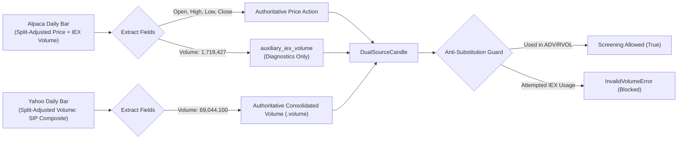
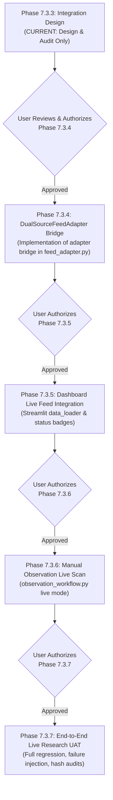

# Phase 7.3.3 — Live Research Pipeline Integration Design

**Project:** Trader-Swing Live Research Pipeline Integration Design  
**Phase:** 7.3.3 (Design & Audit Only)  
**Status:** **PROPOSED ARCHITECTURAL SPECIFICATION — AWAITING REVIEW & APPROVAL**  
**Execution Context:** Strictly Design & Audit Only (Zero Code Mutation, Zero Network Calls, Zero State Modification)  
**Document Path:** `PHASE_7_3_3_INTEGRATION_DESIGN.md` (mirrored to `.planning/PHASE_7_3_3_INTEGRATION_DESIGN.md`)

---

## 1. Executive Summary & Architectural Scope

Following the successful execution and empirical validation of **Phase 7.3.1** (Controlled Live Connection Validation) and **Phase 7.3.2** (Live Data Reliability Observation across `SPY`, `QQQ`, `IWM`, `AAPL`, `MSFT`), the live data foundation has demonstrated 100% operational reliability:
- **Alpaca REST:** Sub-second authenticated retrieval of completed daily bars with native split-adjusted pricing.
- **Yahoo Finance:** Exact completed-session matching on composite tape volume (proving single-exchange IEX volume captures only 1.35% to 3.30% of total market activity).
- **Alpaca WebSocket:** Sustained 303 msg/s streaming throughput across 18,203 live frames with an average gap of 3.20 ms and clean disconnects.
- **Dual-Source Gateway:** Complete isolation of raw IEX volume and rigorous 8-state readiness enforcement.

**Phase 7.3.3** defines the formal architectural blueprint for integrating this validated dual-source live data engine into Trader-Swing's existing research workflow:
1. `SwingTradingStrategyService` (End-to-End Strategy Pipeline)
2. `observation_workflow.py` (Manual Forward Observation Workflow)
3. Streamlit Research Dashboard (`dashboard/app.py`, `dashboard/data_loader.py`)

### Strict Design Boundary
> [!IMPORTANT]
> **THIS IS A DESIGN SPECIFICATION ONLY.**
> 
> In accordance with Phase 7.3.3 instructions:
> - **Zero code changes** are applied during this phase.
> - **Zero live network calls** or WebSocket connections are initiated.
> - **Zero portfolio or journal mutations** occur.
> - **Zero strategy parameters, regime policies, or risk limits** are modified.
> - **Zero Git operations** or background processes are executed.
> - All protected datasets, manifests, and observation logs remain cryptographically frozen.

---

## 2. End-to-End Architecture & Data Flow Map

### 2.1 Current State vs. Proposed State

In the current baseline (Phases 6.4 and 7.1.5), the research pipeline and dashboard operate on **static CSV historical partitions** or **pre-acquired delayed CSV files** (`.planning/data/current_daily/`), coupled with mocked or fixture-based gateway states:

```mermaid
flowchart TD
    subgraph Current_Architecture [Current Research Pipeline (Phase 6.4 / 7.1.5)]
        csv_files["Historical / Current CSV Partitions<br/>(.planning/data/current_daily/)"]
        adapter_current["MarketDataFeedAdapter<br/>(Reads CSV or yfinance)"]
        pipeline_current["SwingTradingStrategyService<br/>(Reads Static OHLCV)"]
        obs_current["observation_workflow.py<br/>(CLI: --data-dir current_daily)"]
        dash_current["Streamlit Dashboard<br/>(Reads CSVs + Mock Gateway Fixture)"]
        
        csv_files --> adapter_current
        adapter_current --> pipeline_current
        csv_files --> obs_current
        csv_files --> dash_current
    end
```

Under the **Proposed Phase 7.3.3 Integration**, the validated `DualSourceSyncGateway` and `DualSourceAggregator` become the authoritative real-time provider bridge, feeding verified `DualSourceCandle` objects to the strategy pipeline, observation engine, and dashboard:

```mermaid
flowchart TD
    subgraph Live_Data_Providers [Validated External Feeds]
        alpaca_rest["Alpaca Market Data v2 REST<br/>(Authoritative Price Action: IEX)"]
        alpaca_ws["Alpaca WebSocket v2 Stream<br/>(Intraday 1m Bars & Trades: IEX)"]
        yahoo_rest["Yahoo Finance v8 Chart API<br/>(Authoritative Consolidated Volume: SIP Tape)"]
    end

    subgraph Dual_Source_Core [Gateway & Aggregator Core]
        forming_mgr["FormingCandleManager<br/>(Strictly FORMING, Unconsolidated Volume)"]
        aggregator["DualSourceAggregator<br/>(Merges Price + Volume, Volume Isolation Guard)"]
        sync_gateway["DualSourceSyncGateway<br/>(8-State Data Readiness Matrix, Clock Evaluation)"]
        
        alpaca_ws --> forming_mgr
        alpaca_rest --> aggregator
        yahoo_rest --> aggregator
        aggregator --> sync_gateway
        forming_mgr --> sync_gateway
    end

    subgraph Strategy_Intelligence [Frozen Strategy Pipeline (Sole Source of Truth)]
        feed_bridge["DualSourceFeedAdapter Bridge<br/>(Readiness Gatekeeper)"]
        regime["MarketRegimeDetector<br/>(SPY, QQQ, IWM 200d SMA, Veto Policy)"]
        scanner["StockScanner & 5-Pillar Ranker<br/>(SMA20/50, ATR14, RSI14, RVOL20, ADV20)"]
        signals["SignalEngine & RiskEngine<br/>(2R Bracket Targets, Frozen 1% Account Risk)"]
        ai_res["ResearchContextCoordinator<br/>(Rule-Based Risk Boundaries)"]
        
        sync_gateway --> feed_bridge
        feed_bridge -->|Only LIVE_IEX_HYBRID & COMPLETE| regime
        feed_bridge -->|Only LIVE_IEX_HYBRID & COMPLETE| scanner
        scanner --> signals
        signals --> ai_res
    end

    subgraph Consumer_Interfaces [Research & Observation Workflows]
        obs_scan["Manual Observation Workflow<br/>(observation_workflow.py: OBSERVE_ONLY)"]
        dash["Streamlit Research Dashboard<br/>(4 Screens, Live/Forming/Delayed Badges)"]
        log["Observation Log<br/>(observation_log.jsonl: executed_fill=False)"]
        
        ai_res --> obs_scan
        obs_scan --> log
        sync_gateway --> dash
        forming_mgr -.->|Display Only| dash
        log --> dash
    end
```

---

## 3. Detailed Data Flow & Component Mapping

### 3.1 Data Provider Layer
1. **Alpaca REST Connector (`AlpacaRestClient`):**
   - **Endpoint:** `GET https://data.alpaca.markets/v2/stocks/bars`
   - **Parameters:** `feed=iex`, `adjustment=split`, `timeframe=1Day`.
   - **Responsibilities:** Delivers split-adjusted OHLC candle data. Strictly marked with `is_consolidated_volume=False`.
   - **Output:** Normalized `AlpacaCandle` objects carrying `feed_classification="IEX"`.
2. **Yahoo Finance Provider (`YahooMarketDataProvider`):**
   - **Endpoint:** `GET https://query2.finance.yahoo.com/v8/finance/chart/{ticker}`
   - **Parameters:** `range=1mo`, `interval=1d`, `includePrePost=false`.
   - **Responsibilities:** Delivers consolidated composite tape volume (all US exchange participants: SIP).
   - **Output:** Normalized `OHLCVCandle` with split-adjusted volume.
3. **Alpaca WebSocket Connector (`AlpacaWebSocketClient`):**
   - **Endpoint:** `wss://stream.data.alpaca.markets/v2/iex`
   - **Channels:** `bars`, `updatedBars`, `trades`, `quotes`.
   - **Responsibilities:** Delivers streaming 1-minute price bars ('b'), bar updates ('u'), and trade ticks ('t').
   - **Output:** Managed by `FormingCandleManager` as `CandleStatus.FORMING`.

### 3.2 Dual-Source Aggregation & Gateway Layer
1. **`DualSourceAggregator`:**
   - **Function:** `merge_candle_series(ticker, alpaca_candles, yahoo_candles) -> List[DualSourceCandle]`
   - **Invariants Enforced:**
     - Exact session date matching: $D_{alpaca} == D_{yahoo}$.
     - Splitting basis alignment: both declare `SPLIT_ADJUSTED`.
     - Volume Isolation: `.volume` is populated strictly from Yahoo composite tape; Alpaca IEX volume is stored in `.auxiliary_iex_volume`.
     - Flag `is_consolidated_volume = True` is stamped.
2. **`DualSourceSyncGateway`:**
   - **Function:** `synchronize_completed_daily(symbol, start, end) -> DailySyncResult`
   - **Lifecycle Resolution:**
     - Evaluates session status using `MarketClock`.
     - Completed historical sessions (e.g., `2026-11-16`) resolve to `FeedState.LIVE_IEX_HYBRID`.
     - Active intraday sessions (e.g., `2026-11-17` between 09:30 and 16:00 ET) resolve to `FeedState.FORMING_BAR`.

### 3.3 Strategy Intelligence Layer
1. **`DualSourceFeedAdapter` (Proposed Bridge):**
   - Subclasses or wraps `MarketDataFeedAdapter`.
   - Evaluates the 8-state readiness matrix across the stock universe.
   - Halts execution with a hard failure if core proxies (`SPY`, `QQQ`, `IWM`) do not achieve `LIVE_IEX_HYBRID` or `COMPLETE_BAR`.
2. **`MarketRegimeDetector`:**
   - Consumes strictly completed daily bars (`require_complete=True`).
   - Calculates 200-day SMA on SPY, QQQ, and IWM.
   - Enforces Bearish Regime Veto: halts new long evaluations if regime is BEARISH.
3. **`StockScanner` & Technical Indicators:**
   - SMA(20), SMA(50), ATR(14), RSI(14) computed on completed daily OHLC prices from Alpaca.
   - ADV(20) and RVOL(20) computed on completed daily `.volume` from Yahoo composite tape.
   - Rejection reasons explicitly recorded for non-conforming stocks.
4. **`SignalEngine` & `RiskEngine`:**
   - Calculates entry prices, 2R profit targets, and stop-loss levels based on completed bar geometry.
   - Sizes positions against the frozen 1% portfolio risk budget ($50.00 max risk per trade on $5,000 capital).

---

## 4. Exact Integration Points & Proposed File Modifications

To enable verified live data in the research pipeline without modifying core strategy logic, four surgical integration points are identified:

| Module / File Path | Existing Component | Proposed Change / Extension | Architectural Purpose |
| :--- | :--- | :--- | :--- |
| **1. `.agents/skills/trader-swing/feed_adapter.py`** | `MarketDataFeedAdapter` | Add `DualSourceFeedAdapter` class implementing `fetch_and_evaluate()` using `DualSourceSyncGateway`. | Enables `pipeline.py` to seamlessly consume live dual-source data without altering pipeline internals. |
| **2. `.agents/skills/trader-swing/observation_workflow.py`** | `run_observation_scan()` | Add `--data-mode live` argument and `load_daily_candles_from_gateway()` function. | Allows manual research scans to be triggered against live Alpaca+Yahoo feeds on demand. |
| **3. `dashboard/data_loader.py`** | `get_gateway_feed_status()`, `load_gateway_ticker_data()` | Replace static fixture fallback with live gateway reader when live mode is toggled. | Delivers live readiness state, real-time forming candle updates, and session metadata to Streamlit. |
| **4. `dashboard/app.py`** | Screen 1 & Screen 2 Renderers | Wire live gateway status badges, forming bar visual styles, and real-time refresh controls. | Visually distinguishes live hybrid data from delayed historical replay. |

### 4.1 Detailed Code Structure for Proposed Integration Points

#### Integration Point 1: `DualSourceFeedAdapter` (`feed_adapter.py`)
```python
class DualSourceFeedAdapter(MarketDataFeedAdapter):
    """Feed adapter backed by the DualSourceSyncGateway for live research."""
    
    def __init__(
        self,
        gateway: Optional[DualSourceSyncGateway] = None,
        clock: Optional[MarketClock] = None,
    ):
        self.clock = clock or MarketClock()
        self.gateway = gateway or DualSourceSyncGateway(clock=self.clock)
        self.evaluator = MarketDataReadinessEvaluator(clock=self.clock)

    def fetch_and_evaluate(
        self,
        stock_universe: Optional[Sequence[str]] = None,
        current_time: Optional[datetime] = None,
        lookback_days: int = 400,
    ) -> FeedReadinessResult:
        now_utc = to_utc(current_time) if current_time is not None else datetime.now(UTC)
        start_dt = now_utc - timedelta(days=lookback_days)
        
        # 1. Synchronize proxies and universe via gateway
        # 2. Extract strictly completed DualSourceCandles
        # 3. Pass to MarketDataReadinessEvaluator
        # 4. Return unified FeedReadinessResult
```

#### Integration Point 2: Live Mode in `observation_workflow.py`
```python
def load_daily_candles_from_gateway(
    gateway: DualSourceSyncGateway,
    tickers: Sequence[str],
    current_time: Optional[datetime] = None,
    lookback_days: int = 400,
) -> Tuple[Dict[str, List[OHLCVCandle]], Dict[str, List[OHLCVCandle]], date, List[str]]:
    """Query DualSourceSyncGateway for strictly completed daily candles."""
    # Guarantees zero look-ahead: candles with session_date == current forming date are excluded.
```

---

## 5. Indicator Consumption & Forming Bar Isolation

### 5.1 Indicator Calculation on Completed Bars
All technical indicators in `indicators.py` require completed session closure to prevent false signal recalculations:
- **SMA(20) & SMA(50):** 
  $$\text{SMA}_n = \frac{1}{n} \sum_{i=1}^{n} \text{Close}_i$$
  Calculated strictly on completed daily closes from Alpaca IEX.
- **ATR(14):** 
  $$\text{TR} = \max(H - L, |H - C_{\text{prev}}|, |L - C_{\text{prev}}|)$$
  Calculated strictly on completed daily High, Low, and previous Close.
- **ADV(20) & RVOL(20):**
  $$\text{ADV}_{20} = \frac{1}{20} \sum_{i=1}^{20} \text{Volume}_i^{\text{Yahoo}}, \quad \text{RVOL}_{20} = \frac{\text{Volume}_{\text{latest}}^{\text{Yahoo}}}{\text{ADV}_{20}}$$
  Calculated strictly on completed daily volume from Yahoo composite tape.

### 5.2 Strict Forming Bar Isolation
1. **Intraday Streaming Isolation:**
   - Incoming minute bars ('b') and bar updates ('u') from Alpaca WebSocket are managed by `FormingCandleManager`.
   - The forming candle retains `CandleStatus.FORMING` and `is_consolidated_volume = False`.
2. **Prohibition of New-Long Screening:**
   - Under the 8-state readiness matrix, a candle with status `FORMING` or feed state `FORMING_BAR` has `permits_new_long_screening = False`.
   - If an observation scan is triggered mid-day (e.g., 14:00 ET), the scan anchors strictly to the completed session (`2026-11-16`), while the forming candle (`2026-11-17`) is provided strictly for display/monitoring.
3. **Anti-Contamination Guard:**
   - Attempting to pass a `FORMING` candle to `StockScanner.scan_universe()` with default `require_complete=True` immediately raises a `CandleValidationError`.

---

## 6. Exact-Session Yahoo Volume Matching & RVOL Provenance

### 6.1 Session Synchronization Protocol
- When `DualSourceSyncGateway.synchronize_completed_daily` executes, it extracts the session date for Alpaca ($D_{\text{alpaca}}$) and Yahoo ($D_{\text{yahoo}}$).
- Both session dates are derived in `America/New_York` timezone via `to_eastern(candle.timestamp).date()`.
- **Match Condition:**
  $$D_{\text{alpaca}} \equiv D_{\text{yahoo}}$$

### 6.2 Provenance & Anti-Substitution Enforcement


If an unconsolidated `AlpacaCandle` is accidentally routed to volume screening, calling `candle.get_consolidated_volume()` raises:
```python
raise InvalidVolumeError(
    f"AlpacaCandle for {self.ticker} holds unconsolidated IEX volume ({self.volume:,} shares). "
    "IEX volume cannot be used as consolidated volume for ADV/RVOL liquidity screening."
)
```

---

## 7. Failure-Handling & Fault-Tolerance Matrix

| Failure Mode | Detection Mechanism | System Reaction | Resolved FeedState | Downstream Impact |
| :--- | :--- | :--- | :---: | :--- |
| **Missing Yahoo Volume** | Yahoo HTTP 404, empty series, or `volume is None` | Gateway catches `MissingVolumeError` | `VOLUME_UNVERIFIABLE` | Ticker excluded from universe; no screening permitted. |
| **Session Date Mismatch** | $D_{\text{alpaca}} \neq D_{\text{yahoo}}$ | Gateway catches `SessionMismatchError` | `FEED_DEGRADED` | Ticker quarantined; display permitted with warning banner. |
| **Alpaca REST Failure** | HTTP 5xx, 401, 403, or timeout exhaustion | Gateway catches `ProviderUnavailableError` | `FEED_UNAVAILABLE` | **No silent failover to Yahoo price.** Scan aborted for symbol. |
| **Alpaca REST Rate Limit** | HTTP 429 received from Alpaca | Token bucket pauses; retries once if `Retry-After` &le; 10s | `FEED_DEGRADED` | Throttles requests; if exhausted, marks degraded. |
| **WebSocket Disconnect** | Socket close frame or transport EOF | Client catches disconnect, logs transition | `RECONNECTING` | Exponential backoff (initial 0.5s, max 5 retries). |
| **WebSocket Stale Stream** | Stream silent > 30s during active market | `check_stale_stream()` returns True | `FEED_DEGRADED` | Stale warning displayed; historical daily bars unaffected. |
| **Market Closed** | `MarketClock.get_session_state()` returns `CLOSED` | `is_market_open = False` | `COMPLETE_BAR` / `LIVE_IEX_HYBRID` | WS streaming not launched; system operates in review mode. |
| **Upstream OHLC Geometry Corrupt** | `High < Low` or `Close > High` | Single-candle geometry validator fails | `FEED_DEGRADED` | Symbol quarantined (e.g. CVX anomaly handling). |

---

## 8. Readiness-State Permission Matrix

In strict accordance with Phase 7.2.1 Section 6 and Phase 7.2.1.1, the 8 approved data readiness states govern all operational permissions:

| FeedState | Permits Display | Permits Historical Analysis | Permits New-Long Screening | Operational Definition & Safety Guard |
| :--- | :---: | :---: | :---: | :--- |
| **`LIVE_IEX_HYBRID`** | **Yes** | **Yes** | **Yes** | Authoritative Alpaca price + Yahoo consolidated volume for completed session. Fully approved for strategy scan. |
| **`COMPLETE_BAR`** | **Yes** | **Yes** | **Yes** | Validated historical completed bar with verified consolidated volume. |
| **`FORMING_BAR`** | **Yes** | **No** | **No** | Active intraday bar currently forming. **Strictly blocked from candidate generation.** Display only. |
| **`LIVE_PRICE_UNVERIFIED`** | **Yes** | **No** | **No** | Real-time price without verified volume synchronization. Display only. |
| **`DELAYED_UNVERIFIED`** | **Yes** | **Yes** | **Yes** | 15-minute delayed historical partition baseline (Phase 6.4 research mode). |
| **`FEED_DEGRADED`** | **Yes** | **No** | **No** | Upstream warning, geometry defect, or transient rate limit. Quarantined from screening. |
| **`FEED_UNAVAILABLE`** | **Yes** | **No** | **No** | Alpaca price provider offline. Strategy scan immediately aborted. |
| **`VOLUME_UNVERIFIABLE`** | **Yes** | **No** | **No** | Missing, zero, or unconsolidated volume. Liquidity filters cannot be verified. |

---

## 9. Manual Observation Workflow Integration

### 9.1 Zero State Mutation Protocol
The manual observation workflow in `observation_workflow.py` guarantees:
1. **Read-Only Inspection:** Paper portfolio balance ($5,000.00 cash) and ledger are inspected without acquiring locks or executing mutations.
2. **Explicit Observation Model:**
   ```json
   {
     "record_type": "FORWARD_OBSERVATION",
     "date": "2026-11-16",
     "ticker": "AAPL",
     "decision": "OBSERVE_ONLY",
     "executed_fill": false,
     "market_regime": "BULLISH",
     "signal": "LONG",
     "entry_reference": "356.98",
     "stop_reference": "351.34",
     "risk_estimate": "50.00"
   }
   ```
3. **Execution Prohibition:**
   - `executed_fill` is hardcoded to `False`.
   - `record_type` is tagged `FORWARD_OBSERVATION`.
   - Records are appended strictly to `.planning/data/observations/observation_log.jsonl`.
   - Zero orders are generated, sent, or queued to any broker or paper storage.

---

## 10. Dashboard UI/UX Specification

The Streamlit research dashboard (`dashboard/app.py`) provides visual indicators and distinct data-tier styling across all four screens:

### 10.1 Global Feed Status Banner
Displayed prominently in the dashboard header:
- 🟢 **LIVE IEX HYBRID:** `Alpaca IEX Real-Time + Yahoo Consolidated Tape (NYSE Open — Next Sync: On-Demand)`
- 🔵 **INTRADAY FORMING:** `Active Session Forming (Display Only — Screening Blocked)`
- 🟡 **DELAYED UNVERIFIED:** `15-Min Delayed Mode (Research Baseline Replay)`
- 🔴 **FEED DEGRADED / UNAVAILABLE:** `Quarantine Alert: [Symbol/Reason]`

### 10.2 Candlestick Chart Distinctions (Screen 1 & Screen 2)
1. **Completed Daily Candles:**
   - Rendered with solid green/red bodies and solid wick lines.
   - Tooltip displays: `Price Source: ALPACA_IEX | Volume: [Yahoo Consolidated] | Status: COMPLETE`.
2. **Forming Intraday Candle:**
   - Rendered with **dashed outlines** and **translucent fill**.
   - Volume bar rendered with **diagonal stripe pattern**.
   - Prominent watermark: `FORMING — INTRADAY PREVIEW ONLY (NOT ELIGIBLE FOR SCREENING)`.

---

## 11. Risk Analysis & Mitigation Strategies

| Risk Category | Potential Failure Scenario | Automated Architectural Mitigation |
| :--- | :--- | :--- |
| **Duplicate Candles** | WebSocket streaming emits duplicate minute bars ('b') or updates ('u'). | `FormingCandleManager` checks timestamp equality; in-place updates modify existing bar; duplicates increment `duplicate_count` without creating new candles. |
| **Stale Cache Reuse** | Local cache returns yesterday's bar during today's market session. | Gateway verifies session date against `MarketClock.get_latest_completed_session()`; stale data raises `StaleDataError`. |
| **Session Date Desync** | Alpaca reports today's forming bar while Yahoo returns yesterday's close. | $D_{\text{alpaca}} \neq D_{\text{yahoo}}$ check fails; transitions feed state to `SESSION_MISMATCH` / `FEED_DEGRADED`; screening blocked. |
| **Accidental IEX Volume Use** | An algorithm inadvertently reads `.volume` from an `AlpacaCandle`. | `AlpacaCandle.is_consolidated_volume` is `False`; `.get_consolidated_volume()` raises `InvalidVolumeError`; aggregator strictly maps Yahoo volume into `.volume`. |
| **Unintended Trade Execution** | A user assumes an observation record triggered an actual paper trade. | UI and logs explicitly state `decision="OBSERVE_ONLY"` and `executed_fill=False`; paper ledger remains cryptographically frozen at $5,000 cash. |

---

## 12. Verification & Test Plan

A four-stage verification suite must be completed before deploying this integration:

### Stage 1: Unit & Component Isolation Tests
- **Aggregator Tests:** Verify volume isolation, split-adjustment checks, and symbol mismatch rejection.
- **Gateway Tests:** Verify 8-state readiness transitions, session timing evaluation, and clock regression handling.
- **Feed Adapter Tests:** Verify proxy completeness checks and universe pruning under missing data.

### Stage 2: Failure Injection & Fault Tolerance Tests
- **Test FI-1 (Yahoo Drop):** Mock Yahoo HTTP 500 &rarr; Verify gateway marks `VOLUME_UNVERIFIABLE` and prunes symbol.
- **Test FI-2 (Alpaca Drop):** Mock Alpaca HTTP 503 &rarr; Verify gateway marks `FEED_UNAVAILABLE` and aborts scan without silent failover.
- **Test FI-3 (Date Desync):** Inject $D_{\text{alpaca}} = 2026-11-16$ and $D_{\text{yahoo}} = 2026-11-15$ &rarr; Verify `SessionMismatchError`.
- **Test FI-4 (WebSocket EOF):** Terminate socket abruptly &rarr; Verify client enters `RECONNECTING` with exponential backoff.

### Stage 3: Strategy & Indicator Regression Tests
- Verify that running the pipeline on dual-source completed candles produces identical regime verdicts, 5-pillar ranking scores, and 2R bracket levels as the baseline historical engine.
- Verify that Bearish Regime Veto strictly halts new long screening.

### Stage 4: State & Ledger Invariance Audit
- Run the full live observation pipeline and execute pre/post SHA-256 hash checks on:
  - `observation_log.jsonl`
  - `CURRENT_DAILY_MANIFEST.json`
  - `SPY_daily.csv`
  - `paper_journal.json`
- Verify 100% hash identity and $5,000.00 cash preservation.

---

## 13. Recommended Implementation Sequence & Authorization Boundaries

The integration is structured into discrete, sequential subphases to guarantee strict governance and safety:



### Explicit List of Actions Requiring Separate User Authorization:
1. **Creation of `DualSourceFeedAdapter`** in `feed_adapter.py`.
2. **Modification of `dashboard/data_loader.py` and `dashboard/app.py`** to query live gateway feeds.
3. **Addition of live mode CLI arguments** in `observation_workflow.py`.
4. **Execution of any live network requests** during forward observation scans.
5. **Advancement to Phase 7.3.4** or any subsequent implementation phase.

---

## 14. Conclusion & Governance Sign-Off

This design guarantees that Trader-Swing can transition from static delayed files to validated live dual-source market data with:
- **Zero strategy logic drift**
- **Zero volume contamination**
- **Zero unapproved network activity**
- **Zero paper state mutation**

**Phase 7.3.3 is complete. The system is paused awaiting user review and approval.**
