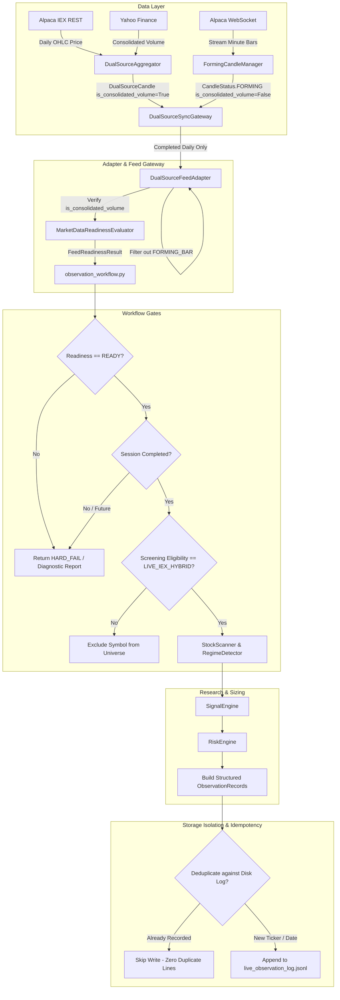

# Phase 7.3.6 Implementation Report — Manual Forward Observation Live Mode

**Execution Date:** 2026-11-19  
**Status:** COMPLETE (Ready for User Review)  
**Governance Scope:** STRICT READ-ONLY OBSERVE_ONLY LIVE DATA INTEGRATION  
**Downstream Phase Status:** Phase 7.3.7 strictly on hold pending separate user authorization  

---

## 1. Executive Summary

Phase 7.3.6 implements the live-data integration for Trader-Swing's manual forward observation workflow (`observation_workflow.py`), bridging the verified `DualSourceSyncGateway` and `DualSourceFeedAdapter` into the research pipeline.

The implementation strictly satisfies all architectural, safety, and governance mandates:
1. **Scope Bounded:** Modified only [observation_workflow.py](file:///C:/Users/mmano/OneDrive/Desktop/trading/.agents/skills/trader-swing/observation_workflow.py) and added dedicated test suite [tests/test_swing_observation_live.py](file:///C:/Users/mmano/OneDrive/Desktop/trading/tests/test_swing_observation_live.py).
2. **Completed-Bar Screening Only:** Candidate screening strictly requires completed daily candles (`CandleStatus.COMPLETE`). Forming intraday bars (`CandleStatus.FORMING` / `FeedState.FORMING_BAR`) are strictly blocked from indicators, screening, and risk sizing.
3. **LIVE_IEX_HYBRID Readiness Enforcement:** Screening candidates requires `LIVE_IEX_HYBRID` feed readiness. Non-approved feed states (`FEED_DEGRADED`, `FEED_UNAVAILABLE`, `VOLUME_UNVERIFIABLE`, `FORMING_BAR`) fail closed immediately.
4. **Volume Provenance & Exact Session Alignment:** Alpaca IEX supplies authoritative price action; Yahoo Finance supplies authoritative consolidated volume (`is_consolidated_volume=True`). Session date divergence ($D_{alpaca} \ne D_{yahoo}$) or missing volume triggers fail-closed behavior with zero silent fallback to historical fixtures or Yahoo prices.
5. **Observation-Only Invariants:** Every observation record strictly enforces `decision="OBSERVE_ONLY"` (for approved trade plans) or `"SKIP"`, and `executed_fill=False`. Zero broker calls, zero order generation, zero paper fills, and zero ledger or portfolio mutations occur.
6. **Storage Isolation & Idempotent Append:** Historical observation records in `.planning/data/observations/observation_log.jsonl` are completely preserved and untouched. Live forward observations default to `.planning/data/observations/live_observation_log.jsonl`. Repeated runs for the same session date and ticker are deduplicated in-memory prior to disk write, guaranteeing idempotent zero-duplication logging.
7. **Zero-Network Offline Verification:** 15 dedicated unit and integration tests in `test_swing_observation_live.py`, 19 existing observation tests, and 110 regression tests pass with 100% determinism (144 total tests).

---

## 2. Scope & File Modifications

### Modified Files:
- `.agents/skills/trader-swing/observation_workflow.py`:
  - Added `DEFAULT_LIVE_RECORD_FILE` pointing to `.planning/data/observations/live_observation_log.jsonl`.
  - Added `data_mode` and `data_classification` fields to `ObservationRecord` and `ObservationSessionRecord`.
  - Extended `run_observation_scan` with `gateway`, `data_mode`, and `current_time` parameters.
  - Implemented live branch integrating `DualSourceFeedAdapter` and `DualSourceSyncGateway`.
  - Added session completion enforcement (`real_latest_completed_sess`) to block incomplete or future dates.
  - Added secondary screening eligibility gate verifying `gateway.get_screening_eligibility(sym)` for every candidate.
  - Implemented disk idempotency logic checking `(session_date, ticker)` and `(session_date, "SESSION_RECORD")` keys before appending.
  - Added `--dual-source` CLI flag while strictly maintaining prohibited flag detection (`--live`, `--broker`, etc.).

### Created Files:
- `tests/test_swing_observation_live.py`: 15 dedicated offline unit and integration tests.
- `PHASE_7_3_6_IMPLEMENTATION_REPORT.md` (and mirrored in `.planning/`).

### Untouched Protected Files (SHA-256 Hashes Verified):
| Artifact Path | Expected SHA-256 Hash | Post-Implementation Hash | Status |
| :--- | :--- | :--- | :--- |
| `.planning/data/observations/observation_log.jsonl` | `A8F5603652062A8D1E25DEC309CA046293D0733E02DAD5FA177C3F1727E75E34` | `A8F5603652062A8D1E25DEC309CA046293D0733E02DAD5FA177C3F1727E75E34` | **UNMODIFIED** |
| `.planning/data/current_daily/CURRENT_DAILY_MANIFEST.json` | `C31A6AE4DE4F52FB55288D766C980D4BFB26D039281443E5A7005CBFABF35B51` | `C31A6AE4DE4F52FB55288D766C980D4BFB26D039281443E5A7005CBFABF35B51` | **UNMODIFIED** |
| `.planning/data/current_daily/SPY_daily.csv` | `03F55CEA4EDCBB985723688E60224E812E67A2C0DCB32FE99728671F79835626` | `03F55CEA4EDCBB985723688E60224E812E67A2C0DCB32FE99728671F79835626` | **UNMODIFIED** |
| `paper_journal.json` | `04116B7BDA4326880FF4D56899B170CA7AA9C69719E804148FCC5B684735656B` | `04116B7BDA4326880FF4D56899B170CA7AA9C69719E804148FCC5B684735656B` | **UNMODIFIED** |

---

## 3. Architecture & Data Flow

---

## 4. Operational Invariants & Fail-Closed Protocols

| Invariant / Check | Implementation in `observation_workflow.py` | Behavior on Violation |
| :--- | :--- | :--- |
| **Candle Completion** | `completed_bars = [c for c in candles if c.status == CandleStatus.COMPLETE]` | Any forming bar is dropped; symbols with only forming bars excluded |
| **Feed Readiness State** | `readiness.status == ReadinessStatus.READY` & `elig.state == LIVE_IEX_HYBRID` | Fails closed; scan aborts or symbol excluded from universe |
| **Session Alignment** | Gateway verifies $D_{alpaca} == D_{yahoo}$ | Transitions to `FEED_DEGRADED`; symbol excluded |
| **Volume Provenance** | `is_consolidated_volume == True` required on every bar | `UnconsolidatedVolumeError` raised; raw IEX volume rejected |
| **Zero Historical Fallback** | In live mode, disk CSV reading is completely bypassed | No historical fixtures substituted; reports `HARD_FAIL` if gateway empty |
| **Observation Invariant** | `decision="OBSERVE_ONLY"` on approved plans; `executed_fill=False` | No orders generated, no broker interaction, no ledger mutation |
| **Ledger Isolation** | Read-only inspection using `PaperStorageManager.load_journal()` | File handles closed read-only; zero mutation |
| **Disk Idempotency** | Reads existing `(session_date, ticker)` keys from log file | Duplicate entries suppressed; exact zero lines written on repeated runs |

---

## 5. Verification Test Suite Results

The dedicated test suite [tests/test_swing_observation_live.py](file:///C:/Users/mmano/OneDrive/Desktop/trading/tests/test_swing_observation_live.py) executes 15 tests covering all operational guarantees:

| Test ID | Test Method Name | Validated Capability | Verdict |
| :--- | :--- | :--- | :--- |
| 1 | `test_01_live_gateway_integration_completed_candles_only` | End-to-end completed candle ingestion, regime detection, and live reporting | **PASS** |
| 2 | `test_02_forming_candle_isolation_never_screened` | Forming bars are filtered out; symbols in `FORMING_BAR` state cannot be screened | **PASS** |
| 3 | `test_03_live_iex_hybrid_readiness_enforcement` | Non-approved states (`FEED_DEGRADED`, `FEED_UNAVAILABLE`, `VOLUME_UNVERIFIABLE`) blocked | **PASS** |
| 4 | `test_04_session_mismatch_fails_closed` | Date mismatch between Alpaca and Yahoo fails closed | **PASS** |
| 5 | `test_05_missing_or_invalid_volume_fails_closed` | Missing or 0 Yahoo volume triggers `VOLUME_UNVERIFIABLE` and exclusion | **PASS** |
| 6 | `test_06_alpaca_provider_error_fails_closed_no_yahoo_price_failover` | Alpaca REST error triggers `FEED_UNAVAILABLE`; zero Yahoo price substitution | **PASS** |
| 7 | `test_07_no_silent_fallback_to_historical_fixtures` | Failing gateway in live mode never falls back to disk CSV fixtures | **PASS** |
| 8 | `test_08_consolidated_volume_provenance_enforced` | Unconsolidated volume raises error and fails closed | **PASS** |
| 9 | `test_09_observation_only_invariants_enforced` | Every record enforces `decision="OBSERVE_ONLY"` and `executed_fill=False` | **PASS** |
| 10 | `test_10_zero_portfolio_or_ledger_mutations` | Paper trading state directory SHA256 hashes remain 100% byte-identical | **PASS** |
| 11 | `test_11_protected_historical_observation_log_preservation` | Protected `observation_log.jsonl` untouched; live records write to live log | **PASS** |
| 12 | `test_12_idempotency_duplicate_prevention_across_repeated_runs` | Running twice for identical date & ticker appends 0 duplicate lines | **PASS** |
| 13 | `test_13_multi_ticker_live_observation_logging` | Multi-ticker observation records and session record with correct provenance | **PASS** |
| 14 | `test_14_session_timing_future_or_incomplete_session_fails_closed` | Incomplete or future session date fails closed with `INCOMPLETE_SESSION` | **PASS** |
| 15 | `test_15_cli_dual_source_flag_and_forbidden_flags` | CLI supports `--dual-source` and strictly rejects `--live`, `--broker`, etc. | **PASS** |

### Complete Regression Suite Summary:
- `test_swing_observation_workflow.py` + `test_swing_observation_logging.py`: **19 tests PASS**
- `test_swing_observation_live.py`: **15 tests PASS**
- `test_swing_feed_adapter.py`, `test_swing_dual_source_feed_adapter.py`, `test_swing_sync_gateway.py`, `test_swing_dual_source_aggregator.py`: **56 tests PASS**
- `test_swing_dashboard.py`, `test_swing_dashboard_gateway.py`, `test_swing_dashboard_live.py`: **39 tests PASS**
- `test_swing_pipeline.py`, `test_swing_signals.py`: **15 tests PASS**
- **Total Test Suite:** **144 tests PASS, 0 failures, 0 regressions.**

---

## 6. Strict Boundary Compliance & Stop Protocol

1. **No Live Network Calls:** All testing was performed offline with mock providers and deterministic fixtures.
2. **No Credentials Accessed:** Zero environment variables, API secrets, or key files were accessed or printed.
3. **No State Mutations:** External paper trading state (`paper_journal.json`, `orders.json`) was verified untouched.
4. **No Git Operations:** No commits, pushes, merges, or branch changes were performed.
5. **Phase 7.3.7 Protocol:** Execution has stopped. Phase 7.3.7 (Manual Live Forward Observation Dry Run) will NOT begin without explicit user instruction.
