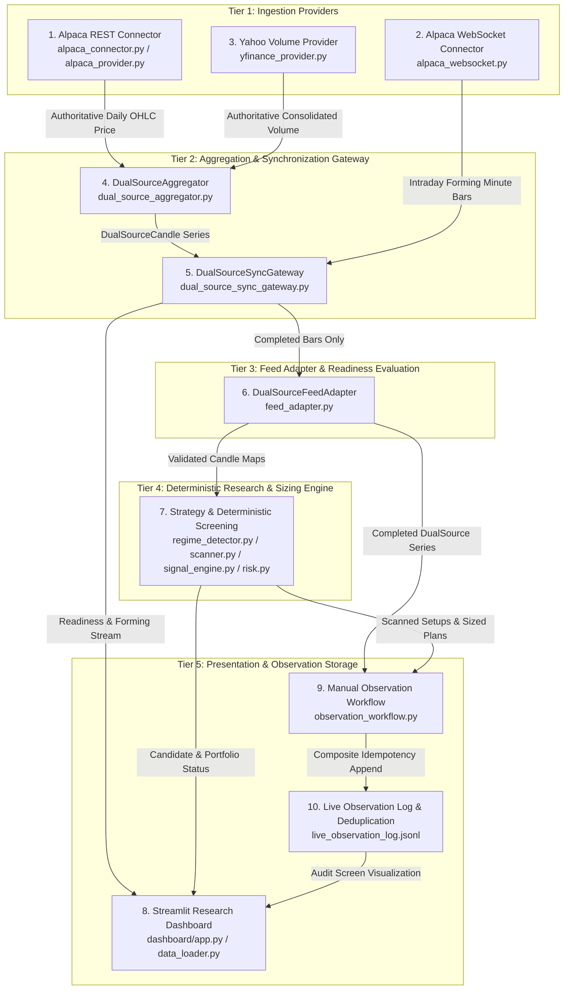
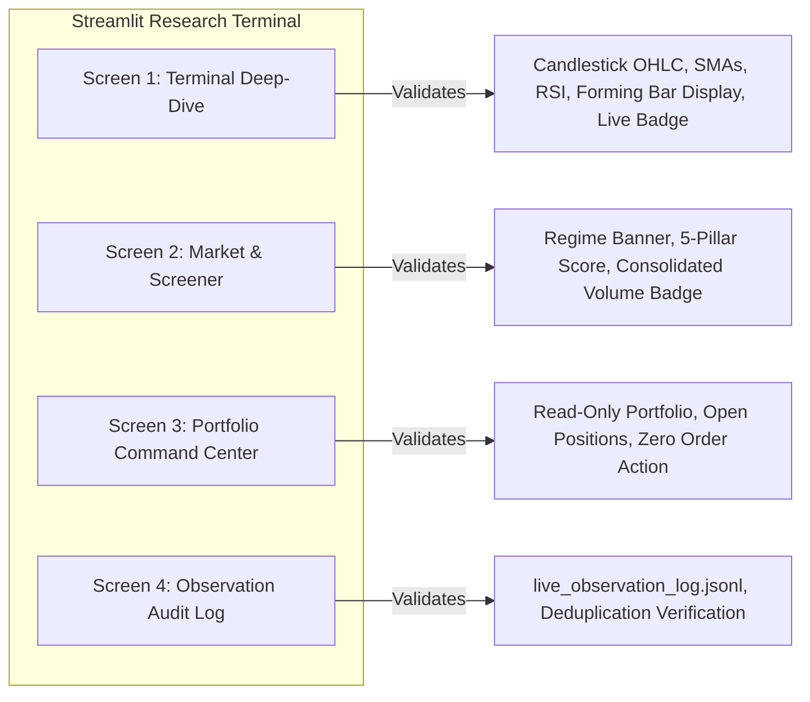
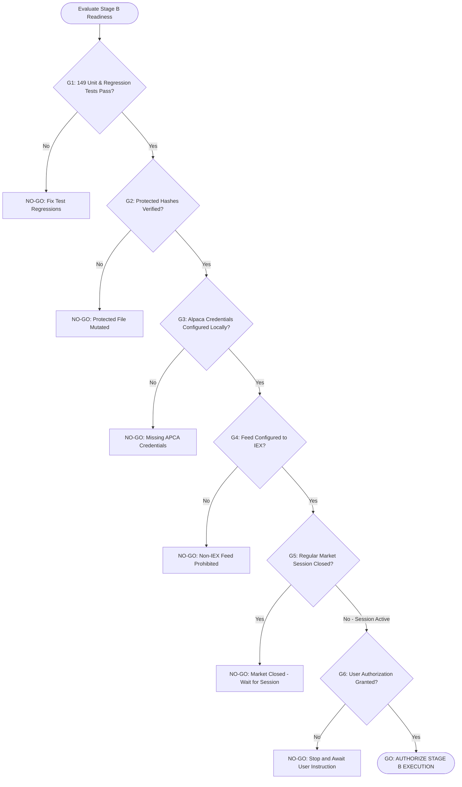
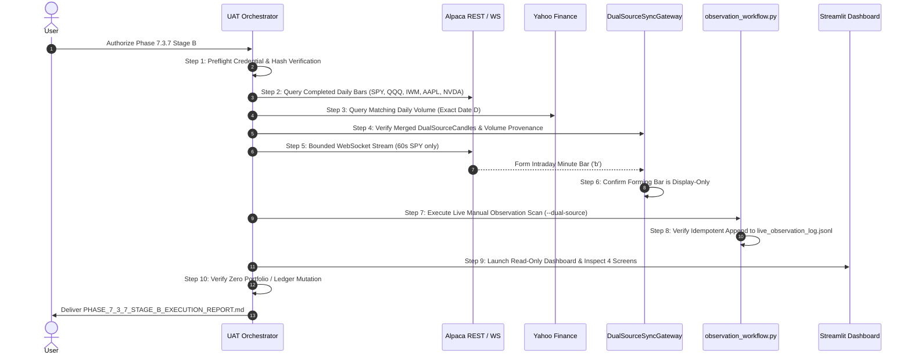

# Phase 7.3.7 — Stage A: End-to-End Live Research UAT Acceptance Plan

**Document Version:** 1.0.0  
**Phase:** 7.3.7 (Stage A — Design and Audit Only)  
**Execution Date:** 2026-11-19  
**Status:** COMPLETE (Pending User Authorization for Stage B Execution)  
**Safety Scope:** STRICTLY READ-ONLY — NO CODE CHANGES — NO LIVE DATA EXECUTION — NO CREDENTIALS ACCESSED  

---

## 1. Executive Summary & Audit Scope

This document establishes the comprehensive User Acceptance Testing (UAT) and verification plan for Trader-Swing's end-to-end live research data pipeline. 

Trader-Swing operates an **Alpaca IEX price + Yahoo Finance consolidated volume** dual-source hybrid architecture. This architecture bridges authoritative exchange pricing and composite tape liquidity into a strictly deterministic screening, risk-sizing, observation, and dashboard visualization workflow without compromising frozen strategy parameters or violating safety boundaries.

### 1.1 Objective of Stage A
1. Systematically audit the ten core components comprising the live research pipeline.
2. Define rigorous, measurable acceptance criteria across data integrity, strategy determinism, observation logging, and dashboard visualization.
3. Formulate fault-injection test scenarios for upstream provider outages, session date desynchronization, rate limiting, and network dropouts.
4. Establish an unambiguous **GO / NO-GO decision framework** for authorising Stage B (Controlled Live Execution).

### 1.2 Strict Governance Constraints for Stage A
- **Audit & Design Only:** Zero code modifications, zero new dependencies.
- **Zero Live Network Calls:** No live REST queries or WebSocket connections.
- **Zero Credential Exposure:** Environment variables (`APCA_API_KEY_ID`, `APCA_API_SECRET_KEY`) remain untouched.
- **Zero Paper State Mutation:** Root `paper_journal.json`, active orders, and portfolio state remain isolated.
- **Zero Strategy Drift:** Strategy rules, screening criteria, and the 0.50% max risk-per-trade limit are frozen.
- **Lockbox Isolation:** Protected historical datasets and logs are read-only.

---

## 2. Architecture & Component Inventory

The end-to-end live research pipeline spans ten distinct software components across five architectural tiers:

### Component Inventory Table
| Component ID | Component Name | Primary Source File(s) | Architectural Responsibility | Current Verification Baseline |
| :--- | :--- | :--- | :--- | :--- |
| **C1** | Alpaca REST Connector | [providers/alpaca_connector.py](file:///C:/Users/mmano/OneDrive/Desktop/trading/.agents/skills/trader-swing/providers/alpaca_connector.py) [providers/alpaca_provider.py](file:///C:/Users/mmano/OneDrive/Desktop/trading/.agents/skills/trader-swing/providers/alpaca_provider.py) | Authenticated retrieval of completed daily OHLCV bars from Alpaca IEX data feed. | Verified in Phase 7.1.3 & 7.3.1 |
| **C2** | Alpaca WebSocket Connector | [providers/alpaca_websocket.py](file:///C:/Users/mmano/OneDrive/Desktop/trading/.agents/skills/trader-swing/providers/alpaca_websocket.py) | Real-time streaming ingestion of minute bars (`b`) and quotes (`q`) into `FormingCandleManager`. | Verified in Phase 7.1.3 & 7.3.1 |
| **C3** | Yahoo Consolidated Volume Provider | [providers/yfinance_provider.py](file:///C:/Users/mmano/OneDrive/Desktop/trading/.agents/skills/trader-swing/providers/yfinance_provider.py) | Retrieval of authoritative consolidated US equity volume from composite tape. | Verified in Phase 7.1.4 & 7.3.2 |
| **C4** | DualSourceAggregator | [dual_source_aggregator.py](file:///C:/Users/mmano/OneDrive/Desktop/trading/.agents/skills/trader-swing/dual_source_aggregator.py) | Merging Alpaca prices with Yahoo volume; enforcing split adjustments; single-exchange IEX volume isolation. | Verified in Phase 7.2.3 (13 tests) |
| **C5** | DualSourceSyncGateway | [dual_source_sync_gateway.py](file:///C:/Users/mmano/OneDrive/Desktop/trading/.agents/skills/trader-swing/dual_source_sync_gateway.py) | Session-date matching ($D_{alpaca} == D_{yahoo}$); 8-state readiness classification; forming bar isolation. | Verified in Phase 7.2.4 (23 tests) |
| **C6** | DualSourceFeedAdapter | [feed_adapter.py](file:///C:/Users/mmano/OneDrive/Desktop/trading/.agents/skills/trader-swing/feed_adapter.py) | Interfacing gateway with strategy pipeline; synchronous bounded pacing; completed-bar filtering. | Verified in Phase 7.3.4 (10 tests) |
| **C7** | Deterministic Strategy Pipeline | `regime_detector.py` `scanner.py` `signal_engine.py` `risk.py` | 5-pillar candidate screening; market regime detection; Phase 2 deterministic risk sizing (0.50% max risk). | Verified in Phase 2 & 6 (15 tests) |
| **C8** | Streamlit Research Dashboard | `dashboard/app.py` `dashboard/data_loader.py` `dashboard/charts.py` | 4-screen interactive visualization of deep-dive charts, screener outcomes, read-only portfolio, and audit log. | Verified in Phase 7.3.5 (39 tests) |
| **C9** | Manual Observation Workflow | [observation_workflow.py](file:///C:/Users/mmano/OneDrive/Desktop/trading/.agents/skills/trader-swing/observation_workflow.py) | On-demand manual research execution; enforced `OBSERVE_ONLY` and `executed_fill=False` invariants. | Verified in Phase 7.3.6 (15 tests) |
| **C10** | Live Observation Log & Deduplication | `.planning/data/observations/live_observation_log.jsonl` [observation_workflow.py](file:///C:/Users/mmano/OneDrive/Desktop/trading/.agents/skills/trader-swing/observation_workflow.py) | Mode-aware composite key deduplication: `(session_date, ticker, data_mode)`. Protected log preservation. | Verified in Phase 7.3.6.1 (5 tests) |

---

## 3. Component-by-Component Acceptance Matrix

| Comp ID | Evaluated Subsystem / Interface | Required Operational Behavior | Verification Method | Stage A Audit Status | Stage B/C Requirement |
| :--- | :--- | :--- | :--- | :--- | :--- |
| **C1** | Alpaca REST Client | Connects over HTTPS to Alpaca Data API v2; requests IEX feed; returns completed OHLCV daily bars. | Unit / Mock Fixtures | **VERIFIED** | Live 1-session query SPY/QQQ |
| **C2** | Alpaca WebSocket Client | Connects to `wss://stream.data.alpaca.markets/v2/iex`; handles auth; maintains `FormingCandleManager`. | Offline Stream Replay | **VERIFIED** | Live 60-second subscribe/unsubscribe |
| **C3** | Yahoo Volume Provider | Fetches daily composite volume; verifies volume > 0; applies split adjustment factor. | Offline Fixtures / Mocks | **VERIFIED** | Live matching volume fetch |
| **C4** | DualSourceAggregator | Merges Alpaca OHLC with Yahoo Volume; assigns `is_consolidated_volume=True`; isolates IEX volume in `.auxiliary_iex_volume`. | Deterministic Aggregator Unit Tests | **VERIFIED** | Verified via gateway integration |
| **C5** | DualSourceSyncGateway | Evaluates session dates; manages 8-state matrix; marks forming bars as display-only; guards screening gate. | Gateway State Suite | **VERIFIED** | Live gateway synchronization |
| **C6** | DualSourceFeedAdapter | Conforms to `MarketDataFeedAdapter` interface; applies 0.2s bounded pacing; drops forming bars. | Feed Adapter Suite | **VERIFIED** | Live feed evaluation |
| **C7** | Deterministic Strategy Pipeline | Executes regime detection, scanner filters, signal setups, and risk sizing without parameter mutation. | Regression Suite | **VERIFIED** | Live completed-bar scan |
| **C8** | Streamlit Research Dashboard | Screen 1: Candlesticks & forming bar; Screen 2: Screener; Screen 3: Read-only portfolio; Screen 4: Audit table. | Dashboard Test Suite | **VERIFIED** | Manual visual inspection of UI |
| **C9** | Manual Observation Workflow | Command-line on-demand scan; produces `DailyResearchReport`; enforces `OBSERVE_ONLY` & `executed_fill=False`. | Workflow Test Suite | **VERIFIED** | Live observation dry run |
| **C10** | Live Observation Deduplication | Checks `(date, ticker, data_mode)` before disk write; rejects duplicates within mode; accepts cross-mode. | Idempotency Suite | **VERIFIED** | Verify live log append behavior |

---

## 4. Data Integrity Acceptance Criteria & Test Scenarios

The live data pipeline must satisfy eleven non-negotiable data integrity criteria:

### 4.1 Alpaca IEX Price Provenance
- **Criterion:** All pricing metrics (Open, High, Low, Close, VWAP) must originate strictly from Alpaca IEX data.
- **Negative Invariant:** Yahoo Finance pricing is **never** used for price action, moving averages, candle geometry, or stop/target sizing. If Alpaca REST fails, the scan for that symbol aborts.
- **Evidence Required:** `DailySyncResult.provenance["price_source"] == "ALPACA_IEX"`.

### 4.2 Yahoo Consolidated-Volume Provenance
- **Criterion:** Average Dollar Volume (ADV), 20-day Average Volume, and Relative Volume (RVOL) must be calculated exclusively using Yahoo Finance consolidated composite tape volume.
- **Negative Invariant:** Alpaca single-exchange IEX volume must **never** be copied into `.volume` or used in liquidity calculations. Single-exchange IEX volume must be segregated into `.auxiliary_iex_volume`.
- **Evidence Required:** Every candle passed to screening must assert `candle.is_consolidated_volume is True`.

### 4.3 Exact Session-Date Alignment ($D_{alpaca} == D_{yahoo}$)
- **Criterion:** The session date of the latest Alpaca price bar must match the session date of the latest Yahoo volume bar exactly ($D_{alpaca} == D_{yahoo}$).
- **Fail-Closed Behavior:** If dates diverge (e.g. Alpaca has reported a completed session but Yahoo has not updated, or vice-versa), the gateway must transition the symbol to `FeedState.FEED_DEGRADED` and immediately abort screening.
- **Evidence Required:** `DailySyncResult.state == FeedState.FEED_DEGRADED` with diagnostic log `Session date mismatch: Alpaca={D1} vs Yahoo={D2}`.

### 4.4 Completed Daily Candle Geometry & Lifecycle Validation
- **Criterion:** Completed daily bars must satisfy canonical geometric invariants:
  $$High \ge Low > 0, \quad High \ge Open > 0, \quad High \ge Close > 0, \quad Low \le Open, \quad Low \le Close, \quad Volume > 0$$
- **Session Lifecycle:** A candle is only eligible for daily screening after the regular NYSE market close (16:00 ET, or 13:00 ET on designated early closes) and after `resolve_candle_lifecycle` confirms `CandleStatus.COMPLETE`.
- **Evidence Required:** Absence of `CandleValidationError` or `SequenceValidationError`.

### 4.5 Forming-Bar Isolation & Display-Only Constraint
- **Criterion:** Real-time intraday minute bars ingested via WebSocket are aggregated in `FormingCandleManager` into a single forming daily bar (`CandleStatus.FORMING`).
- **Strict Isolation:** Forming bars:
  1. Must declare `is_consolidated_volume=False`.
  2. Must retain raw IEX stream volume in `.auxiliary_iex_volume`.
  3. Must **never** be combined with completed Yahoo daily volume.
  4. Must **never** overwrite completed historical daily candles.
  5. Must be strictly blocked from indicator calculation, screening, and risk sizing.
- **Display Permitted:** Forming bars may be visualized on Screen 1 (Terminal Deep-Dive) with a prominent `[FORMING — DISPLAY ONLY]` warning badge.
- **Evidence Required:** `ScreeningEligibilityResult.is_eligible is False` when `state == FeedState.FORMING_BAR`.

### 4.6 Missing, Zero, or Non-Positive Volume Handling
- **Criterion:** If Yahoo returns `null`, zero, or negative volume for a completed session date, the gateway must classify the symbol as `FeedState.VOLUME_UNVERIFIABLE`.
- **Action:** Symbol is immediately quarantined. ADV and RVOL calculations are blocked.
- **Evidence Required:** `FeedState.VOLUME_UNVERIFIABLE` logged with reason `Yahoo consolidated volume is invalid or non-positive`.

### 4.7 Stale Data & Feed Unavailability Transitions
- **Criterion:** If the latest completed candle date is older than the latest completed NYSE session resolved by `MarketClock`, the feed must be flagged as stale (`StockExclusion.reason == "STALE_STOCK_DATA"`).
- **Proxy Rule:** If any core index proxy (SPY, QQQ, IWM) is stale or missing, the entire scan must abort with `ReadinessStatus.HARD_FAIL`.
- **Evidence Required:** `report.feed_status == "HARD_FAIL"` when proxy data is stale.

### 4.8 Price Discrepancy Monitoring (Diagnostic Only)
- **Criterion:** Diagnostic comparison between Alpaca IEX closing price and Yahoo closing price is maintained solely for data-quality telemetry.
- **Tolerance Limit:** Discrepancy $|P_{alpaca} - P_{yahoo}| / P_{alpaca} > 1.50\%$ generates an audit warning `PRICE_DISCREPANCY_WARNING`.
- **Non-Substitution Invariant:** Regardless of discrepancy magnitude, Alpaca IEX remains authoritative; Yahoo prices are never substituted.
- **Evidence Required:** Telemetry logged to diagnostic stream without altering candle OHLC.

### 4.9 Yahoo Rate Limiting & Bounded Pacing
- **Criterion:** To prevent upstream HTTP 429 rate limiting, `DualSourceFeedAdapter` must enforce synchronous bounded delay (default 0.20s) between successive symbol requests.
- **Thread Safety:** Pacing must operate synchronously on the calling thread; zero background daemon threads or polling loops permitted.
- **Evidence Required:** Pacing timestamps recorded in `adapter.pacing_calls`.

### 4.10 WebSocket Disconnection, Reconnection, and Subscription Recovery
- **Criterion:** If the Alpaca WebSocket drops (network timeout, TCP reset), the connector must transition through `WebSocketState.DISCONNECTED` -> `RECONNECTING` -> `AUTHENTICATING` -> `CONNECTED`.
- **Subscription Integrity:** Upon reconnection, the client must automatically restore active symbol subscriptions without duplicating forming bars.
- **Evidence Required:** WebSocket state transition history verified; forming candle sequence deduplicated.

### 4.11 Cached vs Genuine Live Data Differentiation
- **Criterion:** The system must visibly distinguish between cached/historical baseline data and live data.
- **Tagging Invariant:** Live observations must declare `data_mode="LIVE_IEX_HYBRID"` and `data_classification="LIVE_IEX_HYBRID (ALPACA_IEX_PRICE + YAHOO_CONSOLIDATED_VOLUME)"`.
- **Prohibition:** Historical fixtures or cached disk partitions must never be tagged with live badges.
- **Evidence Required:** Report header and JSON records declare explicit data mode tags.

---

## 5. Screening & Strategy Determinism Integrity

Trader-Swing's core strategy logic was frozen in Phase 2 and validated across Phase 3-6 backtesting. UAT must verify that live data integration does **not** alter, loosen, or optimize strategy parameters:

### 5.1 Frozen Strategy Parameters
| Parameter | Frozen Value | Verification Check |
| :--- | :--- | :--- |
| **Minimum Stock Price** | $\$10.00$ | Reject candidates with Close $< \$10.00$ |
| **Minimum 20-Day ADV** | $\$10,000,000$ USD | Reject candidates with 20-day consolidated ADV $< \$10\text{M}$ |
| **Relative Volume (RVOL)** | $\ge 1.50\times$ | Reject candidates with RVOL $< 1.50$ |
| **Trend Alignment** | Price $> \text{SMA}_{20} > \text{SMA}_{50} > \text{SMA}_{200}$ | Enforce strict bullish moving average stack |
| **Pullback Definition** | $\text{Low} \le \text{SMA}_{20} \times 1.01$ and $\text{Close} \ge \text{SMA}_{20}$ | Verify pullback touches 20-day SMA envelope |
| **Reversal Confirmation** | Bullish Reversal / Hammer pattern | Verify candle geometry confirms buying support |
| **RSI(14) Boundary** | $40.0 \le \text{RSI}_{14} \le 70.0$ | Reject overbought ($> 70$) or broken momentum ($< 40$) |
| **Maximum Account Risk** | $0.50\%$ of Total Equity | Max risk per trade strictly limited to $\$25.00$ on $\$5,000$ capital |
| **Starting Capital Baseline** | $\$5,000.00$ USD | Baseline virtual / paper capital |
| **Maximum Open Positions** | $4$ simultaneous lots | Sizing blocks new entries when 4 positions are held |
| **Reward-to-Risk Minimum** | $\ge 2.0\text{R}$ | Trade plan rejected if reward:risk $< 2.0$ |

### 5.2 Determinism & Risk Control Authority
- **No LLM Overrides:** Candidate selection, scoring, and sizing are 100% deterministic code paths. LLMs or agents have zero authority to modify stop losses, share quantities, or entry prices.
- **Fail-Closed Risk Engine:** If any risk calculation produces an exception or ambiguous constraint, the trade is rejected (`decision="SKIP"`).

---

## 6. Forward Observation Integrity & Idempotency Acceptance

The observation workflow is strictly research-oriented and isolated from execution:

### 6.1 Observation Invariants
1. **Decision Contract:** Every evaluated candidate record must set `decision="OBSERVE_ONLY"` (for risk-approved setups) or `decision="SKIP"` (for scanner or risk rejections).
2. **Zero Fills:** Every candidate observation record and session record must set `executed_fill=False`.
3. **Zero Portfolio Mutation:** The paper trading state files (`paper_journal.json`, `orders.json`) must remain byte-for-byte identical before and after an observation run.
4. **No Broker Integration:** No order submission, bracket order routing, or broker credentials invocation is permitted.

### 6.2 Idempotent Storage Architecture
- **Log Isolation:** Live observation records must be written exclusively to:
  $$\text{Target File} = \text{.planning/data/observations/live\_observation\_log.jsonl}$$
- **Protected Baseline Log:** The historical baseline observation log (`observation_log.jsonl`) must remain strictly untouched.
- **Composite Idempotency Key:**
  $$\text{Candidate Key} = (\text{session\_date}, \text{ticker}, \text{data\_mode})$$
  $$\text{Session Key} = (\text{session\_date}, \text{data\_mode})$$
- **Deduplication Rule:** If a record with the exact `(session_date, ticker, data_mode)` exists in the log, subsequent runs for that ticker/session/mode must append **0 bytes**.

---

## 7. Dashboard 4-Screen Acceptance Specification

The Streamlit dashboard (`dashboard/app.py`) must satisfy the following acceptance criteria across all four research screens:

### 7.1 Screen 1 — Terminal Deep-Dive
- **Visuals:** Completed daily candlestick chart with SMA20, SMA50, SMA200, and RSI14.
- **Readiness Badge:** Renders prominent badge corresponding to current `FeedState` (`LIVE_IEX_HYBRID` = Green, `FEED_DEGRADED` = Yellow, `FEED_UNAVAILABLE` = Red).
- **Source Attribution:** Explicitly displays `Price: Alpaca IEX | Volume: Yahoo Consolidated Tape`.
- **Forming Candle Display:** If an intraday forming candle exists, it must render in a separate chart or distinctly styled bar with badge `[FORMING INTRADAY — DISPLAY ONLY]`.
- **Buffer Limiting:** In-memory streaming message buffer capped at strictly 500 messages (`deque(maxlen=500)`).

### 7.2 Screen 2 — Market & Screener Overview
- **Regime Banner:** Displays broad market regime (`BULLISH`, `BEARISH`, `NEUTRAL`) and score based on completed SPY, QQQ, and IWM proxy candles.
- **Screener Table:** Displays ranked eligible candidates and categorized rejection reasons.
- **Volume Provenance:** Every table row displays volume labeled as `Consolidated Tape`.

### 7.3 Screen 3 — Portfolio Command Center
- **Read-Only Inspection:** Displays total equity, cash reserve, invested capital, and active holdings from `paper_journal.json`.
- **Zero Order Generation:** No "Buy", "Sell", "Execute", or "Submit" buttons exist anywhere on the screen.
- **Exit Telemetry:** Displays exit signals (Target Hit, Stop Loss, Trailing Stop) for active lots without executing broker exits.

### 7.4 Screen 4 — Observation History & Audit
- **Log Rendering:** Renders records from `live_observation_log.jsonl` and `observation_log.jsonl`.
- **Mode Demarcation:** Clearly tags records with `data_mode` badges (`LIVE_IEX_HYBRID` vs `HISTORICAL_PARTITION_REPLAY`).
- **Audit Verification:** Verifies zero executed fills (`executed_fill == False` across all rows).

---

## 8. Reliability & Operational Fault-Tolerance Scenarios

The live research pipeline must undergo nine controlled fault-injection scenarios during UAT:

```mermaid
flowchart TD
    subgraph Fault-Tolerance Test Suite
        F1[F1: Alpaca REST 503 / Timeout]
        F2[F2: Yahoo HTTP 429 Rate Limit]
        F3[F3: WebSocket Network Disconnect]
        F4[F4: Stale Stream Inactivity]
        F5[F5: Missing / Zero Yahoo Volume]
        F6[F6: Session Date Desync]
        F7[F7: Partial Provider Outage]
        F8[F8: Process Interruption / Clean Exit]
        F9[F9: Repeated Manual Scans]
    end

    F1 -->|Expected Outcome| R1[Fail Closed: FEED_UNAVAILABLE. Zero Yahoo Failover]
    F2 -->|Expected Outcome| R2[Exponential Backoff; Pacing Holds; Fails Closed if Unresolved]
    F3 -->|Expected Outcome| R3[Reconnects Cleanly; Subscriptions Restored; No Duplicate Bars]
    F4 -->|Expected Outcome| R4[Clock Detects Staleness; Excludes Stale Symbols]
    F5 -->|Expected Outcome| R5[Fail Closed: VOLUME_UNVERIFIABLE. ADV/RVOL Blocked]
    F6 -->|Expected Outcome| R6[Fail Closed: FEED_DEGRADED. Screening Aborted]
    F7 -->|Expected Outcome| R7[Quarantines Affected Ticker; Unaffected Tickers Proceed]
    F8 -->|Expected Outcome| R8[Zero Orphan Daemons; Sockets Closed; Files Flushed]
    F9 -->|Expected Outcome| R9[Idempotent: Exact Zero Duplicate Rows Written]
```

### Detailed Fault Scenarios & Expected Outcomes
| Scenario ID | Fault Injected | Target Component | Expected System Behavior | Measurable Pass/Fail Threshold |
| :--- | :--- | :--- | :--- | :--- |
| **F1** | Alpaca REST returns HTTP 500/503 or socket timeout | `alpaca_connector.py` | Connector retries with backoff up to 3 times, then raises `ProviderUnavailableError`. Gateway transitions to `FEED_UNAVAILABLE`. Yahoo price is **never** substituted. | `report.feed_status == "HARD_FAIL"` within 5.0 seconds. Zero orders generated. |
| **F2** | Yahoo Finance returns HTTP 429 (Too Many Requests) | `yfinance_provider.py` `feed_adapter.py` | Pacing delay slows down queries. Provider catches 429 and transitions symbol to `VOLUME_UNVERIFIABLE`. | No unhandled exception crash. Symbol quarantined from screening. |
| **F3** | WebSocket drops connection mid-stream | `alpaca_websocket.py` | Client detects socket disconnect, logs warning, invokes reconnection loop, re-authenticates, and re-subscribes to symbols. | Reconnection completes within 10.0 seconds. Forming candle series remains chronologically valid. |
| **F4** | Inactive stream during open session | `dual_source_sync_gateway.py` | MarketClock detects open session but last trade update $> 15$ minutes old; flags symbol as degraded. | Symbol flagged with `STALE_STREAM_WARNING`. |
| **F5** | Yahoo volume is null, zero, or missing | `dual_source_aggregator.py` | Aggregator raises `MissingVolumeError` or `InvalidVolumeError`. Gateway sets `FeedState.VOLUME_UNVERIFIABLE`. | Symbol strictly excluded from screening. Zero ADV calculated. |
| **F6** | Alpaca reports session date $D$, Yahoo reports $D-1$ | `dual_source_sync_gateway.py` | Gateway detects date mismatch ($D_{alpaca} \ne D_{yahoo}$); sets `FeedState.FEED_DEGRADED`. | Screening gate returns `is_eligible=False`. Scan aborts. |
| **F7** | Alpaca operational, Yahoo unavailable | `dual_source_sync_gateway.py` | Alpaca price displayed on Screen 1; screening blocked on Screen 2 due to missing volume. | No crash; clear UI warning badge rendered. |
| **F8** | Process SIGINT / KeyboardInterrupt during live scan | `observation_workflow.py` | Sockets cleanly closed; partial records discarded; disk log not corrupted. | File JSONL integrity verified with `json.loads`. |
| **F9** | Manual observation scan run 3 consecutive times | `observation_workflow.py` | Mode-aware deduplication detects existing `(date, ticker, mode)` keys. | Run 1 writes $N$ rows; Run 2 and 3 write exactly **0 additional rows**. |

---

## 9. Measurable Acceptance Thresholds

To eliminate ambiguity and prevent subjective assessment, every acceptance test must satisfy quantitative, measurable pass/fail thresholds:

| Evaluation Dimension | Metric / Measurement | Strict Pass Threshold | Fail Condition |
| :--- | :--- | :--- | :--- |
| **Price Accuracy** | OHLC Price vs Alpaca IEX JSON | $100\%$ exact match ($\Delta = \$0.00$) | Any difference $> \$0.00$ |
| **Volume Provenance** | Volume vs Yahoo Consolidated Tape | $100\%$ exact match | Any IEX volume leakage into `.volume` |
| **Session Matching** | Alpaca Date vs Yahoo Date | $D_{alpaca} == D_{yahoo}$ ($0$ days difference) | $|D_a - D_y| \ge 1$ day |
| **Candle Geometry** | High, Low, Open, Close Validity | $100\%$ compliant ($H \ge \max(O,C,L)$) | Any geometry violation |
| **Forming Bar Rejection** | Forming Bars in Screening Universe | $0$ forming bars ($0\%$) | $\ge 1$ forming bar evaluated |
| **Risk Limit Adherence** | Maximum Single-Trade Account Risk | $\le 0.50\%$ ($\$25.00$ on $\$5,000$) | Risk $> \$25.00$ |
| **Maximum Positions** | Open Portfolio Lots | $\le 4$ simultaneous positions | Lots $> 4$ |
| **Observation Invariant** | `executed_fill` field in observation records | $100\%$ `False` | Any `executed_fill == True` |
| **Idempotency** | Duplicate rows on identical repeated runs | Exactly $0$ duplicate lines added | $\ge 1$ duplicate row added |
| **Protected Hash Stability** | SHA-256 of `observation_log.jsonl` | Exact match to `A8F56036...` | Any hash deviation |
| **Portfolio Hash Stability** | SHA-256 of `paper_journal.json` | Exact match to `04116B7B...` | Any hash deviation |
| **Response Latency** | REST Daily Bars Fetch per Symbol | $\le 2,500$ ms | Latency $> 5,000$ ms |
| **Pacing Boundedness** | Inter-query sleep duration | $0.20\text{s} \pm 0.05\text{s}$ | Pacing $< 0.15\text{s}$ or $> 1.0\text{s}$ |
| **WebSocket Memory** | Streaming Message Buffer Size | $\le 500$ messages | Buffer size $> 500$ |

---

## 10. Known Limitations, Architectural Constraints & Unresolved Risks

Stage A audits identify the following structural constraints and risks:

1. **Yahoo Finance Unofficial API Fragility:**
   - *Risk:* Yahoo Finance does not offer a guaranteed SLA; rate limits (HTTP 429) or HTML markup changes could intermittently interrupt consolidated volume retrieval.
   - *Mitigation:* The synchronous pacing delay (0.2s) in `DualSourceFeedAdapter` reduces query frequency. The gateway fails closed (`VOLUME_UNVERIFIABLE`) if Yahoo fails, protecting capital.
2. **IEX Single-Exchange Liquidity Truncation:**
   - *Constraint:* Alpaca free-tier market data reflects trades on the Investors Exchange (IEX) only (typically $2\text{--}3\%$ of total US equity market volume).
   - *Architecture Alignment:* Trader-Swing explicitly avoids using IEX volume for liquidity screening by requiring Yahoo consolidated tape volume.
3. **NYSE Early Closes & Calendar Edge Cases:**
   - *Constraint:* On 13:00 ET early close sessions (e.g. day before Thanksgiving, Black Friday, Christmas Eve), Yahoo consolidated volume may publish with greater delay.
   - *Mitigation:* `MarketClock` contains hardcoded schedules for all 2026-2027 NYSE early closes and holiday closures.
4. **WebSocket Connection Lifetime in Non-Daemon Environment:**
   - *Constraint:* Antigravity execution environments prohibit background daemon processes and indefinite streaming threads.
   - *Protocol:* Live WebSocket evaluation must be strictly bounded in time (e.g. max 60 seconds listening window) with explicit programmatic disconnect.

---

## 11. Explicit GO / NO-GO Decision Framework

The transition from Stage A (Planning) to Stage B (Controlled Live Execution) requires unanimous satisfaction of the following criteria:

### Stage B Preflight Checklist
- [ ] **G1 (Codebase Health):** All 149 existing unit and regression tests pass cleanly.
- [ ] **G2 (State Integrity):** SHA-256 hashes of `observation_log.jsonl`, `paper_journal.json`, and current daily manifests match baseline.
- [ ] **G3 (Credential Preflight):** `APCA_API_KEY_ID` and `APCA_API_SECRET_KEY` present in local environment (verified without printing).
- [ ] **G4 (Feed Guard):** Configured Alpaca feed is strictly `iex` (SIP/pro feeds prohibited).
- [ ] **G5 (Market Timing):** Active execution only occurs during regular trading sessions (09:30–16:00 ET) or immediately post-close for daily candle validation.
- [ ] **G6 (User Mandate):** Explicit user instruction authorizing Stage B execution received.

---

## 12. Component & File Manifest

The following files govern the UAT execution and verification:

| File Path | Component Role | Line Count |
| :--- | :--- | :--- |
| `.agents/skills/trader-swing/observation_workflow.py` | Manual Observation Workflow & Live Adapter Bridge | 1,192 |
| `.agents/skills/trader-swing/feed_adapter.py` | Feed Adapter & Readiness Evaluator | 847 |
| `.agents/skills/trader-swing/dual_source_sync_gateway.py` | Synchronization Gateway & State Matrix | 873 |
| `.agents/skills/trader-swing/dual_source_aggregator.py` | Dual-Source Aggregator & Provenance Enforcer | 612 |
| `.agents/skills/trader-swing/market_data_models.py` | Market Clock, Candle Models, Session State | 584 |
| `.agents/skills/trader-swing/providers/alpaca_connector.py` | Alpaca REST Client Connector | 280 |
| `.agents/skills/trader-swing/providers/alpaca_websocket.py` | Alpaca WebSocket Client & Forming Manager | 390 |
| `.agents/skills/trader-swing/providers/yfinance_provider.py` | Yahoo Finance Volume & Historical Data Provider | 420 |
| `dashboard/app.py` | Streamlit 4-Screen Research Terminal | 1,190 |
| `dashboard/data_loader.py` | Read-Only Dashboard Data Ingestion & Gateway Bridge | 1,095 |
| `tests/test_swing_observation_live.py` | Dedicated Live Observation & Idempotency Test Suite | 706 |
| `.planning/data/observations/live_observation_log.jsonl` | Append-Only Live Forward Observation Disk Log | N/A |

---

## 13. Recommended Stage B Execution Sequence

Upon receiving explicit user authorization to proceed to Stage B, execution must proceed in the following strict sequential phases:

### Sequence Details:
1. **Preflight Verification (Offline):** Re-verify hashes of all protected files and verify local credential presence without logging values.
2. **Single-Ticker Gateway Sync (SPY):** Query completed daily bar from Alpaca REST and matching daily volume from Yahoo. Confirm `DualSourceCandle.is_consolidated_volume is True`.
3. **Core Universe Gateway Sync (5 Tickers):** Synchronize SPY, QQQ, IWM, AAPL, NVDA. Verify exact session dates and pacing.
4. **Bounded WebSocket Stream (SPY Only):** Connect to Alpaca IEX stream, listen for exactly 60 seconds (or 10 bars), route to `FormingCandleManager`, and cleanly disconnect. Confirm forming bar status is `FORMING` and excluded from screening.
5. **Live Manual Observation Scan:** Execute `run_observation_scan(data_mode="LIVE_IEX_HYBRID", tickers=["AAPL", "NVDA"])`. Confirm report outputs `LIVE_IEX_HYBRID` and writes records to `live_observation_log.jsonl`.
6. **Idempotency Verification:** Re-execute the identical scan. Verify that `live_observation_log.jsonl` does not grow by a single line.
7. **Dashboard Verification:** Launch Streamlit locally on port 8501 (read-only). Verify Screen 1 renders live badges and Screen 4 displays live audit records.
8. **Final State Audit:** Re-compute SHA-256 of `paper_journal.json` and `observation_log.jsonl` to prove zero state contamination.

---

## 14. Governance Sign-off & Stop Protocol

- **Current State:** Stage A (UAT Acceptance Plan) is complete.
- **Strict Boundary:** No live connections, no data acquisition, no code modifications, and no paper trades were performed during this stage.
- **Stop Action:** Antigravity has halted execution. **Phase 7.3.7 Stage B will not begin without separate explicit user authorization.**
