# Phase 7.3.7 — Stage B: Controlled Live Data Execution & Verification Report

**Project:** Trader-Swing Controlled Live Research Pipeline Acceptance Testing  
**Phase:** 7.3.7 (Stage B — Controlled Live Execution & Verification)  
**Execution Date:** 2026-11-19  
**Execution Timestamps:**
- **UTC:** `2026-11-19T17:52:58Z` to `2026-11-19T18:01:00Z`
- **America/New_York (ET):** `2026-11-19 12:52:58-05:00` to `2026-11-19 13:01:00-05:00` (NYSE Regular Market Session Active)  
**Target Symbols:** `SPY`, `QQQ`, `IWM`, `AAPL`, `MSFT` (Strictly 5 Authorized US Equity Symbols)  
**Configured Feeds:**
- **Authoritative Price Action:** Alpaca IEX (`https://data.alpaca.markets`, `wss://stream.data.alpaca.markets/v2/iex`)
- **Authoritative Consolidated Volume:** Yahoo Finance Composite SIP Tape  
**Observation Window:** `15.00 seconds` (bounded &le; 60 seconds)  
**Overall Stage Verdict:** **PASS — ALL ACCEPTANCE CRITERIA VERIFIED**  
**Subsequent Phase Gate:** **STOPPED — AWAITING FRESH EXPLICIT AUTHORIZATION**

---

## 1. Executive Summary

Under explicit user authorization, **Phase 7.3.7 — Stage B** was executed to validate the operational integrity, volume provenance, fail-closed safety, and observation workflow of the Trader-Swing live market data architecture across the five authorized symbols (`SPY`, `QQQ`, `IWM`, `AAPL`, `MSFT`).

The test suite executed during active NYSE regular trading hours (mid-day session at ~12:55 ET) and verified all required components:
1. **Alpaca REST Price Acquisition:** 100% request success rate across all 5 symbols (mean latency: 1,186.06 ms). Retrieved completed daily bars through session `2026-11-18` and active forming bars for session `2026-11-19`. Validated canonical OHLC geometry and native `SPLIT_ADJUSTED` pricing.
2. **Yahoo Consolidated Volume Acquisition:** 100% match rate on the latest completed NYSE session (`2026-11-18`) across all 5 symbols (mean latency: 430.94 ms). Verified that single-exchange IEX volume represents between 0.91% and 5.46% of composite tape volume.
3. **DualSource Gateway Synchronization:** Synchronized merged `DualSourceCandle` instances carrying authoritative Alpaca IEX prices and authoritative Yahoo consolidated volume in `.volume`. Raw IEX volume was strictly isolated in `.auxiliary_iex_volume`. Resolved completed session to `LIVE_IEX_HYBRID` (permitting screening) and forming intraday session to `FORMING_BAR` (strictly blocking new-long screening).
4. **Alpaca WebSocket Live Streaming:** Connected to `wss://stream.data.alpaca.markets/v2/iex`, authenticated cleanly, subscribed to 5 symbols across `bars`, `trades`, and `quotes`, and received 2,632 frames (8,547 quotes, 29 trades) over 15.00 seconds. Message gaps averaged 5.07 ms with zero stale stream events. Disconnected gracefully to `WebSocketState.DISCONNECTED`.
5. **Controlled Fault Handling:** Successfully executed and passed 8 controlled fault-injection scenarios: missing Yahoo volume, session-date mismatch, invalid OHLC geometry, REST timeout with zero price failover, HTTP 429 rate limiter enforcement, WebSocket disconnection and recovery, stale stream detection, and forming bar screening gate.
6. **Read-Only Screening Validation:** Verified the deterministic screening pipeline in read-only mode using validated completed candles. Preserved all frozen strategy parameters (0.50% max risk per trade, $5,000 capital, max 4 positions, RVOL $\ge 1.5$, Price $\ge \$10.00$, ADV $\ge \$10\text{M}$). Confirmed that forming bars are strictly excluded. Zero orders or paper fills were generated.
7. **Storage Isolation & Idempotency:** Executed manual observation workflow in `LIVE_IEX_HYBRID` mode writing strictly to an isolated temporary file. First run wrote 3 records; second run wrote 0 records, confirming composite key idempotency `(session_date, ticker, data_mode)`. Neither the historical log nor the live log on disk were modified or created.
8. **Protected State Invariance:** Pre-test and post-test SHA-256 hashes of all protected datasets, manifests, and paper journals matched 100% identically. Zero code modifications, zero Git operations, and zero broker integrations occurred.

```mermaid
flowchart TD
    start["User Authorizes Phase 7.3.7 Stage B"] --> preflight["Step 1: Preflight Audit (PASS)"]
    
    subgraph Preflight_Verification [Preflight Audit]
        p1["Credential Presence Verified (Non-Exposing)"]
        p2["Feed Parameter Confirmed: IEX"]
        p3["Market Session: NYSE REGULAR Active (12:55 ET)"]
        p4["Baseline Hashes Verified Unmodified"]
    end
    preflight --> p1 --> p2 --> p3 --> p4
    
    subgraph Live_Pipeline_Execution [Live Execution & Dual-Source Verification]
        rest["Step 2: Alpaca REST (5 Symbols)<br/>Completed 2026-11-18 (Mean Lat 1186ms)"]
        yahoo["Step 3: Yahoo Volume (5 Symbols)<br/>Exact Match 2026-11-18 (Mean Lat 431ms)"]
        ws["Step 4: Alpaca WebSocket (5 Symbols)<br/>15s Stream, 2632 Frames, Clean Disconnect"]
        gw["Step 5: DualSource Gateway & Feed Adapter<br/>LIVE_IEX_HYBRID (Eligible) vs FORMING_BAR (Blocked)"]
    end
    p4 --> rest --> yahoo --> ws --> gw
    
    subgraph Rigor_Verification [Fault Handling, Screening & Workflow]
        fault["Step 6: Controlled Fault Injection (8 Scenarios Pass)"]
        screen["Step 7: Deterministic Screening (Frozen Parameters Pass)"]
        obs["Step 8: Observation Workflow (Isolated Temp Storage & Idempotency Pass)"]
        dash["Step 9: Dashboard Readiness Integration (Badges & Health Pass)"]
    end
    gw --> fault --> screen --> obs --> dash
    
    dash --> audit["Step 10: Final Protected State Audit (Hashes Identical)"]
    audit --> stop["STOP: Stage B Complete<br/>Await Explicit User Instruction for Stage C+"]
```

---

## 2. Acceptance Matrix & Verification Summary

| Acceptance Criterion | Target Requirement / Invariant | Status | Evidence / Quantitative Result |
| :--- | :--- | :---: | :--- |
| **AC-1: Alpaca IEX Price Provenance** | Authoritative OHLC pricing from Alpaca IEX; split-adjusted; zero Yahoo price failover | **PASS** | 5/5 symbols returned split-adjusted prices from Alpaca REST; `price_source="ALPACA_IEX"`. |
| **AC-2: Yahoo Volume Provenance** | ADV, RVOL, and `.volume` populated exclusively from Yahoo composite tape | **PASS** | `.volume` holds consolidated volume; `.is_consolidated_volume=True`; IEX volume in `.auxiliary_iex_volume`. |
| **AC-3: Session-Date Alignment** | Exact matching session dates ($D_{\text{alpaca}} == D_{\text{yahoo}}$); fail closed on mismatch | **PASS** | 5/5 symbols matched exactly on `2026-11-18`. Controlled mismatch test confirmed transition to `FEED_DEGRADED`. |
| **AC-4: Completed Candle Geometry** | Canonical OHLC invariants ($Low \le Open \le High$, $Low \le Close \le High$, $Volume > 0$) | **PASS** | All completed daily candles passed geometry checks; invalid geometry raised `InvalidPriceError`. |
| **AC-5: Forming-Bar Isolation** | WebSocket minute bars retain `FORMING`; display-only; strictly blocked from screening | **PASS** | Forming candle holds `is_consolidated_volume=False`; `gateway.get_screening_eligibility` returned `is_eligible=False`. |
| **AC-6: Missing/Zero Volume Handling** | Yahoo null or non-positive volume transitions to `VOLUME_UNVERIFIABLE` | **PASS** | Controlled test with volume=0 returned `VOLUME_UNVERIFIABLE` with `success=False`. |
| **AC-7: REST Timeout & Unavailable** | Upstream server failure transitions to `FEED_UNAVAILABLE`; zero price failover | **PASS** | Alpaca 503 test transitioned cleanly to `FEED_UNAVAILABLE`; Yahoo pricing was never accessed. |
| **AC-8: HTTP 429 Rate Limiting** | Token bucket enforces 180 req/min; rejects unauthorized excess bursts | **PASS** | Token bucket exhaustion verified; non-blocking acquire returned `False`. |
| **AC-9: WebSocket Disconnect & Reconnect** | Clean disconnect to `DISCONNECTED`; reconnect backoff and state recovery | **PASS** | 15s live stream disconnected cleanly to `DISCONNECTED`; mock transport drop verified state recovery. |
| **AC-10: Stale Stream Detection** | Silence exceeding threshold triggers `AlpacaWSStaleStreamError` | **PASS** | `check_stale_stream(now=1010.0)` with 5s timeout detected silence and raised `AlpacaWSStaleStreamError`. |
| **AC-11: Frozen Strategy Parameters** | 0.50% max risk ($25/trade), $5,000 capital, max 4 positions, RVOL $\ge 1.5$ | **PASS** | Strategy pipeline ran with zero parameter mutations; zero trade executions or paper fills. |
| **AC-12: Observation Idempotency** | Composite key `(date, ticker, mode)` prevents duplicate writes | **PASS** | Run 1 wrote 3 records; Run 2 wrote 0 new records (file remained at 3 lines). |
| **AC-13: Storage Isolation** | Zero writes to root journal, historical logs, or live logs | **PASS** | Isolated temporary directory used; root files and `.planning/` logs 100% untouched. |
| **AC-14: Protected State Invariance** | Pre/post SHA-256 hashes match identically; cash frozen at $5,000 | **PASS** | All 4 protected baseline file hashes matched byte-for-byte. |

---

## 3. Preflight & Environmental Audit

### 3.1 Credential & Feed Audit
- **Inspection Routine:** Non-disclosing environment audit inspected `APCA_API_KEY_ID` and `APCA_API_SECRET_KEY`.
- **Result:** Both credentials are present and non-empty. Zero secret characters were exposed or logged.
- **Feed Parameter:** Confirmed configured feed parameter is `feed=iex`.
- **WebSocket Endpoint:** Confirmed `wss://stream.data.alpaca.markets/v2/iex`.

### 3.2 Market Session & Clock Verification
- **Test Start Timestamp (UTC):** `2026-11-19T17:52:58.308Z`
- **Test Start Timestamp (ET):** `2026-11-19 12:52:58-05:00`
- **Exchange Session State:** `MarketSessionState.REGULAR` (NYSE Regular Trading Session active).
- **Session Classification:**
  - `2026-11-18` is the latest **completed** exchange session.
  - `2026-11-19` is the active **forming** intraday session.

---

## 4. Live REST Daily Bar Reliability (Alpaca IEX)

Completed split-adjusted daily bars were retrieved from Alpaca Market Data API v2 via `AlpacaRestClient` configured with `feed=iex` and `adjustment=split`:

| Symbol | HTTP Status | Latency (ms) | Bar Count | Latest Completed Session | Completed OHLC (Alpaca IEX) | IEX Volume (Shares) | Invariant Status |
| :---: | :---: | :---: | :---: | :---: | :---: | :---: | :---: |
| **SPY** | 200 OK | 1,557.2 ms | 8 | `2026-11-18` | O: $733.415 \| H: $735.01 \| L: $726.90 \| C: $730.33 | 1,350,941 | **VALID (COMPLETE)** |
| **QQQ** | 200 OK | 866.2 ms | 8 | `2026-11-18` | O: $661.08 \| H: $662.69 \| L: $653.07 \| C: $659.57 | 403,264 | **VALID (COMPLETE)** |
| **IWM** | 200 OK | 967.3 ms | 8 | `2026-11-18` | O: $268.16 \| H: $272.355 \| L: $267.89 \| C: $270.14 | 665,782 | **VALID (COMPLETE)** |
| **AAPL** | 200 OK | 1,000.9 ms | 8 | `2026-11-18` | O: $352.07 \| H: $356.32 \| L: $351.485 \| C: $352.30 | 983,549 | **VALID (COMPLETE)** |
| **MSFT** | 200 OK | 1,538.7 ms | 8 | `2026-11-18` | O: $505.50 \| H: $510.36 \| L: $501.125 \| C: $508.505 | 1,198,340 | **VALID (COMPLETE)** |

### REST Observations
- **Request Success Rate:** 100% (5 of 5 symbols returned HTTP 200 OK).
- **Latency Distribution:** Min: `866.2 ms` (QQQ) | Max: `1,557.2 ms` (SPY) | Mean: `1,186.06 ms`.
- **Candle Geometry:** 100% of candles satisfied $Low \le Open \le High$ and $Low \le Close \le High$ with positive non-zero prices.
- **Failover Protection:** Zero failover to Yahoo price action occurred.

---

## 5. Yahoo Consolidated-Volume Matching & Tape Share

For each symbol, Yahoo Finance was queried for daily composite volume, matching on the latest completed NYSE session date (`2026-11-18`):

| Symbol | Latency (ms) | Matched Session Date | Yahoo Consolidated Volume | Alpaca IEX Volume | IEX Coverage Ratio | Session Alignment | Alignment Status |
| :---: | :---: | :---: | :---: | :---: | :---: | :---: | :---: |
| **SPY** | 347.7 ms | `2026-11-18` | **51,595,000** | 1,350,941 | **2.62%** | EXACT_MATCH | **PASS** |
| **QQQ** | 366.5 ms | `2026-11-18` | **44,423,300** | 403,264 | **0.91%** | EXACT_MATCH | **PASS** |
| **IWM** | 290.8 ms | `2026-11-18` | **22,475,500** | 665,782 | **2.96%** | EXACT_MATCH | **PASS** |
| **AAPL** | 271.6 ms | `2026-11-18` | **34,090,200** | 983,549 | **2.89%** | EXACT_MATCH | **PASS** |
| **MSFT** | 878.1 ms | `2026-11-18` | **21,964,800** | 1,198,340 | **5.46%** | EXACT_MATCH | **PASS** |

### Volume Invariant Validation
- **Matching Success Rate:** 100% (5 of 5 symbols demonstrated exact session date alignment $D_{\text{alpaca}} == D_{\text{yahoo}} == \text{2026-11-18}$).
- **Latency Distribution:** Min: `271.6 ms` (AAPL) | Max: `878.1 ms` (MSFT) | Mean: `430.94 ms`.
- **IEX Tape Coverage Share:** Ranged between **0.91%** (QQQ) and **5.46%** (MSFT).
- **Anti-Substitution Proof:** Single-exchange IEX volume accounts for less than 1/18th (and as low as 1/110th) of the total composite tape. Substituting raw IEX volume would catastrophically corrupt ADV and RVOL calculations. The `DualSourceAggregator` and `DualSourceFeedAdapter` strictly isolate IEX volume in `.auxiliary_iex_volume` and populate `.volume` exclusively with Yahoo consolidated composite volume.

---

## 6. Live WebSocket Streaming Reliability

A live streaming connection was established to `wss://stream.data.alpaca.markets/v2/iex`, subscribing simultaneously to all five authorized symbols across `bars`, `trades`, and `quotes`.

### 6.1 Lifecycle & State Transitions
- **Observation Start:** `2026-11-19T17:55:15.00Z`
- **Observation End:** `2026-11-19T17:55:30.00Z`
- **Duration:** `15.00 seconds` (bounded &le; 60 seconds)
- **Lifecycle Transition Log:**
  1. `DISCONNECTED -> CONNECTING` (Handshake initiated)
  2. `CONNECTING -> AUTHENTICATING` (Connection opened, auth frame dispatched)
  3. `AUTHENTICATING -> AUTHENTICATED` (Server ACK received: `authenticated`)
  4. `AUTHENTICATED -> SUBSCRIBED` (Server ACK received: `subscription`)
  5. `SUBSCRIBED -> DISCONNECTING` (Graceful client disconnect initiated at 15.00s)
  6. `DISCONNECTING -> DISCONNECTED` (Transport closed cleanly)
- **Final Client State:** `WebSocketState.DISCONNECTED`

### 6.2 Stream Ingestion & Health Metrics
- **Total Frames Received:** `2,632` frames
- **Quotes Received:** `8,547` top-of-book quotes
- **Trades Received:** `29` real-time trade ticks
- **Minute Bars Received:** `0` (1-minute boundary did not elapse during 15-second window)
- **Message Gap Statistics:**
  - Minimum Gap: `0.06 ms`
  - Maximum Gap: `789.51 ms`
  - Mean Gap: `5.07 ms`
- **Stale Stream Events:** `0` (maximum gap of 789.51 ms is well below the 10,000 ms threshold)

---

## 7. Dual-Source Gateway & Readiness Matrix Evaluation

The `DualSourceSyncGateway` evaluated data readiness across both completed historical windows and actively forming intraday windows:

### 7.1 Completed Session Synchronization (`2026-11-18`)
- **Gateway Sync Outcome:** 5/5 symbols successfully synchronized.
- **Feed State Classification:** `FeedState.LIVE_IEX_HYBRID`.
- **Candle Properties:**
  - `status`: `CandleStatus.COMPLETE`
  - `is_consolidated_volume`: `True`
  - `volume_source`: `YAHOO_CONSOLIDATED`
  - `price_source`: `ALPACA_IEX`
  - `auxiliary_iex_volume`: Preserved strictly in `.auxiliary_iex_volume`
- **Operational Permissions:**
  - `permits_display`: `True`
  - `permits_historical_analysis`: `True`
  - `permits_new_long_screening`: `True`
- **Screening Eligibility Gate:** `gateway.get_screening_eligibility(sym)` returned `is_eligible=True` for all 5 symbols.

### 7.2 Active Forming Session Synchronization (`2026-11-19`)
- **Intraday Stream Evaluation:** Intraday bars managed via `FormingCandleManager`.
- **Feed State Classification:** `FeedState.FORMING_BAR`.
- **Candle Properties:**
  - `status`: `CandleStatus.FORMING`
  - `is_consolidated_volume`: `False` (Anti-Volume Contamination Guard)
  - `get_consolidated_volume()`: Raises `InvalidVolumeError`
- **Operational Permissions:**
  - `permits_display`: `True` (Badge: `[FORMING — DISPLAY ONLY]`)
  - `permits_historical_analysis`: `False`
  - `permits_new_long_screening`: `False` (Strictly Blocked)
- **Screening Eligibility Gate:** `gateway.get_screening_eligibility(sym)` returned `is_eligible=False` (`Feed state 'FORMING_BAR' strictly blocks new-long screening`).

---

## 8. Controlled Fault-Handling Results

All eight fault-injection scenarios defined in Section 3 of the prompt were systematically executed in controlled test harnesses:

| Scenario ID | Fault Scenario Injected | Mechanism / Target Component | Expected Behavior | Observed Result | Status |
| :---: | :--- | :--- | :--- | :--- | :---: |
| **F-1** | Missing / Zero Yahoo Volume | Provider returns `volume=0` or empty series | Transition to `VOLUME_UNVERIFIABLE`; block screening | Gateway returned `VOLUME_UNVERIFIABLE`; `success=False`; screening blocked | **PASS** |
| **F-2** | Session-Date Mismatch | $D_{\text{alpaca}} \ne D_{\text{yahoo}}$ ($2026-11-18 \ne 2026-11-17$) | Transition to `FEED_DEGRADED`; block screening | Gateway returned `FEED_DEGRADED`; `success=False`; screening blocked | **PASS** |
| **F-3** | Invalid OHLC Geometry | Candle created with $High < Low$ ($720 < 735$) | Validation raises `InvalidPriceError` | `validate_single_candle` raised `InvalidPriceError: Candle high (720) is lower than low (735)` | **PASS** |
| **F-4** | REST Timeout / Service Error | Alpaca raises HTTP 503 Service Unavailable | Transition to `FEED_UNAVAILABLE`; zero Yahoo price failover | Gateway returned `FEED_UNAVAILABLE`; `success=False`; zero failover to Yahoo price | **PASS** |
| **F-5** | HTTP 429 Rate Limiter | Token bucket exhausted; burst capacity exceeded | Reject request; honor token pacing | `limiter.acquire(block=False)` returned `False`; excess burst blocked | **PASS** |
| **F-6** | WebSocket Disconnection & Recovery | Unexpected socket drop during streaming | Enter `RECONNECTING`; exponential backoff; restore subscriptions | Client transitioned `SUBSCRIBED -> CONNECTING`; backoff and subscriptions preserved | **PASS** |
| **F-7** | Stale Stream Detection | Stream silence exceeds `stale_timeout_seconds` | Raise `AlpacaWSStaleStreamError`; invoke error callback | `check_stale_stream(now=1010.0)` detected 10s gap > 5s; raised `AlpacaWSStaleStreamError` | **PASS** |
| **F-8** | Forming Bar Screening Gate | Ticker feed state marked `FORMING_BAR` | `get_screening_eligibility` strictly rejects symbol | Returned `is_eligible=False`; reason: `Feed state 'FORMING_BAR' strictly blocks new-long screening` | **PASS** |

---

## 9. Screening & Strategy Parameter Invariance

The deterministic screening pipeline was executed in read-only mode using validated completed daily candles:
- **Strategy Parameters:** All parameters remained strictly frozen.
  - **Maximum Risk Per Trade:** `0.50%` ($25.00 on a $5,000 capital base).
  - **Starting Capital:** `$5,000.00`.
  - **Maximum Simultaneous Positions:** `4`.
  - **Minimum Relative Volume (RVOL):** `1.50`.
  - **Minimum Share Price:** `$10.00`.
  - **Minimum Average Dollar Volume (ADV):** `$10,000,000`.
- **Execution Invariants:**
  - Zero orders submitted to broker or paper broker.
  - Zero paper trading fills generated.
  - Zero ledger mutations.
  - Screening eligibility was strictly interpreted as research evaluation, never trade authorization.

---

## 10. Observation Workflow & Storage Isolation

The live manual forward observation workflow was executed using `observation_workflow.run_observation_scan` in `LIVE_IEX_HYBRID` mode:
- **Storage Isolation:** The workflow was directed strictly to an isolated temporary file in a dynamic temporary directory (`tempfile.mkdtemp()`).
- **Disk Preservation:** Neither `.planning/data/observations/observation_log.jsonl` nor `live_observation_log.jsonl` were modified or created.
- **Idempotency Verification:**
  - **Run 1:** Evaluated `AAPL` and `MSFT` on completed session `2026-11-18`. Wrote 3 records (1 session header + 2 ticker candidate records).
  - **Run 2:** Re-executed the identical scan on the same temporary file. Wrote **0** new records. Line count remained exactly 3.
  - **Idempotency Result:** **PASS**. The composite key `(session_date, ticker, data_mode)` successfully prevented duplicate records on repeated execution.

---

## 11. Dashboard Readiness Integration

In-memory inspection of `dashboard/data_loader.py` verified UI readiness:
- **Readiness Badges:** Confirmed badge styling and label resolution across all 8 states:
  - `LIVE_PRICE_UNVERIFIED` &rarr; `badge-live-price`
  - `LIVE_IEX_HYBRID` &rarr; `badge-hybrid`
  - `DELAYED_UNVERIFIED` &rarr; `badge-info`
  - `FEED_DEGRADED` &rarr; `badge-degraded`
  - `FEED_UNAVAILABLE` &rarr; `badge-danger`
  - `VOLUME_UNVERIFIABLE` &rarr; `badge-unverifiable`
  - `FORMING_BAR` &rarr; `badge-forming`
  - `COMPLETE_BAR` &rarr; `badge-complete`
- **Screen 1 Deep-Dive:** Forming bars correctly receive the `[FORMING — DISPLAY ONLY]` warning badge.
- **Screen 2 Screener:** Candidate table reflects `combined_readiness` and screening eligibility accurately.
- **Screen 3 Portfolio:** Read-only portfolio status correctly reflects frozen account state ($5,000 cash, 0 positions).
- **Screen 4 Audit Log:** Live observation records remain partitioned by data mode without cross-contamination.

---

## 12. Full Test Suite Regression Status

The repository test suite was executed across all test files:
- **Selected Tests:** 720 tests selected (317 deselected).
- **Passed:** **718 passed**, 1 skipped, 1 pre-existing failure.
- **Dedicated Live Tests Status:**
  - `test_swing_observation_live.py`: **20/20 PASS (100%)**
  - `test_swing_dual_source_feed_adapter.py`: **10/10 PASS (100%)**
  - `test_swing_sync_gateway.py`: **20/20 PASS (100%)**
  - `test_swing_dashboard_gateway.py`: **10/10 PASS (100%)**
  - `test_swing_alpaca_connector.py`: **34/34 PASS (100%)**
  - `test_swing_alpaca_websocket.py`: **27/27 PASS (100%)**
- **Pre-existing Failure Note:** One unit test (`test_34_resolve_candle_lifecycle_unsupported_year_daily_bar` in `test_swing_market_data_validation.py`) failed because Phase 5.9.3 subsequently added 2025 to `HISTORICAL_NYSE_CALENDAR`. In strict compliance with Section 6 of the prompt (*"No strategy or source-code modifications during this acceptance run"*), no test or source files were modified.

---

## 13. Protected State Hash Verification

Pre-test and post-test SHA-256 hashes of all baseline and protected files were audited:

| Protected File Path | Baseline SHA-256 Hash | Post-Test SHA-256 Hash | Integrity Status |
| :--- | :--- | :--- | :---: |
| `.planning/data/observations/observation_log.jsonl` | `A8F5603652062A8D1E25DEC309CA046293D0733E02DAD5FA177C3F1727E75E34` | `A8F5603652062A8D1E25DEC309CA046293D0733E02DAD5FA177C3F1727E75E34` | **IDENTICAL (UNMODIFIED)** |
| `.planning/data/current_daily/CURRENT_DAILY_MANIFEST.json` | `C31A6AE4DE4F52FB55288D766C980D4BFB26D039281443E5A7005CBFABF35B51` | `C31A6AE4DE4F52FB55288D766C980D4BFB26D039281443E5A7005CBFABF35B51` | **IDENTICAL (UNMODIFIED)** |
| `.planning/data/current_daily/SPY_daily.csv` | `03F55CEA4EDCBB985723688E60224E812E67A2C0DCB32FE99728671F79835626` | `03F55CEA4EDCBB985723688E60224E812E67A2C0DCB32FE99728671F79835626` | **IDENTICAL (UNMODIFIED)** |
| `paper_journal.json` | `04116B7BDA4326880FF4D56899B170CA7AA9C69719E804148FCC5B684735656B` | `04116B7BDA4326880FF4D56899B170CA7AA9C69719E804148FCC5B684735656B` | **IDENTICAL (UNMODIFIED)** |

### Portfolio & Ledger Audit
- **Starting Account Cash:** `$5,000.00`
- **Ending Account Cash:** `$5,000.00`
- **Active Orders Count:** `0`
- **Open Positions Count:** `0`
- **Paper Ledger Status:** **FROZEN / UNMUTATED**

---

## 14. Known Limitations & Technical Disclosures

1. **Bounded Observation Scope:** This verification exercise evaluated five symbols (`SPY`, `QQQ`, `IWM`, `AAPL`, `MSFT`) across an active regular NYSE trading session and 8 historical daily sessions. It does not constitute an empirical claim of indefinite 24/7 feed reliability under extreme multi-hour network partitions or exchange-wide market halts.
2. **WebSocket Inactivity Window:** During the bounded 15.00-second WebSocket window, top-of-book quotes (8,547) and trade ticks (29) were continuously ingested, but no 1-minute bar roll-over occurred. Forming candle bar aggregation was independently verified via controlled stream bar injection.
3. **Pacing Guarantee:** Yahoo Finance queries enforce synchronous request pacing to prevent HTTP 429 throttling; this limits high-throughput multi-hundred ticker live sweeps without caching.

---

## 15. Stop Condition & Governance Gate

- **Phase 7.3.7 Stage B is COMPLETE.**
- **Strict Boundary Enforced:** No background daemons, scheduled jobs, paper trade implementations, or order generation routines were initiated.
- **Next Step Gate:** Execution is halted. Antigravity will **NOT** begin Stage C, paper execution implementation, or automated paper trading without separate, explicit user instruction.
