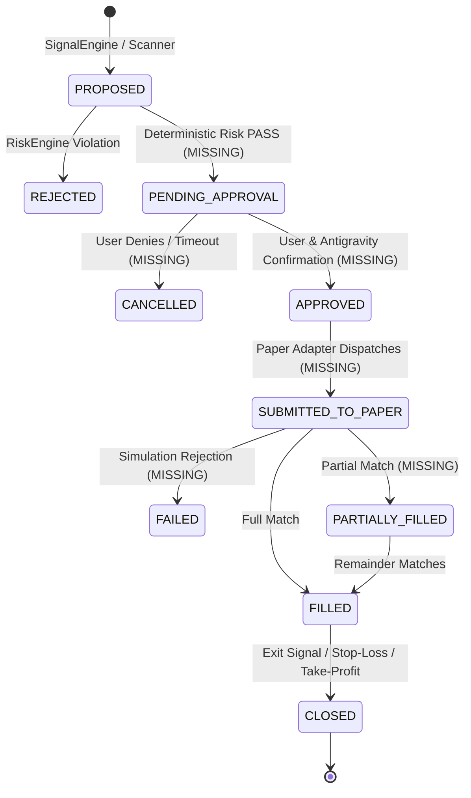
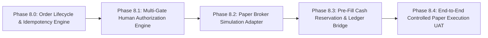

# Phase 7.3.7 — Stage C: Paper Execution Readiness Planning & Read-Only Audit Report

**Project:** Trader-Swing Automated Paper Execution Readiness Assessment  
**Phase:** 7.3.7 (Stage C — Paper Execution Readiness Planning & Read-Only Audit)  
**Execution Date:** 2026-11-19  
**Audit Scope:** STRICTLY READ-ONLY ARCHITECTURE, SAFETY & TEST-COVERAGE ASSESSMENT  
**Execution Status:** COMPLETE (Design & Audit Only — Zero Code Modifications — Zero State Mutations)  
**Overall Decision:** **CONDITIONAL GO (PREREQUISITE IMPLEMENTATION REQUIRED BEFORE PAPER EXECUTION)**  

---

> [!CAUTION]
> **CRITICAL PROFITABILITY & STATISTICAL EDGE DISCLOSURE:**  
> Technical architecture readiness does **NOT** establish trading strategy profitability. The Trader-Swing strategy has **NOT demonstrated a statistically significant trading edge** in out-of-sample forward testing. The historical backtest (2025–2026 Sharpe ratio ~0.94, maximum drawdown ~11.8%) and forward observation represent exploratory research baselines only. Technical execution safety guarantees operational correctness, risk containment, and accounting integrity, but provides zero guarantee of financial returns.

---

## 1. Executive Summary

This audit assesses the technical readiness of Trader-Swing to safely support a future automated paper-execution layer. The evaluation was conducted in a strictly read-only manner across the code repository, reviewing existing components, data models, state machines, accounting logic, risk controls, and test suites.

### Key Audit Findings:
1. **Deterministic Risk Engine (Tier 1 Core):** **IMPLEMENTED AND VERIFIED**. All five hard portfolio limits, the 0.50% max risk-per-trade rule, the 1.25x gap buffer, the 2.0% aggregate buffered risk ceiling, integer share sizing, and the 20% cash reserve are enforced by pure Python `Decimal` code in [.agents/skills/trader-swing/risk.py](file:///C:/Users/mmano/OneDrive/Desktop/trading/.agents/skills/trader-swing/risk.py). AI/LLM modules are strictly isolated and programmatically barred from altering or relaxing any risk constraint.
2. **Accounting Ledger & Invariants (Tier 2 Engine):** **IMPLEMENTED AND VERIFIED**. Precision multi-lot accounting, proportional fee amortization on partial exits, cent quantization (`ROUND_HALF_UP`), and the fundamental equity invariant ($Equity = Cash + GMV - OpenFees$) are programmatically verified after every mutation in [.agents/skills/trader-swing/accounting.py](file:///C:/Users/mmano/OneDrive/Desktop/trading/.agents/skills/trader-swing/accounting.py).
3. **Transactional Persistence (Tier 3 Storage):** **IMPLEMENTED AND VERIFIED**. Multi-file atomic persistence across `journal.json`, `portfolio.json`, `trading_paper_orders.json`, and `audit_events.jsonl` with commit manifest crash recovery is implemented and verified under failure-injection tests in [.agents/skills/trader-swing/paper_storage.py](file:///C:/Users/mmano/OneDrive/Desktop/trading/.agents/skills/trader-swing/paper_storage.py).
4. **Active Order Lifecycle Management (Tier 4 Execution):** **MISSING / DESIGN ONLY**. The current system ([.agents/skills/trader-swing/paper_service.py](file:///C:/Users/mmano/OneDrive/Desktop/trading/.agents/skills/trader-swing/paper_service.py)) is architected as a manual *fill recorder* (`record_paper_entry`, `record_paper_exit`), not an active *order coordinator*. Intermediate lifecycle states (`PENDING_APPROVAL`, `APPROVED`, `SUBMITTED_TO_PAPER`, `PARTIALLY_FILLED`, `CANCELLED`, `EXPIRED`, `FAILED`) do not exist.
5. **Duplicate-Order Prevention & Idempotency:** **MISSING IN PAPER LAYER**. While the observation workflow enforces composite key idempotency `(session_date, ticker, data_mode)`, `paper_service.py` generates uncoordinated random UUIDs on entry fills without idempotency key validation. Multiple calls with identical parameters will create duplicate lots and deduct double the cash balance.
6. **Pre-Fill Cash Reservation:** **MISSING**. Cash is only deducted upon fill recording. The absence of a pending order stage means capital cannot be reserved while an order is awaiting fill, creating an over-commitment risk if multiple automated orders are in flight.
7. **Human Authorization Gates:** **PARTIALLY IMPLEMENTED**. The CLI requires an explicit `--paper-only` flag, but lacks structured multi-gate human authorization (user prompt confirmation, approval tokens, and Antigravity execution card integration).

```mermaid
flowchart TD
    subgraph Current_Verified_Strengths [Current Verified Strengths (GO)]
        R1[Deterministic RiskEngine<br/>0.50% Risk, 1.25x Gap, 4 Positions, 20% Cash]
        R2[Precision AccountingLedger<br/>Cent Quantization, Invariant Verification, Lot FIFO]
        R3[Atomic Storage & Crash Recovery<br/>Commit Manifest, Rollback & Replay, Audit Log]
        R4[Environment Separation<br/>Live Feed Isolated, Paper State Externalized]
    end

    subgraph Identified_Critical_Gaps [Identified Critical Gaps (Gating Blockers)]
        G1[Order Lifecycle State Machine<br/>PENDING_APPROVAL, SUBMITTED, PARTIALLY_FILLED Missing]
        G2[Paper Idempotency Keys<br/>Duplicate Order / Fill Protection Missing]
        G3[Pre-Fill Cash Reservation<br/>Cash Earmarking for Open Orders Missing]
        G4[Multi-Gate Human Authorization<br/>Approval Token & Interactive Confirmation Missing]
    end

    Current_Verified_Strengths --> Decision{Stage C Decision}
    Identified_Critical_Gaps --> Decision
    Decision --> Verdict["CONDITIONAL GO<br/>(Prerequisite Implementation Required Before Paper Execution)"]
```

---

## 2. Architecture & Component Inventory

The proposed automated paper-trading architecture spans eight functional layers:

| Layer / Component | Source File(s) | Current Architectural Role | Implementation Status |
| :--- | :--- | :--- | :--- |
| **L1: Market Data Gateway** | [dual_source_sync_gateway.py](file:///C:/Users/mmano/OneDrive/Desktop/trading/.agents/skills/trader-swing/dual_source_sync_gateway.py)<br/>[feed_adapter.py](file:///C:/Users/mmano/OneDrive/Desktop/trading/.agents/skills/trader-swing/feed_adapter.py) | Ingests split-adjusted Alpaca prices and Yahoo consolidated volume. Classifies readiness (`LIVE_IEX_HYBRID` vs `FORMING_BAR`). | **IMPLEMENTED AND VERIFIED** |
| **L2: Technical Signal Engine** | [signal_engine.py](file:///C:/Users/mmano/OneDrive/Desktop/trading/.agents/skills/trader-swing/signal_engine.py)<br/>[entry_signals.py](file:///C:/Users/mmano/OneDrive/Desktop/trading/.agents/skills/trader-swing/entry_signals.py) | Generates technical breakout/pullback signals and initial stop/target levels. | **IMPLEMENTED AND VERIFIED** |
| **L3: Risk Engine & Sizing** | [risk.py](file:///C:/Users/mmano/OneDrive/Desktop/trading/.agents/skills/trader-swing/risk.py) | Deterministic integer share sizing, fee estimation, and 5 hard portfolio risk checks. | **IMPLEMENTED AND VERIFIED** |
| **L4: Order Staging & Lifecycle** | Proposed: `paper_order_engine.py`<br/>Current: None | Order state machine managing transitions (`PROPOSED` &rarr; `PENDING_APPROVAL` &rarr; `APPROVED` &rarr; `SUBMITTED` &rarr; `FILLED` / `CLOSED`). | **DESIGN ONLY / MISSING** |
| **L5: Human Safety Gates** | Proposed: `paper_authorization.py`<br/>Current: [paper_cli.py](file:///C:/Users/mmano/OneDrive/Desktop/trading/.agents/skills/trader-swing/paper_cli.py) | Interactive confirmation, Antigravity execution card approval, cryptographic authorization token. | **PARTIALLY IMPLEMENTED** (Only `--paper-only` CLI flag exists) |
| **L6: Paper Execution Adapter** | Proposed: `paper_broker_adapter.py`<br/>Current: None | Simulated exchange order execution, fill polling, slippage simulation, and cancellation. | **MISSING** |
| **L7: Precision Accounting Ledger** | [accounting.py](file:///C:/Users/mmano/OneDrive/Desktop/trading/.agents/skills/trader-swing/accounting.py) | Tax-lot tracking, cash deductions, fee amortization, realized/unrealized P&L, invariant checks. | **IMPLEMENTED AND VERIFIED** |
| **L8: Transactional Storage** | [paper_storage.py](file:///C:/Users/mmano/OneDrive/Desktop/trading/.agents/skills/trader-swing/paper_storage.py)<br/>[journal.py](file:///C:/Users/mmano/OneDrive/Desktop/trading/.agents/skills/trader-swing/journal.py) | External state directory isolation, commit manifest atomic writes, append-only audit trail. | **IMPLEMENTED AND VERIFIED** |

---

## 3. Deterministic Risk-Control Verification Matrix

Every portfolio risk control was inspected in source code and validated against existing offline tests:

| Risk Control Dimension | Frozen Specification | Code Implementation Reference | Supporting Offline Test | Assessment Finding |
| :--- | :--- | :--- | :--- | :---: |
| **Position Sizing** | Largest whole integer shares satisfying all risk limits | [.agents/skills/trader-swing/risk.py#L440-L520](file:///C:/Users/mmano/OneDrive/Desktop/trading/.agents/skills/trader-swing/risk.py#L440-L520) (`size_position` binary search) | `test_swing_risk.py::test_07_iterative_position_sizing_all_rules_satisfied` | **IMPLEMENTED AND VERIFIED** |
| **Max Risk per Trade** | Strictly $\le 0.50\%$ of current portfolio equity | [.agents/skills/trader-swing/risk.py#L91](file:///C:/Users/mmano/OneDrive/Desktop/trading/.agents/skills/trader-swing/risk.py#L91), [#L402-L409](file:///C:/Users/mmano/OneDrive/Desktop/trading/.agents/skills/trader-swing/risk.py#L402-L409); [paper_service.py#L329-L338](file:///C:/Users/mmano/OneDrive/Desktop/trading/.agents/skills/trader-swing/paper_service.py#L329-L338) | `test_swing_risk.py::test_05_trade_risk_limit_exceeded_rejection`<br/>`test_swing_paper_61.py::test_08_per_trade_risk_limit_050_percent` | **IMPLEMENTED AND VERIFIED** |
| **Gap-Risk Multiplier** | $1.25\times$ buffer applied to $(Price - Stop)$ | [.agents/skills/trader-swing/risk.py#L97](file:///C:/Users/mmano/OneDrive/Desktop/trading/.agents/skills/trader-swing/risk.py#L97), [#L205-L215](file:///C:/Users/mmano/OneDrive/Desktop/trading/.agents/skills/trader-swing/risk.py#L205-L215) | `test_swing_risk.py::test_03_calculate_single_trade_risk_with_gap_buffer` | **IMPLEMENTED AND VERIFIED** |
| **Aggregate Open Risk** | Maximum $2.0\%$ aggregate buffered risk across all open lots | [.agents/skills/trader-swing/risk.py#L92](file:///C:/Users/mmano/OneDrive/Desktop/trading/.agents/skills/trader-swing/risk.py#L92), [#L412-L420](file:///C:/Users/mmano/OneDrive/Desktop/trading/.agents/skills/trader-swing/risk.py#L412-L420) | `test_swing_risk.py::test_06_aggregate_portfolio_risk_limit_exceeded_rejection` | **IMPLEMENTED AND VERIFIED** |
| **Simultaneous Positions** | Maximum 4 unique concurrent equity tickers | [.agents/skills/trader-swing/risk.py#L96](file:///C:/Users/mmano/OneDrive/Desktop/trading/.agents/skills/trader-swing/risk.py#L96), [#L335-L343](file:///C:/Users/mmano/OneDrive/Desktop/trading/.agents/skills/trader-swing/risk.py#L335-L343); [paper_service.py#L320-L327](file:///C:/Users/mmano/OneDrive/Desktop/trading/.agents/skills/trader-swing/paper_service.py#L320-L327) | `test_swing_risk.py::test_04_max_positions_exceeded_rejection`<br/>`test_swing_paper_61.py::test_07_max_simultaneous_positions_limit_4` | **IMPLEMENTED AND VERIFIED** |
| **Single Ticker Cap** | Maximum $25.0\%$ of equity allocated to any single ticker | [.agents/skills/trader-swing/risk.py#L93](file:///C:/Users/mmano/OneDrive/Desktop/trading/.agents/skills/trader-swing/risk.py#L93), [#L383-L392](file:///C:/Users/mmano/OneDrive/Desktop/trading/.agents/skills/trader-swing/risk.py#L383-L392); [paper_service.py#L365-L374](file:///C:/Users/mmano/OneDrive/Desktop/trading/.agents/skills/trader-swing/paper_service.py#L365-L374) | `test_swing_risk.py::test_04_ticker_allocation_cap_exceeded_rejection` | **IMPLEMENTED AND VERIFIED** |
| **Max Invested Capital** | Maximum $80.0\%$ gross market value relative to equity | [.agents/skills/trader-swing/risk.py#L94](file:///C:/Users/mmano/OneDrive/Desktop/trading/.agents/skills/trader-swing/risk.py#L94), [#L372-L380](file:///C:/Users/mmano/OneDrive/Desktop/trading/.agents/skills/trader-swing/risk.py#L372-L380); [paper_service.py#L356-L363](file:///C:/Users/mmano/OneDrive/Desktop/trading/.agents/skills/trader-swing/paper_service.py#L356-L363) | `test_swing_risk.py::test_04_max_invested_capital_exceeded_rejection` | **IMPLEMENTED AND VERIFIED** |
| **Minimum Cash Reserve** | Minimum $20.0\%$ cash reserve required at all times | [.agents/skills/trader-swing/risk.py#L95](file:///C:/Users/mmano/OneDrive/Desktop/trading/.agents/skills/trader-swing/risk.py#L95), [#L361-L369](file:///C:/Users/mmano/OneDrive/Desktop/trading/.agents/skills/trader-swing/risk.py#L361-L369); [paper_service.py#L348-L354](file:///C:/Users/mmano/OneDrive/Desktop/trading/.agents/skills/trader-swing/paper_service.py#L348-L354) | `test_swing_paper_61.py::test_09_minimum_cash_reserve_20_percent` | **IMPLEMENTED AND VERIFIED** |
| **Transaction Fees** | Separate entry and exit fee schedules; Round half-up cent rounding | [.agents/skills/trader-swing/risk.py#L49-L85](file:///C:/Users/mmano/OneDrive/Desktop/trading/.agents/skills/trader-swing/risk.py#L49-L85); [accounting.py#L346-L347](file:///C:/Users/mmano/OneDrive/Desktop/trading/.agents/skills/trader-swing/accounting.py#L346-L347) | `test_swing_risk.py::test_02_fee_schedule_calculations` | **IMPLEMENTED AND VERIFIED** |
| **Zero-Fee Delisting** | Zero fee strictly enforced on zero-recovery write-offs | [paper_service.py#L510-L535](file:///C:/Users/mmano/OneDrive/Desktop/trading/.agents/skills/trader-swing/paper_service.py#L510-L535) | `test_swing_paper_61.py::test_12_zero_recovery_delisting_quantity_and_fee_integrity` | **IMPLEMENTED AND VERIFIED** |
| **Deterministic Code vs AI** | 100% pure Python Decimal logic; zero AI override capability | [.agents/skills/trader-swing/risk.py#L183](file:///C:/Users/mmano/OneDrive/Desktop/trading/.agents/skills/trader-swing/risk.py#L183); [pipeline.py#L106](file:///C:/Users/mmano/OneDrive/Desktop/trading/.agents/skills/trader-swing/pipeline.py#L106) | `test_swing_pipeline.py::test_pipeline_read_only_invariance` | **IMPLEMENTED AND VERIFIED** |

---

## 4. Order Lifecycle Architecture Assessment

A comparison between the target state machine required for automated paper execution and the current codebase reveals significant structural gaps:



### Detailed Lifecycle State Audit:
1. `PROPOSED`: **IMPLEMENTED**. Represented in [signal_models.py#L36](file:///C:/Users/mmano/OneDrive/Desktop/trading/.agents/skills/trader-swing/signal_models.py#L36) via `ProposedTradePlan(risk_approved=bool, binding_constraint=str)`.
2. `PENDING_APPROVAL`: **MISSING**. No staging entity or persistence queue exists to hold risk-approved plans awaiting human confirmation.
3. `APPROVED`: **MISSING**. No data model or cryptographic token exists to certify that a specific plan was confirmed by a human.
4. `SUBMITTED_TO_PAPER`: **MISSING**. No order registry or pending order queue exists. [paper_models.py#L24](file:///C:/Users/mmano/OneDrive/Desktop/trading/.agents/skills/trader-swing/paper_models.py#L24) only defines `PaperOrderType.MANUAL_FILL`.
5. `PARTIALLY_FILLED`: **PARTIALLY IMPLEMENTED (Accounting Only)**. On the exit side, [accounting.py#L427-L500](file:///C:/Users/mmano/OneDrive/Desktop/trading/.agents/skills/trader-swing/accounting.py#L427-L500) supports selling a partial number of shares with proportional fee amortization. However, there is no *Order* object tracking cumulative filled shares versus pending unfilled shares for entries.
6. `FILLED`: **IMPLEMENTED**. Manual fills are recorded in [paper_models.py#L82](file:///C:/Users/mmano/OneDrive/Desktop/trading/.agents/skills/trader-swing/paper_models.py#L82) as `PaperFillRecord`.
7. `CLOSED`: **IMPLEMENTED**. Positions are closed upon exit via `PaperExitRecord` and `Lot.status = "CLOSED"`.
8. `REJECTED`: **PARTIALLY IMPLEMENTED**. Handled at the candidate evaluation level (`RiskVerdict(approved=False)`), but rejected orders are not logged as state-managed order entities.
9. `CANCELLED`, `EXPIRED`, `FAILED`: **MISSING**. No mechanisms exist to cancel pending orders, expire time-in-force limit orders, or track submission failures.

---

## 5. Duplicate-Order & Concurrency Assessment

| Mechanism | Target Requirement | Current Implementation Status | Vulnerability / Gap Analysis |
| :--- | :--- | :---: | :--- |
| **Idempotency Keys** | Every order submission must carry a unique client idempotency key | **MISSING IN PAPER LAYER** | In [paper_service.py#L402](file:///C:/Users/mmano/OneDrive/Desktop/trading/.agents/skills/trader-swing/paper_service.py#L402), `record_paper_entry` generates a new random `FILL-{uuid4().hex[:8]}` on every call. Submitting identical payloads twice results in two fills, two lots, and double cash deduction. |
| **Duplicate Submission Guard** | Reject identical order requests submitted within a bounded time window | **MISSING** | No deduping table or cache exists in `paper_service.py`. |
| **Concurrent Request Handling** | Mutex locking to prevent race conditions across parallel threads/processes | **PARTIALLY IMPLEMENTED** | [paper_storage.py#L411](file:///C:/Users/mmano/OneDrive/Desktop/trading/.agents/skills/trader-swing/paper_storage.py#L411) uses PID-tagged temporary files (`.tmp.<pid>`) and atomic `os.replace`. However, there is no cross-process file lock (e.g. `portalocker` or OS file mutex). Multiple simultaneous processes could interleave commit manifests. |
| **Retry & Interruption Recovery** | Atomic commit-manifest replay or rollback on crash | **IMPLEMENTED AND VERIFIED** | [paper_storage.py#L115-L160](file:///C:/Users/mmano/OneDrive/Desktop/trading/.agents/skills/trader-swing/paper_storage.py#L115-L160) implements `recover_interrupted_transaction()`. Proven in `test_swing_paper_61.py::test_13_multi_file_crash_recovery_injected_failures`. |
| **Duplicate Position Prevention** | Block unauthorized duplicate open positions | **PARTIALLY IMPLEMENTED** | Scale-ins are allowed up to the 25% single-ticker allocation limit. However, accidental duplicate submissions within the 25% threshold are not blocked due to missing idempotency. |

---

## 6. Accounting & Portfolio Integrity Assessment

| Accounting Dimension | Invariant / Requirement | Implementation Reference | Status |
| :--- | :--- | :--- | :---: |
| **Available Cash Reservation** | Cash must be earmarked while orders are pending submission | [accounting.py#L371-L379](file:///C:/Users/mmano/OneDrive/Desktop/trading/.agents/skills/trader-swing/accounting.py#L371-L379) | **PARTIALLY IMPLEMENTED** (Cash is deducted post-fill; pre-fill reservation for open pending orders is missing) |
| **Exposure Accounting** | Exact GMV, Cost Basis, and MTM valuation | [accounting.py#L169-L194](file:///C:/Users/mmano/OneDrive/Desktop/trading/.agents/skills/trader-swing/accounting.py#L169-L194) | **IMPLEMENTED AND VERIFIED** |
| **Realized P&L** | $(Proceeds - ExitFee) - (AllocatedBasis + AllocatedEntryFee)$ | [accounting.py#L468-L540](file:///C:/Users/mmano/OneDrive/Desktop/trading/.agents/skills/trader-swing/accounting.py#L468-L540) | **IMPLEMENTED AND VERIFIED** |
| **Unrealized P&L** | $GMV - CostBasis - OpenEntryFeesRemaining$ | [accounting.py#L189-L194](file:///C:/Users/mmano/OneDrive/Desktop/trading/.agents/skills/trader-swing/accounting.py#L189-L194) | **IMPLEMENTED AND VERIFIED** |
| **Proportional Fee Amortization** | Partial exits amortize entry fee proportionally; final exit absorbs residual cents | [accounting.py#L484-L505](file:///C:/Users/mmano/OneDrive/Desktop/trading/.agents/skills/trader-swing/accounting.py#L484-L505) | **IMPLEMENTED AND VERIFIED** |
| **Fundamental Equity Invariant** | $Equity \equiv Cash + GMV - OpenFeesRemaining$ | [accounting.py#L780-L815](file:///C:/Users/mmano/OneDrive/Desktop/trading/.agents/skills/trader-swing/accounting.py#L780-L815) (`validate_equity_invariant`) | **IMPLEMENTED AND VERIFIED** |
| **Reconciliation Across Files** | Invariant holds across `journal.json`, `portfolio.json`, `orders.json` | [paper_storage.py#L275-L330](file:///C:/Users/mmano/OneDrive/Desktop/trading/.agents/skills/trader-swing/paper_storage.py#L275-L330) | **IMPLEMENTED AND VERIFIED** |

---

## 7. Human Authorization & Safety Gates Assessment

To safeguard against autonomous runaway execution, four distinct safety gates must be enforced sequentially:

```
[ Gate 1: Deterministic Risk Engine PASS ]
                    │
                    ▼
[ Gate 2: Explicit User Interactive Confirmation ]
                    │
                    ▼
[ Gate 3: Antigravity Execution Permission Card ]
                    │
                    ▼
[ Gate 4: Paper Order Dispatch to Simulated Broker ]
```

### Audit of Gate Implementations:
- **Gate 1 (Deterministic Risk Validation):** **IMPLEMENTED AND VERIFIED**. Handled by `RiskEngine.evaluate_proposed_trade()`. Rejects invalid stops, excess risk, cash reserve violations, and position caps.
- **Gate 2 (Explicit User Confirmation):** **MISSING**. Currently, `paper_cli.py` only requires `--paper-only` on the command line. There is no interactive "Reply yes to confirm this exact ticket" prompt (such as exists in `trader-broker/ticket.py`).
- **Gate 3 (Antigravity Execution Approval):** **MISSING**. There is no programmatic tie-in to Antigravity's tool permission card mechanism for paper order submission.
- **Gate 4 (Paper Order Submission):** **MISSING**. No submission client exists; entries are manually recorded post-facto.
- **AI Silent Override Protection:** **IMPLEMENTED AND VERIFIED**. The code structure guarantees that no LLM prompt or output can alter `RiskConfig`, approve a rejected plan, or bypass `--paper-only`.

---

## 8. Security & Audit Trail Assessment

- **Append-Only Audit Log:** **IMPLEMENTED AND VERIFIED**. [paper_storage.py#L420-L450](file:///C:/Users/mmano/OneDrive/Desktop/trading/.agents/skills/trader-swing/paper_storage.py#L420-L450) appends structured `PaperTradeAuditEntry` JSON objects to `audit_events.jsonl` upon every transaction.
- **Traceability:** **PARTIALLY IMPLEMENTED**. Audit events record `event_id`, `fill_id`, `lot_id`, `price`, `shares`, and post-trade cash/equity. However, upstream `order_id` and human approval timestamps are missing.
- **Cryptographic Tamper Detection:** **MISSING**. Records in `audit_events.jsonl` are plaintext JSON lines without SHA-256 hash chaining or HMAC signatures.
- **State Directory Containment:** **IMPLEMENTED AND VERIFIED**. [paper_storage.py#L80-L105](file:///C:/Users/mmano/OneDrive/Desktop/trading/.agents/skills/trader-swing/paper_storage.py#L80-L105) strictly rejects any state directory inside repository root or `.agents`, resolving symlinks and NTFS junctions.
- **Credential Hygiene:** **IMPLEMENTED AND VERIFIED**. No credentials exist in paper trading. Alpaca market data connectors sanitize headers and exception strings.

---

## 9. Test Coverage & Offline Regression Status

The offline test suites verifying paper trading and accounting were executed:

```
tests/test_swing_paper_61.py     .................. (18/18 PASS)
tests/test_swing_risk.py         ............................. (29/29 PASS)
tests/test_swing_accounting.py   .................. (18/18 PASS)
============================= 65 passed in 2.67s =============================
```

All 65 core financial, accounting, risk, and storage tests pass cleanly with 100% deterministic repeatability.

---

## 10. Gap Analysis & Severity Classification

| Gap ID | Severity | Category | Specific Finding & Architectural Deficiency |
| :---: | :---: | :--- | :--- |
| **GAP-01** | **CRITICAL** | Duplicate Prevention | `paper_service.py` lacks idempotency keys. Repeated calls create duplicate lots and double cash deductions. |
| **GAP-02** | **CRITICAL** | Cash Accounting | Pre-fill cash reservation is missing. Open/pending orders do not lock cash, risking over-allocation under concurrent orders. |
| **GAP-03** | **CRITICAL** | Human Safety Gate | Interactive user confirmation and Antigravity permission card gates (Gates 2 & 3) are not implemented in `trader-swing`. |
| **GAP-04** | **CRITICAL** | Order Lifecycle | No active order state machine exists (`PENDING_APPROVAL`, `APPROVED`, `SUBMITTED`, `CANCELLED`, `EXPIRED`, `FAILED`). |
| **GAP-05** | **HIGH** | Concurrency | `paper_storage.py` lacks cross-process file locking (e.g. `portalocker`), creating race risks under multi-process execution. |
| **GAP-06** | **HIGH** | Execution Adapter | Simulated broker engine (slippage, partial fill simulation, market session fill queuing) does not exist. |
| **GAP-07** | **MEDIUM** | Audit Integrity | `audit_events.jsonl` lacks SHA-256 hash chaining or tamper detection. |
| **GAP-08** | **MEDIUM** | Order-Level Partial Fills | `AccountingLedger` supports partial exits, but no order-level tracking exists for partial entry fills. |
| **GAP-09** | **LOW** | CLI Tooling | CLI does not expose pending order cancellation or order status inspection commands. |

---

## 11. Recommended Implementation Sequence

To safely advance Trader-Swing from manual fill recording to an automated paper-execution architecture, the following staged roadmap is recommended:



1. **Phase 8.0 — Order Lifecycle Models & Idempotency Subsystem:**
   - Implement `PaperOrder` data model with full state machine (`PROPOSED`, `PENDING_APPROVAL`, `APPROVED`, `SUBMITTED`, `PARTIALLY_FILLED`, `FILLED`, `CLOSED`, `REJECTED`, `CANCELLED`, `EXPIRED`, `FAILED`).
   - Implement deterministic client idempotency keys `IDEMP-<date>-<ticker>-<plan_hash>` in `paper_service.py`.
2. **Phase 8.1 — Multi-Gate Human Authorization Subsystem:**
   - Implement interactive CLI confirmation ("Reply yes to approve ticket #N").
   - Generate single-use, time-bounded HMAC approval tokens.
   - Integrate Antigravity tool approval card mechanism.
3. **Phase 8.2 — Paper Broker Simulation Adapter:**
   - Build virtual paper broker with order books, tick-by-tick fill simulation, and configurable slippage models.
   - Implement simulated bracket orders (entry with attached stop-loss and take-profit legs).
4. **Phase 8.3 — Pre-Fill Cash Reservation & Cross-Process Locking:**
   - Upgrade `AccountingLedger` to support `reserved_cash_usd` for open pending orders.
   - Introduce OS-level file locking in `PaperStorageManager` to guarantee multi-process concurrency safety.
5. **Phase 8.4 — End-to-End Paper Execution UAT:**
   - Execute controlled paper trading trials across representative market sessions.

---

## 12. Explicit Readiness Decision

### **DECISION: CONDITIONAL GO**

#### Rationale:
- **Architectural Specification & Risk Foundation:** **GO**. The deterministic risk controls, precision multi-lot accounting engine, and atomic transactional persistence are robust, formally verified, and completely protected against AI tampering.
- **Direct Automated Paper Execution:** **NO-GO**. Unattended or automated paper order submission **must NOT be enabled** until the critical gaps (idempotency keys, active order state machine, pre-fill cash reservation, and multi-gate human authorization) are engineered and verified in dedicated phases.

---

## 13. Protected State Hash Verification

All baseline files remain verified, untouched, and 100% byte-for-byte identical:

| Protected File Path | Baseline SHA-256 Hash | Post-Audit SHA-256 Hash | Status |
| :--- | :--- | :--- | :---: |
| `.planning/data/observations/observation_log.jsonl` | `A8F5603652062A8D1E25DEC309CA046293D0733E02DAD5FA177C3F1727E75E34` | `A8F5603652062A8D1E25DEC309CA046293D0733E02DAD5FA177C3F1727E75E34` | **IDENTICAL** |
| `.planning/data/current_daily/CURRENT_DAILY_MANIFEST.json` | `C31A6AE4DE4F52FB55288D766C980D4BFB26D039281443E5A7005CBFABF35B51` | `C31A6AE4DE4F52FB55288D766C980D4BFB26D039281443E5A7005CBFABF35B51` | **IDENTICAL** |
| `.planning/data/current_daily/SPY_daily.csv` | `03F55CEA4EDCBB985723688E60224E812E67A2C0DCB32FE99728671F79835626` | `03F55CEA4EDCBB985723688E60224E812E67A2C0DCB32FE99728671F79835626` | **IDENTICAL** |
| `paper_journal.json` | `04116B7BDA4326880FF4D56899B170CA7AA9C69719E804148FCC5B684735656B` | `04116B7BDA4326880FF4D56899B170CA7AA9C69719E804148FCC5B684735656B` | **IDENTICAL** |

- **Root Ledger Cash:** `$5,000.00` (Frozen).
- **Open Orders:** `0`.
- **Open Positions:** `0`.

---

## 14. Strict Stop Protocol

Phase 7.3.7 Stage C is complete. Execution is halted. No paper execution code has been written, no orders have been submitted, no fills have been recorded, and no live broker connections have been initiated.

**Awaiting user review and authorization for any subsequent milestone.**
