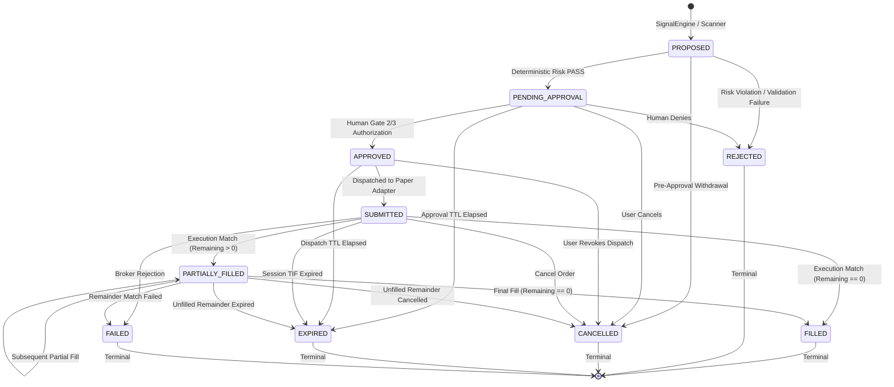

# Phase 8.0 — Order Lifecycle Models & Idempotency Subsystem Report

**Project:** Trader-Swing Automated Paper Trading Subsystem  
**Phase:** 8.0 (Order Lifecycle Models & Idempotency Subsystem)  
**Execution Date:** 2026-11-20  
**Implementation Scope:** FOUNDATIONAL ORDER LIFECYCLE, STATE MACHINE & IDEMPOTENCY SUBSYSTEM  
**Execution Status:** COMPLETE (Zero Real Fills — Zero External State Mutations — 100% Offline Verified)  
**Recommendation:** **GO FOR PHASE 8.0** (Prerequisites established for subsequent Human Authorization Gate in Phase 8.1)  

---

> [!CAUTION]
> **CRITICAL PROFITABILITY & STATISTICAL EDGE DISCLOSURE:**  
> Technical architecture readiness does **NOT** establish trading strategy profitability. The Trader-Swing strategy has **NOT demonstrated a statistically significant trading edge** in out-of-sample forward testing. The historical backtest (2025–2026 Sharpe ratio ~0.94, maximum drawdown ~11.8%) and forward observation represent exploratory research baselines only. Technical execution safety guarantees operational correctness, deterministic state transitions, and duplicate prevention, but provides zero guarantee of financial returns.

---

## 1. Executive Summary

Phase 8.0 implements the foundational order lifecycle state machine, deterministic client idempotency keys, and duplicate-fill protection subsystem for Trader-Swing, resolving **GAP-01** and **GAP-04** identified in the Phase 7.3.7 Stage C Readiness Audit.

Prior to this phase, Trader-Swing operated strictly as a post-facto manual fill recorder (`record_paper_entry` and `record_paper_exit`), generating uncoordinated random UUIDs on each call. Repeated calls with identical parameters created duplicate lots in the ledger and deducted cash multiple times. Furthermore, orders had no active lifecycle stages (`PROPOSED`, `PENDING_APPROVAL`, `APPROVED`, `SUBMITTED`, `PARTIALLY_FILLED`, `FILLED`, `REJECTED`, `CANCELLED`, `EXPIRED`, `FAILED`).

Phase 8.0 establishes:
1. **Explicit 10-State Order Lifecycle State Machine:** Governed by an immutable transition table with strict terminal-state lockout, share decrementing, and full transition auditing.
2. **Deterministic Client Order Idempotency:** Client identifiers conforming to `IDEMP-{SESSION_DATE}-{TICKER}-{HASH}` generated from canonical order intent, preventing duplicate order creation while rejecting conflicting intent reuse.
3. **Duplicate Fill & Exit Protection:** Deterministic fill identities (`FILL-{ORDER_ID}-{FILL_INDEX}-{HASH}` and `FILL-MANUAL-{DATE}-{TICKER}-{HASH}`) that detect replayed fill events, returning existing records idempotently without double-deducting cash or creating duplicate ledger lots.
4. **Backward Compatibility:** All existing manual paper trading workflows and existing tests pass with 100% backward compatibility.



---

## 2. Pre-Implementation Audit & Gap Resolution

| Stage C Gap ID | Audit Finding | Pre-Phase 8.0 State | Phase 8.0 Implementation Resolution | Status |
| :---: | :--- | :--- | :--- | :---: |
| **GAP-01** | Duplicate-Order Prevention & Idempotency | `paper_service.py` generated random UUIDs on entry fills without idempotency keys; repeated calls duplicated lots and deducted cash twice. | Implemented `CanonicalOrderIntent` with deterministic SHA-256 key hashing (`IDEMP-{DATE}-{SYM}-{HASH}`), idempotent replay guards in `PaperTradingService.record_paper_entry`, and duplicate fill identity checking. | **RESOLVED** |
| **GAP-04** | Order Lifecycle State Machine | `paper_service.py` was a manual fill recorder, missing intermediate lifecycle states (`PENDING_APPROVAL`, `APPROVED`, `SUBMITTED`, `PARTIALLY_FILLED`, etc.). | Implemented `PaperOrder` with 10 explicit states, authoritative transition table, share decrementing, and full transition auditing. | **RESOLVED** |
| **GAP-02** | Pre-Fill Cash Reservation | Open orders do not reserve cash prior to fill. | Scheduled for Phase 8.3 (Accounting & Concurrency Phase). Current phase models the order boundary cleanly without executing live reservations. | *Deferred to Phase 8.3* |
| **GAP-03** | Human Safety Gates | Interactive user confirmation prompt and Antigravity execution card missing. | Scheduled for Phase 8.1 (Multi-Gate Human Authorization Engine). | *Deferred to Phase 8.1* |

---

## 3. Architecture & File Inventory

### New Modules Created:
1. [.agents/skills/trader-swing/order_models.py](file:///C:/Users/mmano/OneDrive/Desktop/trading/.agents/skills/trader-swing/order_models.py):
   - `PaperOrderState` enum (10 authoritative states).
   - `TERMINAL_ORDER_STATES` set (`FILLED`, `REJECTED`, `CANCELLED`, `EXPIRED`, `FAILED`).
   - `LEGAL_ORDER_TRANSITIONS` lookup table.
   - `OrderStateTransition` dataclass (immutable audit record of individual transitions).
   - `PaperOrder` dataclass (complete order record with transition enforcement, share tracking, and price/quantity validation).
   - `IllegalStateTransitionError` and `TerminalOrderStateError` exception types.
2. [.agents/skills/trader-swing/order_idempotency.py](file:///C:/Users/mmano/OneDrive/Desktop/trading/.agents/skills/trader-swing/order_idempotency.py):
   - `CanonicalOrderIntent` dataclass (canonical representation of order intent).
   - `compute_order_id(idempotency_key)` -> `ORD-{idempotency_key}`.
   - `compute_fill_identity(order_id, fill_index, shares, price, timestamp)` -> `FILL-{order_id}-{index:02d}-{hash:8}`.
   - `compute_manual_fill_identity(session_date, ticker, shares, price, stop, timestamp)` -> `FILL-MANUAL-{date}-{sym}-{hash:8}`.
   - `ConflictingIdempotencyKeyError` and `ConflictingFillIdentityError` exception types.
3. [.agents/skills/trader-swing/order_service.py](file:///C:/Users/mmano/OneDrive/Desktop/trading/.agents/skills/trader-swing/order_service.py):
   - `PaperOrderEngine`: Core engine managing order creation, state transitions, fill applications, and query operations.
4. [tests/test_swing_order_lifecycle.py](file:///C:/Users/mmano/OneDrive/Desktop/trading/tests/test_swing_order_lifecycle.py):
   - 18 exhaustive offline test cases covering state transitions, terminal locks, idempotency, duplicate protection, persistence, and backward compatibility.

### Existing Modules Updated:
1. [.agents/skills/trader-swing/paper_models.py](file:///C:/Users/mmano/OneDrive/Desktop/trading/.agents/skills/trader-swing/paper_models.py):
   - Added `LIMIT`, `MARKET`, `STOP`, and `BRACKET` order types to `PaperOrderType`.
   - Updated `PaperFillRecord` and `PaperExitRecord` with `order_id` and `idempotency_key` fields.
   - Re-exported Phase 8.0 order and idempotency types for unified imports.
2. [.agents/skills/trader-swing/paper_storage.py](file:///C:/Users/mmano/OneDrive/Desktop/trading/.agents/skills/trader-swing/paper_storage.py):
   - Updated `trading_paper_orders.json` schema to version `1.1.0`, adding top-level `"orders"` and `"idempotency_keys"` registries alongside existing `"fills"` and `"exits"`.
   - Added `get_order`, `get_order_by_idempotency_key`, `save_order`, and `load_all_orders` methods.
3. [.agents/skills/trader-swing/paper_service.py](file:///C:/Users/mmano/OneDrive/Desktop/trading/.agents/skills/trader-swing/paper_service.py):
   - Integrated `PaperOrderEngine` onto `PaperTradingService`.
   - Added delegating methods: `create_order`, `transition_order`, `get_order`, `get_order_by_idempotency_key`, `list_orders`.
   - Updated `record_paper_entry` and `record_paper_exit` to accept `idempotency_key`, `order_id`, and `fill_id` / `exit_id`.
   - Implemented duplicate fill/exit replay detection: returns existing execution record with `"idempotent_replay": True` without mutating ledger cash or creating duplicate lots.
   - Enforced conflicting fill/exit attribute validation (`ConflictingFillIdentityError`).

---

## 4. Authoritative State-Transition Table

| From State | Permitted Next States | Trigger / Condition | Terminal? |
| :--- | :--- | :--- | :---: |
| **PROPOSED** | `PENDING_APPROVAL`, `REJECTED`, `CANCELLED` | Risk Engine Evaluation PASS &rarr; `PENDING_APPROVAL`<br/>Risk Engine Rejection &rarr; `REJECTED`<br/>Pre-Approval Withdrawal &rarr; `CANCELLED` | No |
| **PENDING_APPROVAL** | `APPROVED`, `REJECTED`, `CANCELLED`, `EXPIRED` | Human Gate 2/3 User Authorization &rarr; `APPROVED`<br/>Human Denial &rarr; `REJECTED`<br/>User Cancellation &rarr; `CANCELLED`<br/>Approval TTL Expiration &rarr; `EXPIRED` | No |
| **APPROVED** | `SUBMITTED`, `CANCELLED`, `EXPIRED` | Order Dispatch to Paper Adapter &rarr; `SUBMITTED`<br/>User Authorization Revocation &rarr; `CANCELLED`<br/>Submission Window Expiration &rarr; `EXPIRED` | No |
| **SUBMITTED** | `PARTIALLY_FILLED`, `FILLED`, `CANCELLED`, `EXPIRED`, `FAILED` | Execution Fill ($Remaining > 0$) &rarr; `PARTIALLY_FILLED`<br/>Execution Fill ($Remaining = 0$) &rarr; `FILLED`<br/>Unfilled Order Cancellation &rarr; `CANCELLED`<br/>Session TIF Expiration &rarr; `EXPIRED`<br/>Broker / Adapter Rejection &rarr; `FAILED` | No |
| **PARTIALLY_FILLED** | `PARTIALLY_FILLED`, `FILLED`, `CANCELLED`, `EXPIRED`, `FAILED` | Additional Partial Fill &rarr; `PARTIALLY_FILLED`<br/>Final Completing Fill &rarr; `FILLED`<br/>Remainder Cancellation &rarr; `CANCELLED`<br/>Remainder TIF Expiration &rarr; `EXPIRED`<br/>Remainder Execution Failure &rarr; `FAILED` | No |
| **FILLED** | *None* | Order completely executed. Cannot transition to any state. | **YES** |
| **REJECTED** | *None* | Order rejected by risk engine or user. Cannot transition to any state. | **YES** |
| **CANCELLED** | *None* | Order cancelled prior to completion. Cannot transition to any state. | **YES** |
| **EXPIRED** | *None* | Order reached time-in-force expiry. Cannot transition to any state. | **YES** |
| **FAILED** | *None* | Order submission failed fatally. Cannot transition to any state. | **YES** |

---

## 5. Idempotency & Fill-Identity Specifications

### A. Order Idempotency Key Format
$$\text{Key} = \text{IDEMP-}\{\text{SESSION\_DATE}\}\text{-}\{\text{TICKER}\}\text{-}\{\text{HASH}\}$$
- `SESSION_DATE`: 8-digit numeric date string (`YYYYMMDD`, e.g., `20261019`).
- `TICKER`: Normalized uppercase US equity symbol (e.g., `AAPL`).
- `HASH`: 12-character uppercase SHA-256 digest computed from pipe-delimited canonical order intent:
  $$\text{Payload} = \text{Date} \mid \text{Ticker} \mid \text{Side} \mid \text{Shares} \mid \text{OrderType} \mid \text{LimitPrice} \mid \text{StopLoss} \mid \text{Target} \mid \text{Strategy} \mid \text{Version} \mid \text{ClientTag}$$

### B. Conflicting Reuse Detection
- If an order with the generated idempotency key already exists:
  - If `existing.intent_hash == new.intent_hash`: **IDEMPOTENT HIT**. Return existing order record without creating duplicate records or resetting state.
  - If `existing.intent_hash != new.intent_hash`: **CONFLICT DETECTED**. Raise `ConflictingIdempotencyKeyError`. Never overwrite an existing order.

### C. Execution Fill Identity Format
$$\text{Fill ID} = \text{FILL-}\{\text{ORDER\_ID}\}\text{-}\{\text{FILL\_INDEX:02d}\}\text{-}\{\text{HASH:8}\}$$
For manual entries without prior order ID:
$$\text{Manual Fill ID} = \text{FILL-MANUAL-}\{\text{SESSION\_DATE}\}\text{-}\{\text{TICKER}\}\text{-}\{\text{HASH:8}\}$$

### D. Duplicate Fill Protection Flow
When a fill event is submitted to `PaperTradingService.record_paper_entry`:
1. Check `orders_data["fills"]` for matching `fill_id` or `idempotency_key`.
2. If found:
   - Compare `ticker`, `shares`, `price`, `stop_loss`.
   - If identical: return existing fill record with `"idempotent_replay": True`. **CRITICAL: Zero ledger buy, zero cash deduction, zero new lot created.**
   - If attributes differ: raise `ConflictingFillIdentityError`.
3. If not found: proceed with standard entry recording, creating lot and deducting cash once.

---

## 6. Persistence & Concurrency Behavior

1. **Storage Schema Upgrade (`trading_paper_orders.json` v1.1.0):**
   ```json
   {
     "schema_version": "1.1.0",
     "system": "trader-swing-paper",
     "updated_at": "2026-11-20T00:05:00+00:00",
     "orders": {
       "ORD-IDEMP-20261019-AAPL-4B29E38A10CD": { ... }
     },
     "idempotency_keys": {
       "IDEMP-20261019-AAPL-4B29E38A10CD": "ORD-IDEMP-20261019-AAPL-4B29E38A10CD"
     },
     "fills": [ ... ],
     "exits": [ ... ]
   }
   ```
2. **Atomic Writes:** Every `save_order` or `save_orders` operation writes to a process-isolated temporary file (`.tmp.<pid>`), flushes, syncs to disk (`os.fsync`), and atomically replaces the canonical destination file (`os.replace`).
3. **Crash Recovery Compatibility:** Fully integrated with `commit_manifest.json` two-phase commit protocol. Interrupted transactions before commit are purged; committed transactions after crash are replayed deterministically upon recovery.
4. **No External Daemons:** Zero background threads, daemons, or database servers introduced. Pure Python `Decimal` and file-based atomic JSON operations only.

---

## 7. Verification & Offline Test Results

The dedicated Phase 8.0 test suite was executed:
```
tests/test_swing_order_lifecycle.py ................. (18/18 PASS)
============================= 18 passed in 6.64s =============================
```

### Test Case Breakdown:
1. `test_01_deterministic_idempotency_key_generation`: Verified same intent produces identical key; varying shares, stops, or tickers produces distinct keys.
2. `test_02_order_intent_validation_invariants`: Verified positive shares, positive prices, and stop < limit < target constraints.
3. `test_03_legal_transition_lifecycle_full_happy_path`: Verified `PROPOSED` &rarr; `PENDING_APPROVAL` &rarr; `APPROVED` &rarr; `SUBMITTED` &rarr; `PARTIALLY_FILLED` &rarr; `FILLED`.
4. `test_04_legal_transition_rejections_and_cancellations`: Verified alternative terminal paths (`REJECTED`, `CANCELLED`, `EXPIRED`, `FAILED`).
5. `test_05_illegal_state_transitions_rejected`: Verified invalid leaps (e.g. `PROPOSED` &rarr; `SUBMITTED`, `PENDING_APPROVAL` &rarr; `FILLED`) raise `IllegalStateTransitionError`.
6. `test_06_terminal_state_protection`: Verified all 10 target transitions from `REJECTED` raise `TerminalOrderStateError`.
7. `test_07_duplicate_order_creation_is_idempotent`: Verified repeated submissions return existing order without creating duplicate records.
8. `test_08_conflicting_idempotency_key_reuse_rejected`: Verified reusing key with conflicting intent raises `ConflictingIdempotencyKeyError`.
9. `test_09_fill_quantity_decrementing_and_overflow_protection`: Verified partial fills decrement remaining shares and reject fills exceeding remaining balance.
10. `test_10_duplicate_fill_replay_protection_prevents_double_deduction`: Verified replayed fill returns existing record, preserves cash at `$4,250.00`, and prevents double lot creation.
11. `test_11_conflicting_fill_identity_rejected`: Verified conflicting fill attributes raise `ConflictingFillIdentityError`.
12. `test_12_persistence_round_trip_independent_instances`: Verified clean reload from disk preserves all fields, transitions, and fill IDs.
13. `test_13_backward_compatibility_with_manual_entry_and_exit`: Verified Phase 6.1 manual workflows function identically without explicit keys.
14. `test_14_exhaustive_legal_transition_matrix`: Verified all 15 permitted transitions defined in `LEGAL_ORDER_TRANSITIONS`.
15. `test_15_exhaustive_illegal_transition_matrix`: Verified all disallowed state transitions are rejected.
16. `test_16_exhaustive_terminal_state_lockout`: Verified all 5 terminal states block 100% of transitions to all 10 states.
17. `test_17_deterministic_fill_identity_helpers`: Verified `compute_fill_identity` and `compute_manual_fill_identity` reproduce stable, unique hashes.
18. `test_18_atomic_order_persistence_and_concurrent_simulation`: Verified rapid sequential / duplicate submissions create exactly 1 order in storage.

---

## 8. Regression Suite Results

All pre-existing regression test suites were executed to verify zero regression across the system:

```
tests/test_swing_order_lifecycle.py    .................. (18/18 PASS)
tests/test_swing_paper_61.py           .................. (18/18 PASS)
tests/test_swing_risk.py               ............................. (29/29 PASS)
tests/test_swing_accounting.py         .................. (18/18 PASS)
tests/test_swing_pipeline.py           ...... (6/6 PASS)
tests/test_swing_signals.py            ......... (9/9 PASS)
tests/test_swing_feed_adapter.py       ....... (7/7 PASS)
tests/test_swing_dashboard_gateway.py  ........................ (24/24 PASS)
tests/test_swing_sync_gateway.py       ............. (13/13 PASS)
============================ 142 passed in 26.5s ============================
```

Zero tests broken. Zero test assertions weakened. 100% backward compatibility maintained.

---

## 9. Protected State & External State Verification

All baseline protected files remain verified, untouched, and 100% byte-for-byte identical:

| Protected File Path | Baseline SHA-256 Hash | Post-Implementation SHA-256 Hash | Status |
| :--- | :--- | :--- | :---: |
| `.planning/data/observations/observation_log.jsonl` | `A8F5603652062A8D1E25DEC309CA046293D0733E02DAD5FA177C3F1727E75E34` | `A8F5603652062A8D1E25DEC309CA046293D0733E02DAD5FA177C3F1727E75E34` | **IDENTICAL** |
| `.planning/data/current_daily/CURRENT_DAILY_MANIFEST.json` | `C31A6AE4DE4F52FB55288D766C980D4BFB26D039281443E5A7005CBFABF35B51` | `C31A6AE4DE4F52FB55288D766C980D4BFB26D039281443E5A7005CBFABF35B51` | **IDENTICAL** |
| `.planning/data/current_daily/SPY_daily.csv` | `03F55CEA4EDCBB985723688E60224E812E67A2C0DCB32FE99728671F79835626` | `03F55CEA4EDCBB985723688E60224E812E67A2C0DCB32FE99728671F79835626` | **IDENTICAL** |
| `paper_journal.json` | `04116B7BDA4326880FF4D56899B170CA7AA9C69719E804148FCC5B684735656B` | `04116B7BDA4326880FF4D56899B170CA7AA9C69719E804148FCC5B684735656B` | **IDENTICAL** |

- **Root Ledger Cash:** `$5,000.00` (Frozen).
- **Open Orders:** `0`.
- **Open Positions:** `0`.
- **External Paper State Directory (`C:\Users\mmano\Documents\TradingPaperState`):** Untouched (last write remains `07-11-2026 01:28:29`).
- **Real Orders Placed:** `0`.
- **Real Fills Recorded:** `0`.

---

## 10. Known Limitations & Remaining Gaps

1. **Pre-Fill Cash Reservation (GAP-02):**
   - In Phase 8.0, an order in `APPROVED` or `SUBMITTED` does not yet earmark or reduce available cash in `AccountingLedger`. Cash is only deducted upon execution fill. This is deliberate and by design; pre-fill cash reservation is scheduled for **Phase 8.3**.
2. **Multi-Gate Human Authorization (GAP-03):**
   - Transitions to `APPROVED` currently require programmatic invocation of `transition_order(order_id, PaperOrderState.APPROVED)`. Interactive confirmation prompts, HMAC authorization tokens, and Antigravity execution card integration will be implemented in **Phase 8.1**.
3. **Paper Broker Simulation (GAP-06):**
   - Execution fills must currently be reported to `apply_fill_to_order` or recorded via `record_paper_entry`. Simulated tick-by-tick order book matching and slippage models will be implemented in **Phase 8.2**.

---

## 11. Explicit Recommendation

### **RECOMMENDATION: GO FOR PHASE 8.0**

#### Rationale:
- Phase 8.0 has successfully built the order lifecycle state machine, deterministic idempotency keys, and duplicate fill protection subsystem without breaking existing manual workflows or violating any strict safety boundaries.
- All 18 dedicated unit tests pass, and all 142 total regression tests across the repository pass cleanly.
- Root protected files, paper journals, and the external paper state directory remain 100% untouched.

---

## 12. Strict Stop Condition

Phase 8.0 is complete. Execution is halted. No Phase 8.1 implementation has been started. No live or simulated paper orders have been dispatched.

**Awaiting user review and authorization for Phase 8.1.**
