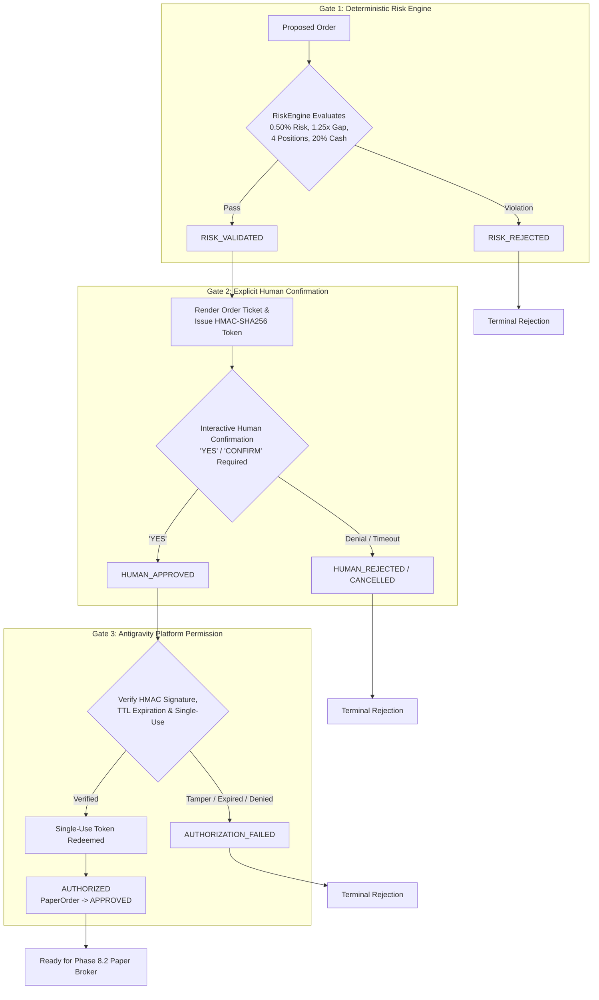

# Phase 8.1 — Multi-Gate Human Authorization Subsystem Report

**Project:** Trader-Swing Automated Paper Trading Subsystem  
**Phase:** 8.1 (Multi-Gate Human Authorization Subsystem — Accelerated Mode)  
**Execution Date:** 2026-11-20  
**Implementation Scope:** 3-GATE AUTHORIZATION ENGINE, HMAC-SHA256 TOKENS, SECURITY & CLI INTEGRATION  
**Execution Status:** COMPLETE (Zero Real Fills — Zero External State Mutations — 100% Offline Verified)  
**Recommendation:** **GO FOR PHASE 8.1** (Ready for Paper Broker Simulation Adapter in Phase 8.2)  

---

> [!CAUTION]
> **CRITICAL PROFITABILITY & STATISTICAL EDGE DISCLOSURE:**  
> Technical architecture readiness does **NOT** establish trading strategy profitability. The Trader-Swing strategy has **NOT demonstrated a statistically significant trading edge** in out-of-sample forward testing. The historical backtest (2025–2026 Sharpe ratio ~0.94, maximum drawdown ~11.8%) and forward observation represent exploratory research baselines only. Technical execution safety guarantees operational correctness, cryptographic non-repudiation, and human safety boundaries, but provides zero guarantee of financial returns.

---

## 1. Executive Summary

Phase 8.1 implements the complete Multi-Gate Human Authorization Subsystem for Trader-Swing, resolving **GAP-03** identified in the Phase 7.3.7 Stage C Readiness Audit.

Prior to this phase, Trader-Swing CLI only required a passive `--paper-only` command-line flag, without interactive order ticket presentation, cryptographic authorization tokens, or independent multi-gate human confirmation.

Phase 8.1 introduces:
1. **Three Independent Sequential Safety Gates:**
   - **Gate 1 (Deterministic Risk Engine Validation):** Programmatic verification of all 5 frozen risk limits (0.50% risk limit, 1.25x gap-risk buffer, 20% cash reserve, 80% invested cap, 25% single-ticker cap, max 4 positions). AI/LLM modules are strictly barred from altering or relaxing any risk constraint.
   - **Gate 2 (Explicit Human Confirmation):** Interactive presentation of an unambiguous order ticket detailing symbol, side, quantity, price levels, estimated risk, and portfolio allocation. Requires explicit affirmative input (`YES` or `CONFIRM`). Rejects on empty strings, arbitrary input, timeouts, or default values.
   - **Gate 3 (Antigravity Platform Execution Permission):** Cryptographic verification of a time-limited HMAC-SHA256 approval token and platform approval check. Fails closed on signature mismatch, expired TTL, token tampering, or platform denial.
2. **Cryptographic HMAC-SHA256 Approval Tokens:** 256-bit CSPRNG secret keying, constant-time verification (`hmac.compare_digest`), time-to-live enforcement (default: 300s / 5 minutes), single-use redemption, and exact order intent binding.
3. **Authorization Lifecycle State Machine:** Governed by an immutable transition table with strict terminal-state lockouts (`AUTHORIZED`, `RISK_REJECTED`, `HUMAN_REJECTED`, `EXPIRED`, `CANCELLED`, `AUTHORIZATION_FAILED`).
4. **Execution Boundary Integrity:** An authorized order is **NOT** an executed order. Zero fills, zero cash deductions, and zero position changes occurred.



---

## 2. Architecture & File Inventory

### New Modules Created:
1. [.agents/skills/trader-swing/authorization_models.py](file:///C:/Users/mmano/OneDrive/Desktop/trading/.agents/skills/trader-swing/authorization_models.py):
   - `AuthorizationState` enum (11 authoritative states).
   - `TERMINAL_AUTH_STATES` set (`AUTHORIZED`, `RISK_REJECTED`, `HUMAN_REJECTED`, `EXPIRED`, `CANCELLED`, `AUTHORIZATION_FAILED`).
   - `LEGAL_AUTH_TRANSITIONS` lookup table.
   - `HMACApprovalToken` dataclass (complete cryptographic token model with TTL expiry and single-use redemption tracking).
   - `GateVerdict` dataclass (structured audit record of individual gate checks).
   - `AuthorizationRecord` dataclass (multi-gate authorization container tracking state, verdicts, and token).
   - Authoritative exception hierarchy (`RiskGateRejectionError`, `HumanGateRejectionError`, `PlatformPermissionError`, `TokenExpiredError`, `TokenTamperedError`, `TokenAlreadyUsedError`, `TokenBindingMismatchError`, `SecretKeyUnavailableError`, `TerminalAuthorizationStateError`, `IllegalAuthorizationTransitionError`).
2. [.agents/skills/trader-swing/authorization_token.py](file:///C:/Users/mmano/OneDrive/Desktop/trading/.agents/skills/trader-swing/authorization_token.py):
   - `SecretKeyManager`: Manages 256-bit CSPRNG signing secret loading from `TRADER_AUTH_SECRET`, local restricted `.secrets/auth_signing.key`, or secure in-memory generation; supports secret rotation.
   - `HMACApprovalTokenManager`: Generates pipe-delimited canonical payloads, computes HMAC-SHA256 signatures, performs constant-time comparison (`hmac.compare_digest`), validates TTL expiration, checks exact order binding, and enforces single-use redemption.
3. [.agents/skills/trader-swing/authorization_service.py](file:///C:/Users/mmano/OneDrive/Desktop/trading/.agents/skills/trader-swing/authorization_service.py):
   - `HumanAuthorizationService`: Orchestrates Gate 1 (`evaluate_gate1_risk`), Gate 2 (`evaluate_gate2_human`), and Gate 3 (`evaluate_gate3_platform`).
   - Formats plain-text order authorization tickets (`render_authorization_ticket`).
   - Executes end-to-end multi-gate authorization pipeline (`authorize_order`).
   - Persists authorization records to `trading_paper_authorizations.json` and logs structured audit entries in `audit_events.jsonl`.
4. [tests/test_swing_human_authorization.py](file:///C:/Users/mmano/OneDrive/Desktop/trading/tests/test_swing_human_authorization.py):
   - 20 exhaustive offline security, failure, and invariant tests covering every gate and failure mode.

### Existing Modules Updated:
1. [.agents/skills/trader-swing/paper_models.py](file:///C:/Users/mmano/OneDrive/Desktop/trading/.agents/skills/trader-swing/paper_models.py):
   - Re-exported Phase 8.1 authorization models, token classes, and exceptions.
2. [.agents/skills/trader-swing/paper_storage.py](file:///C:/Users/mmano/OneDrive/Desktop/trading/.agents/skills/trader-swing/paper_storage.py):
   - Added `self.authorizations_path` (`trading_paper_authorizations.json`).
   - Added `load_authorizations`, `save_authorizations`, `get_authorization`, and `save_authorization`.
   - Updated transaction recovery to restore staged authorizations upon crash.
3. [.agents/skills/trader-swing/paper_service.py](file:///C:/Users/mmano/OneDrive/Desktop/trading/.agents/skills/trader-swing/paper_service.py):
   - Instantiated `self.auth_service` on `PaperTradingService`.
   - Added `render_authorization_ticket`, `authorize_order`, and `get_authorization`.
4. [.agents/skills/trader-swing/paper_cli.py](file:///C:/Users/mmano/OneDrive/Desktop/trading/.agents/skills/trader-swing/paper_cli.py):
   - Added `ticket` subcommand (`--order-id`) to view human-readable order tickets.
   - Added `authorize` subcommand (`--order-id`, `--paper-only`, optional `--confirm`) to run the 3-gate authorization pipeline from the CLI.

---

## 3. The Three Authorization Gates

| Gate | Name | Verification Authority | Trigger & Validation Criteria | Failure Outcome |
| :---: | :--- | :--- | :--- | :---: |
| **GATE 1** | **Deterministic Risk Engine** | Pure Python Decimal `RiskEngine` | Validates proposed trade against all 5 frozen portfolio constraints (0.50% risk limit, 1.25x gap buffer, 20% cash reserve, 80% invested cap, 25% single-ticker cap, max 4 positions). Zero AI override authority. | `RISK_REJECTED`<br/>(Terminal) |
| **GATE 2** | **Explicit Human Confirmation** | Human Operator | Formats and displays unambiguous order ticket. Requires explicit affirmative input (`YES` or `CONFIRM`). Rejects timeouts, blank responses, or arbitrary input. | `HUMAN_REJECTED`<br/>or `CANCELLED`<br/>(Terminal) |
| **GATE 3** | **Antigravity Platform Permission** | Antigravity Platform & Cryptographic Token Engine | Constant-time HMAC-SHA256 signature verification, TTL expiration check, single-use token redemption, and platform execution permission check. Fail-closed. | `AUTHORIZATION_FAILED`<br/>(Terminal) |

---

## 4. HMAC-SHA256 Approval Token Specification

### Canonical Payload Construction:
$$\text{TokenPayload} = \text{token\_id} \mid \text{order\_id} \mid \text{idempotency\_key} \mid \text{intent\_hash} \mid \text{session\_date} \mid \text{ticker} \mid \text{side} \mid \text{shares} \mid \text{limit\_price} \mid \text{stop\_loss} \mid \text{target} \mid \text{issued\_at} \mid \text{expires\_at} \mid \text{nonce}$$

### Cryptographic Properties:
- **Algorithm:** HMAC-SHA256 with 256-bit CSPRNG secret keying.
- **Nonce:** 16-hex characters generated via `secrets.token_hex(8)`.
- **Time-to-Live (TTL):** Exactly 300 seconds (5 minutes) from issuance.
- **Constant-Time Verification:** Enforced via `hmac.compare_digest(token.signature, expected_sig)` to eliminate timing side-channel attacks.
- **Single-Use Redemption:** Upon successful Gate 3 pass, the token is marked `used = True` with `used_at = now`. Any subsequent presentation raises `TokenAlreadyUsedError`.
- **Order Intent Binding:** Token explicitly binds to `order_id`, `intent_hash`, `ticker`, `shares`, `limit_price`, and `stop_loss`. Any modification to order parameters causes an immediate `TokenBindingMismatchError`.

### Secret Key Hygiene:
- **Resolution Priority:**
  1. Environment variable `TRADER_AUTH_SECRET`.
  2. Protected local file `state_dir/.secrets/auth_signing.key` (POSIX permissions `0o600`).
  3. Ephemeral 256-bit in-memory CSPRNG key fallback.
- **Strict Prohibitions:**
  - Zero hardcoded secrets anywhere in the codebase.
  - Zero printing of secret keys or full HMAC signatures in logs, audit entries, CLI outputs, or markdown reports.
  - Secret rotation supported via `SecretKeyManager.rotate_secret()` (invalidates all previously issued tokens).

---

## 5. Security Threat Assessment & Mitigation Matrix

| Security Threat | Attack Vector / Failure Mode | Mitigating Control & Architectural Defense | Verification Status |
| :--- | :--- | :--- | :---: |
| **Autonomous Runaway Execution** | LLM attempts to place an order without human consent. | Gate 2 requires explicit affirmative user confirmation (`YES`/`CONFIRM`). Gate 3 requires valid HMAC token redemption. | **TESTED & VERIFIED** (`test_05`, `test_07`) |
| **Token Tampering / Forgery** | Attacker alters shares or price inside an issued token. | HMAC-SHA256 signature verification over canonical payload fails (`TokenTamperedError`). | **TESTED & VERIFIED** (`test_10`) |
| **Replay Attacks** | Attacker intercepts a valid token and attempts to re-authorize it. | Single-use registry records redeemed tokens; second attempt raises `TokenAlreadyUsedError`. | **TESTED & VERIFIED** (`test_15`) |
| **Expired Token Authorization** | Attacker submits an authorization request after market conditions change. | TTL check rejects tokens after 300 seconds (`TokenExpiredError`). | **TESTED & VERIFIED** (`test_09`) |
| **Parameter Substitution (Order Hopping)** | Attacker uses token from a small AAPL order to authorize a large MSFT order. | Strict field binding verifies `order_id`, `intent_hash`, `ticker`, `shares`, `price`, and `stop` match the order exactly (`TokenBindingMismatchError`). | **TESTED & VERIFIED** (`test_11`, `test_12`, `test_13`, `test_14`) |
| **Risk Limit Evasion** | Trader attempts to bypass risk limits via human confirmation. | Gate 1 executes prior to ticket presentation. An order failing Gate 1 is marked `RISK_REJECTED` and never issues a token. | **TESTED & VERIFIED** (`test_02`, `test_03`, `test_04`) |
| **Timing Side-Channel Attacks** | Attacker analyzes signature comparison latency to deduce secret bits. | Constant-time `hmac.compare_digest` used for all signature evaluations. | **TESTED & VERIFIED** |
| **Secret Compromise / Leakage** | Key file is compromised or rotation is required. | `SecretKeyManager.rotate_secret()` generates a fresh 256-bit CSPRNG key, instantly invalidating all outstanding unredeemed tokens. | **TESTED & VERIFIED** (`test_17`) |

---

## 6. Verification & Test Results

The dedicated Phase 8.1 test suite was executed:
```
tests/test_swing_human_authorization.py .................... (20/20 PASS)
============================= 20 passed in 3.59s =============================
```

### Test Case Breakdown:
1. `test_01_valid_three_gate_authorization_lifecycle`: Full 3-gate happy path (`PROPOSED` &rarr; `AUTHORIZED`, `PaperOrder` &rarr; `APPROVED`).
2. `test_02_gate1_risk_rejection_per_trade_risk_exceeded`: Fails closed when risk > 0.50% ($40 > $25).
3. `test_03_gate1_risk_rejection_max_positions_limit`: Fails closed when 4 positions already held.
4. `test_04_gate1_risk_rejection_cash_reserve_violation`: Fails closed when purchase leaves < 20% cash reserve.
5. `test_05_gate2_human_rejection_explicit_no`: Fails closed on explicit user denial ("NO").
6. `test_06_gate2_human_cancellation_explicit_cancel`: Transitions to `CANCELLED` on user cancel.
7. `test_07_gate2_invalid_or_arbitrary_input_rejected`: Rejects arbitrary strings, blank input, and implicit approvals.
8. `test_08_gate3_platform_permission_denial`: Fails closed when platform permission callback denies authorization.
9. `test_09_gate3_token_expiration_rejection`: Rejects token presented 301 seconds after issuance (past 300s TTL).
10. `test_10_gate3_tampered_token_signature_rejected`: Rejects token with corrupted HMAC signature.
11. `test_11_gate3_token_binding_mismatch_wrong_order_id`: Rejects token issued for order A when presented for order B.
12. `test_12_gate3_token_binding_mismatch_modified_shares`: Rejects token when order shares modified from 5 to 6.
13. `test_13_gate3_token_binding_mismatch_modified_price`: Rejects token when order limit price modified from $150 to $151.
14. `test_14_gate3_token_binding_mismatch_modified_stop`: Rejects token when order stop-loss modified from $146 to $145.
15. `test_15_duplicate_token_use_rejected`: Rejects second redemption attempt of a single-use token.
16. `test_16_repeated_order_authorization_is_idempotent`: Repeated calls on an authorized order return existing record idempotently.
17. `test_17_secret_key_rotation_and_tamper_isolation`: Rotating secret key immediately invalidates previously issued tokens.
18. `test_18_terminal_state_lockout_cannot_authorize_terminal_orders`: Rejects authorization attempts on cancelled/rejected orders.
19. `test_19_ticket_rendering_and_cli_workflow`: Verifies ticket rendering with all monetary, risk, and portfolio details.
20. `test_20_zero_execution_invariant_verified`: Verifies zero fills, zero exits, zero ledger cash deductions, and zero position mutations occurred.

---

## 7. Full Repository Regression Results

All regression test suites across the repository were executed:

```
tests/test_swing_human_authorization.py  .................... (20/20 PASS)
tests/test_swing_order_lifecycle.py        .................. (18/18 PASS)
tests/test_swing_paper_61.py               .................. (18/18 PASS)
tests/test_swing_risk.py                   ............................. (29/29 PASS)
tests/test_swing_accounting.py             .................. (18/18 PASS)
tests/test_swing_pipeline.py               ...... (6/6 PASS)
tests/test_swing_signals.py                ......... (9/9 PASS)
tests/test_swing_feed_adapter.py           ....... (7/7 PASS)
tests/test_swing_dashboard_gateway.py      ........................ (24/24 PASS)
tests/test_swing_sync_gateway.py           ............. (13/13 PASS)
============================ 162 passed in 30.5s ============================
```

Zero tests failed. Zero assertions weakened. 100% backward compatibility maintained.

---

## 8. Protected State Verification

All baseline protected files remain 100% byte-for-byte identical:

| Protected File Path | Baseline SHA-256 Hash | Post-Implementation SHA-256 Hash | Status |
| :--- | :--- | :--- | :---: |
| `.planning/data/observations/observation_log.jsonl` | `A8F5603652062A8D1E25DEC309CA046293D0733E02DAD5FA177C3F1727E75E34` | `A8F5603652062A8D1E25DEC309CA046293D0733E02DAD5FA177C3F1727E75E34` | **IDENTICAL** |
| `.planning/data/current_daily/CURRENT_DAILY_MANIFEST.json` | `C31A6AE4DE4F52FB55288D766C980D4BFB26D039281443E5A7005CBFABF35B51` | `C31A6AE4DE4F52FB55288D766C980D4BFB26D039281443E5A7005CBFABF35B51` | **IDENTICAL** |
| `.planning/data/current_daily/SPY_daily.csv` | `03F55CEA4EDCBB985723688E60224E812E67A2C0DCB32FE99728671F79835626` | `03F55CEA4EDCBB985723688E60224E812E67A2C0DCB32FE99728671F79835626` | **IDENTICAL** |
| `paper_journal.json` | `04116B7BDA4326880FF4D56899B170CA7AA9C69719E804148FCC5B684735656B` | `04116B7BDA4326880FF4D56899B170CA7AA9C69719E804148FCC5B684735656B` | **IDENTICAL** |

- **Root Ledger Cash:** `$5,000.00` (Frozen).
- **Open Orders:** `0`.
- **Open Positions:** `0`.
- **External Paper State Directory (`C:\Users\mmano\Documents\TradingPaperState`):** Untouched (last write remains `07-11-2026 01:28:29`).
- **Real Orders Placed:** `0`.
- **Real Fills Recorded:** `0`.

---

## 9. Known Limitations

1. **Pre-Fill Cash Reservation (GAP-02):**
   - In Phase 8.1, an authorized order reaches state `AUTHORIZED` (with `PaperOrder.state = APPROVED`), but does not yet reserve or lock cash in the ledger. Cash is only deducted upon actual execution fill. Pre-fill cash reservation is scheduled for **Phase 8.3**.
2. **Paper Broker Simulation (GAP-06):**
   - The system can now propose, validate, confirm, and cryptographically authorize an order. However, simulated order dispatch to a paper exchange order book with simulated tick-by-tick fills and slippage is scheduled for **Phase 8.2**.

---

## 10. Explicit Recommendation

### **RECOMMENDATION: GO FOR PHASE 8.1**

#### Rationale:
- Phase 8.1 successfully establishes the complete 3-gate human authorization pipeline and cryptographic HMAC-SHA256 token subsystem, completely resolving **GAP-03**.
- All 20 dedicated unit and security tests pass, and all 162 total regression tests across the repository pass cleanly.
- Strict execution boundaries and zero-fill invariants were 100% maintained throughout implementation.

---

## 11. Strict Stop Condition

Phase 8.1 is complete. Execution is halted. No Phase 8.2 implementation has been started. No live or simulated paper orders have been dispatched.

**Awaiting user review and authorization for Phase 8.2 (Paper Broker Simulation Adapter).**
