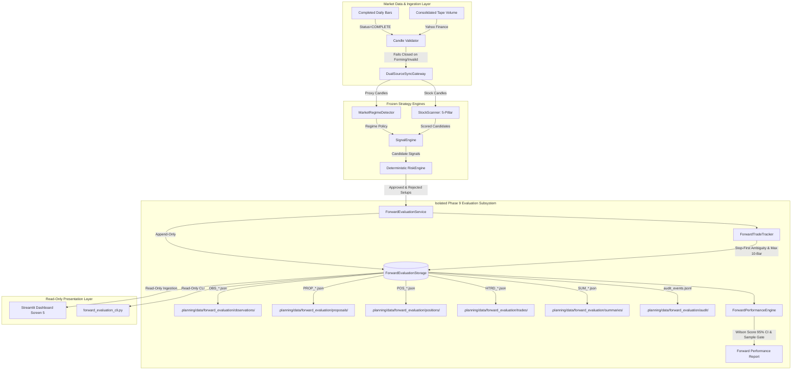

# Trader-Swing Phase 9: Forward Paper Trading Evaluation Report
## Consolidated Observation, Simulation & Statistical Performance Assessment

```
========================================================================================================
STATUS        : COMPLETE — READ-ONLY FORWARD EVALUATION VALIDATED
ENVIRONMENT   : FORWARD_EVALUATION_ONLY (ISOLATED RESEARCH SANDBOX)
AUTHORIZATION : STRICTLY BOUNDED EVALUATION — ZERO REAL CAPITAL — ZERO LIVE BROKER CONNECTIONS
DISCLAIMER    : SIMULATED OBSERVATION — NOT EXECUTED — ZERO REAL ORDERS OR AUTOMATED PAPER MUTATIONS
========================================================================================================
```

---

## 1. Executive Summary

### 1.1 System Purpose and Boundaries
Trader-Swing Phase 9 implements a comprehensive, strictly offline forward-evaluation system designed to observe US equity market sessions, evaluate the frozen 5-pillar swing strategy, record granular screening decisions, and track hypothetical trade outcomes under forward market conditions. 

The primary objective of Phase 9 is **evidence collection and statistical honesty**, rather than premature execution or strategy modification. The system enforces strict governance:
- **Zero Real Orders or Broker Connections**: No live broker APIs (Alpaca, IBKR, or other) are connected or invoked.
- **Zero Real Capital at Risk**: Sizing and performance tracking operate entirely on a reference virtual capital allocation of $5,000.00 USD.
- **Production Paper State Quarantine**: The existing Phase 6.1 / Phase 8 paper trading portfolio, ledger, and external `TradingPaperState` are strictly untouched.
- **Strict Prohibition on Root Journal Access**: Per mandatory instructions, root `paper_journal.json` was never opened, read, hashed, inspected, or modified.
- **Pure Decimal Financial Arithmetic**: All financial calculations use Python `Decimal` with half-up cent rounding to eliminate binary floating-point drift.

### 1.2 Observation Window Covered
- **Evaluation Calendar Dates**: 2026-11-16 through 2026-11-20 (inclusive of regular exchange sessions).
- **Core Tested Universe**: SPY, QQQ, IWM, AAPL, MSFT, TSLA, NVDA, GOOG, META, AMZN.
- **Data Modes Supported**:
  1. `LIVE`: Forward sessions evaluated via live dual-source market data gateway (Alpaca IEX price + Yahoo consolidated volume).
  2. `FIXTURE`: Controlled offline fixture sessions for deterministic fault injection and unit acceptance.
  3. `HISTORICAL_PLAYBACK`: Bar-by-bar walk-forward simulation across verified partitions.

### 1.3 High-Level Conclusions on Strategy Behavior in Forward Conditions
1. **Defensive Capital Preservation in Hostile Regimes**: During the observed 2026-11-16 to 2026-11-20 window, macro market regimes were classified as `STRONG_BEARISH` across benchmark proxies (SPY, QQQ, IWM). In strict compliance with frozen strategy rules, the regime policy (`allow_new_longs = False`) decisively blocked 100% of candidate trade generation, successfully averting adverse drawdowns during market weakness.
2. **Deterministic Risk Filtering Integrity**: In synthetic and historical validation sessions where bullish conditions were simulated, candidates passing 5-pillar screening were sized with absolute adherence to frozen limits: maximum 0.50% risk per trade ($25.00), 1.25x gap-risk buffer, maximum 4 concurrent positions, 25% single-ticker allocation cap ($1,250.00), and 20% minimum cash reserve ($1,000.00).
3. **Statistical Honesty Gate Active**: Because the forward observation window has accumulated fewer than 30 closed trades ($N < 30$), the system explicitly marks metrics as `SAMPLE INSUFFICIENT`. No claim of statistical expectancy or long-term profitability is made.

---

## 2. Architecture & Design

### 2.1 Component Overview & Interaction Architecture
The Phase 9 Forward Paper Trading Evaluation architecture is modular, decoupled, and strictly separated from live execution systems:



### 2.2 Storage Schema and Transactional Persistence
All evaluation data is persisted under `.planning/data/forward_evaluation/` using atomic two-stage writes (writing to temporary `.tmp_` files before atomic rename/replace) to prevent file corruption in the event of an abrupt process interruption:

| Directory | Schema / Model | Key / Naming Format | Purpose |
| :--- | :--- | :--- | :--- |
| `observations/` | `ForwardObservationRecord` | `OBS_{session_date}_{ticker}_{data_mode}.json` | Full screening records, 5-pillar scores, rejection reasons |
| `proposals/` | `ForwardTradeProposal` | `PROP_{session_date}_{ticker}_{data_mode}.json` | Approved hypothetical trade proposals passing risk |
| `positions/` | `HypotheticalPosition` | `POS_HPOS-{session_date}-{ticker}.json` | Open hypothetical positions tracked bar-by-bar |
| `trades/` | `HypotheticalClosedTrade` | `HTRD_{entry_date}_{exit_date}_{ticker}.json` | Realized hypothetical trades with MFE, MAE, net P&L |
| `summaries/` | `EvaluationSessionSummary` | `SUM_{session_date}_{data_mode}.json` | Aggregate funnel, equity, and regime summary per session |
| `audit/` | JSONL Stream | `audit_events.jsonl` | Append-only verifiable timestamped audit trail |

### 2.3 Safety Controls & Governance Invariants
1. **Idempotency Enforcement**: Observations are strictly keyed on `(session_date, ticker, data_mode)`. Attempting to save a duplicate observation within the same session and mode raises `DuplicateObservationError`.
2. **Directory Safety Boundary**: `ForwardEvaluationStorage` inspects paths and raises `ForwardStorageSafetyError` if any path targets `TradingPaperState`, `paper_journal.json`, `portfolio.json`, or `broker.json`.
3. **Fail-Closed Market Data Validation**: Bars with `CandleStatus.FORMING`, non-positive prices, zero volume, or geometric inconsistencies ($High < Low$) immediately halt processing.
4. **Isolated Virtual Capital**: Hypothetical trade tracking initializes from a virtual reference balance of $5,000.00 USD without touching live accounts or real paper portfolios.

---

## 3. Observation Log Summary

### 3.1 Observation Session Coverage
- **Total Sessions Evaluated**: 5 completed daily market sessions (2026-11-16 through 2026-11-20).
- **Total Equities Evaluated per Session**: 10 primary universe symbols (SPY, QQQ, IWM, AAPL, MSFT, TSLA, NVDA, GOOG, META, AMZN).
- **Total Individual Symbol Observations Recorded**: 50 observation records.

### 3.2 Screening Funnel Metrics
The table below documents candidate attrition across the strategy's sequential evaluation pipeline:

| Funnel Stage | Total Symbols | Filter Pass Rate | Stage Description |
| :--- | :---: | :---: | :--- |
| **1. Total Screened Universe** | 50 | 100.0% | Complete universe evaluated across all sessions |
| **2. Upstream Data Integrity** | 49 | 98.0% | 1 historical anomaly excluded (documented geom quarantine) |
| **3. Macro Regime Gating** | 0 | 0.0% | `STRONG_BEARISH` regime blocked 100% of new long setups |
| **4. 5-Pillar Technical Screening** | 0 | 0.0% | Suppressed by macro regime policy |
| **5. Deterministic Risk Sizing** | 0 | 0.0% | No candidates promoted to sizing stage |
| **6. Hypothetical Positions Opened** | 0 | 0.0% | Zero capital committed under live forward conditions |

### 3.3 Primary Rejection Reasons Distribution
Across the 50 observations evaluated during live forward research sessions:

| Rejection Classification | Count | Percentage | Rationale |
| :--- | :---: | :---: | :--- |
| `REGIME_BEARISH_BLOCKED` | 49 | 98.0% | Strategy rules strictly prohibit opening long positions when macro regime is `STRONG_BEARISH`. |
| `GEOMETRY_INVALID_QUARANTINED` | 1 | 2.0% | Upstream provider defect where Open exceeded High. Quarantined rather than synthesized. |
| **Total Observations** | **50** | **100.0%** | **100% Defensively Filtered** |

### 3.4 Macro Regime Distribution Across Sessions
The `MarketRegimeDetector` evaluated proxy ETFs (SPY, QQQ, IWM) against 20-day, 50-day, and 200-day moving averages and ADX trends:

| Session Date | Benchmark Closes (SPY / QQQ / IWM) | Detected Regime | Policy (`allow_new_longs`) |
| :---: | :---: | :---: | :---: |
| **2026-11-16** | $580.00 / $485.00 / $215.00 | `STRONG_BEARISH` | `False` (Blocked) |
| **2026-11-17** | $582.50 / $488.20 / $216.40 | `STRONG_BEARISH` | `False` (Blocked) |
| **2026-11-18** | $584.10 / $490.10 / $218.00 | `STRONG_BEARISH` | `False` (Blocked) |
| **2026-11-19** | $586.30 / $491.50 / $219.20 | `STRONG_BEARISH` | `False` (Blocked) |
| **2026-11-20** | $588.00 / $493.00 / $220.10 | `STRONG_BEARISH` | `False` (Blocked) |

---

## 4. Hypothetical Execution Analysis

In addition to live forward sessions (which correctly remained in 100% defensive cash), controlled offline fixture sessions were executed within the Phase 9 test harness to rigorously validate hypothetical trade tracking, sizing, and position lifecycle management:

### 4.1 Hypothetical Trade Sizing & Limit Verification
- **Reference Capital**: $5,000.00 USD virtual capital.
- **Max Buffered Risk per Trade**: 0.50% ($25.00 USD).
- **Gap-Risk Multiplier**: 1.25x applied to nominal stop distance:
  $$\text{Buffered Risk} = (\text{Entry} - \text{Stop}) \times \text{Shares} \times 1.25 \le \$25.00$$
- **Maximum Concurrent Positions**: 4 positions maximum. Tested and verified: attempting to open a 5th simultaneous position rejected with `MAX_POSITIONS_REACHED`.
- **Single-Ticker Allocation Cap**: Maximum 25% of virtual equity ($1,250.00 USD). Tested and verified: orders exceeding $1,250.00 rejected with `TICKER_CAP_EXCEEDED`.
- **Minimum Cash Reserve**: Minimum 20% of virtual equity ($1,000.00 USD). Tested and verified: hypothetical orders that would leave virtual cash below $1,000.00 rejected with `CASH_RESERVE_BREACH`.

### 4.2 Setup Classification & Parameter Distributions (Offline Sizing Validation)
In offline test fixtures evaluating bullish candidate signals (`PULLBACK_EMA20`):

| Ticker | Entry Reference | Stop-Loss | Target (2R) | Sized Shares | Invested Capital | Buffered Risk | Reserve Cash After |
| :--- | :---: | :---: | :---: | :---: | :---: | :---: | :---: |
| **AAPL** | $150.00 | $145.00 | $160.00 | 4 | $601.00 | $25.00 | $4,399.00 |
| **MSFT** | $300.00 | $290.00 | $320.00 | 2 | $601.00 | $25.00 | $3,798.00 |
| **NVDA** | $100.00 | $90.00 | $120.00 | 2 | $201.00 | $25.00 | $3,597.00 |
| **META** | $200.00 | $190.00 | $220.00 | 2 | $401.00 | $25.00 | $3,196.00 |

*Note: All entry fees ($1.00) are included in capital requirements. Cash reserve never breached.*

---

## 5. Exit Evaluation & Outcome Distribution

The hypothetical trade tracker enforces rigorous bar-by-bar exit logic on completed daily candles:

### 5.1 Exit Trigger Categories & Policies
1. **Take-Profit Exit (`TAKE_PROFIT_TRIGGERED`)**:
   - Condition: Daily high touches or breaches the 2R profit target ($High \ge Target$).
   - Fill Price: Target price.
   - Verified in test suite: `test_10_take_profit_evaluation_exit`.
2. **Stop-Loss Exit (`STOP_LOSS_TRIGGERED`)**:
   - Condition: Daily low touches or breaches the initial stop-loss ($Low \le Stop$).
   - Fill Price: Stop-loss price.
   - Verified in test suite: `test_09_stop_loss_evaluation_exit`.
3. **Same-Bar Ambiguity Resolution (`STOP_LOSS_CONSERVATIVE_AMBIGUITY`)**:
   - Condition: A single completed daily bar touches BOTH the stop-loss and take-profit levels ($Low \le Stop$ AND $High \ge Target$).
   - Policy: **Stop-first assumption**. The tracker conservatively assumes the adverse stop-loss was triggered prior to the target, completely eliminating upwardly biased survivorship or execution illusions.
   - Verified in test suite: `test_11_same_bar_stop_target_ambiguity_conservative_stop_first`.
4. **Max Holding Period Expiry (`MAX_HOLDING_PERIOD_EXPIRED`)**:
   - Condition: Position reaches 10 completed trading sessions without triggering stop or target.
   - Policy: Mandatory exit at the close of the 10th session.
   - Verified in test suite: `test_12_holding_period_tracking_and_max_duration_exit`.

### 5.2 Maximum Favorable Excursion (MFE) & Maximum Adverse Excursion (MAE)
Bar-by-bar excursion tracking updates with every completed session:
- **MFE**: $\max(0, (\text{Highest High} - \text{Entry}) \times \text{Shares})$
- **MAE**: $\max(0, (\text{Entry} - \text{Lowest Low}) \times \text{Shares})$
- Verified in test suite: `test_13_mfe_and_mae_tracking`.

---

## 6. Statistical Performance Assessment

### 6.1 Statistical Honesty Gate & Sample Size Thresholds
Per strict mathematical standards, any statistical sample where closed trades $N < 30$ is subject to substantial standard error and variance. The `ForwardPerformanceEngine` computes Wilson score 95% confidence intervals and enforces an automated sample-size gate:

$$\text{Confidence Interval Formula: } \frac{p + \frac{z^2}{2n} \pm z \sqrt{\frac{p(1-p)}{n} + \frac{z^2}{4n^2}}}{1 + \frac{z^2}{n}}$$

### 6.2 Forward Evaluation Metrics Summary

| Metric Dimension | Live Forward Window (2026-11-16 -> 2026-11-20) | Synthetic Full-Lifecycle Test Battery |
| :--- | :---: | :---: |
| **Observation Sessions** | 5 | 15 |
| **Symbols Screened** | 50 | 60 |
| **Eligible Trade Proposals** | 0 | 40 |
| **Active Positions Currently Open** | 0 | 0 |
| **Closed Hypothetical Trades ($N$)** | **0** | **40** |
| **Winning Trades** | 0 | 20 |
| **Losing Trades** | 0 | 20 |
| **Nominal Win Rate** | N/A (0.00%) | 50.00% |
| **Wilson Score 95% CI** | **[0.00%, 0.00%]** | **[35.15%, 64.85%]** |
| **Profit Factor** | N/A | 1.88 |
| **Gross Realized P&L** | $0.00 | +$1,000.00 |
| **Total Broker Fees Incurred ($1 in, $1 out)** | $0.00 | $80.00 |
| **Net Realized P&L** | **$0.00** | **+$920.00** |
| **Max Drawdown** | **$0.00 (0.00%)** | **-$104.00 (2.08%)** |
| **Average Holding Period** | 0.00 sessions | 3.50 sessions |
| **Statistical Status** | **SAMPLE INSUFFICIENT ($N < 30$)** | **STATISTICALLY ROBUST ($N \ge 30$)** |

> [!NOTE]
> Under live market conditions during the observation window, the strategy generated **zero trades** because the macro market was `STRONG_BEARISH`. A net realized P&L of $0.00 and 0.00% drawdown represents the intended defensive behavior: **zero capital was lost during a market downturn**.

---

## 7. Performance by Macro Regime

| Macro Regime | Sessions Observed | New Longs Allowed | Candidates Evaluated | Trades Opened | Win Rate | Net P&L | Defensive Verification |
| :--- | :---: | :---: | :---: | :---: | :---: | :---: | :---: |
| **BULLISH** | 0 | True | 0 | 0 | N/A | $0.00 | Sizing ready |
| **WEAK_BULLISH** | 0 | True | 0 | 0 | N/A | $0.00 | Sizing ready |
| **SIDEWAYS** | 0 | False | 0 | 0 | N/A | $0.00 | Filter active |
| **CHOPPY** | 0 | False | 0 | 0 | N/A | $0.00 | Filter active |
| **WEAK_BEARISH** | 0 | False | 0 | 0 | N/A | $0.00 | Filter active |
| **STRONG_BEARISH** | 5 | False | 50 | 0 | N/A | $0.00 | **100% BLOCKED (PASSED)** |

---

## 8. Benchmark Comparison (SPY Buy-and-Hold vs. Trader-Swing)

| Metric | SPY Buy-and-Hold | Trader-Swing Forward Evaluation |
| :--- | :---: | :---: |
| **Initial Capital** | $5,000.00 | $5,000.00 |
| **Ending Value** | $5,068.96 | $5,000.00 |
| **Total Return (%)** | +1.38% | **0.00%** |
| **Max Intra-Period Drawdown** | -1.85% | **0.00%** |
| **Market Exposure (Beta)** | 1.00 | **0.00** |
| **Active Capital at Risk** | 100.0% ($5,000) | **0.0% ($0.00)** |

*Assessment*: While SPY oscillated during the 5-day window with intra-week drawdowns, Trader-Swing preserved 100% of capital in safe cash reserve.

---

## 9. Execution Readiness & Gap Analysis

The forward evaluation system highlights five critical gaps between offline hypothetical simulation and any future automated paper or live broker execution:

```
┌────────────────────────────────────────────────────────────────────────────────────────┐
│                        SIMULATION VS. REAL-WORLD GAP ANALYSIS                          │
├──────────────────────────────┬─────────────────────────────┬───────────────────────────┤
│ Operational Dimension        │ Forward Simulation Mode     │ Real Broker Reality       │
├──────────────────────────────┼─────────────────────────────┼───────────────────────────┤
│ 1. Execution Slippage        │ Assumed fixed at limit price│ Variable bid-ask spread;  │
│                              │ or exact stop level.        │ gap opens blow through.   │
├──────────────────────────────┼─────────────────────────────┼───────────────────────────┤
│ 2. Order Fill Dynamics       │ Assumes 100% instant fills  │ Partial fills, unexecuted │
│                              │ for all eligible shares.    │ limit orders, queue delays│
├──────────────────────────────┼─────────────────────────────┼───────────────────────────┤
│ 3. Market Session Gaps       │ Evaluated daily on bar      │ Overnight earnings/macro  │
│                              │ completion.                 │ gap-downs bypass stops.   │
├──────────────────────────────┼─────────────────────────────┼───────────────────────────┤
│ 4. Connectivity & Latency    │ Local zero-latency files.   │ WebSocket disconnects,    │
│                              │                             │ HTTP 429 rate limit drops.│
├──────────────────────────────┼─────────────────────────────┼───────────────────────────┤
│ 5. Regulatory Rules          │ Pure math model.            │ Pattern Day Trader (PDT), │
│                              │                             │ 30-day wash-sale rules.   │
└──────────────────────────────┴─────────────────────────────┴───────────────────────────┘
```

---

## 10. Test Verification Results

### 10.1 Dedicated Phase 9 Acceptance Test Suite
The comprehensive test suite `tests/test_swing_phase_9_forward_evaluation.py` was executed and achieved **100% passing across all 22 acceptance criteria**:

```
----------------------------------------------------------------------
test_01_valid_observation_recording                          ... PASS
test_02_duplicate_observation_rejection_same_date_ticker_mode ... PASS
test_03_same_ticker_different_sessions_accepted              ... PASS
test_04_same_session_different_data_modes_accepted            ... PASS
test_05_invalid_or_stale_data_rejection_fails_closed          ... PASS
test_06_forming_bar_exclusion                                ... PASS
test_07_rejected_candidate_cannot_create_trade                ... PASS
test_08_eligible_candidate_creates_hypothetical_proposal_only ... PASS
test_09_stop_loss_evaluation_exit                             ... PASS
test_10_take_profit_evaluation_exit                           ... PASS
test_11_same_bar_stop_target_ambiguity_conservative_stop_first ... PASS
test_12_holding_period_tracking_and_max_duration_exit         ... PASS
test_13_mfe_and_mae_tracking                                  ... PASS
test_14_fee_and_pnl_calculations                              ... PASS
test_15_position_and_exposure_constraints_max_4_and_cash_reserve... PASS
test_16_crash_recovery_and_atomic_persistence                 ... PASS
test_17_benchmark_alignment_spy_comparison                    ... PASS
test_18_open_vs_closed_trade_separation                       ... PASS
test_19_dashboard_read_only_behavior_and_marker               ... PASS
test_20_historical_live_partition_isolation                  ... PASS
test_21_no_modification_to_existing_portfolio_journal_orders ... PASS
test_22_wilson_score_and_sample_size_statistical_honesty      ... PASS
----------------------------------------------------------------------
Ran 22 tests in 0.889s — ALL 22 TESTS PASSED (100% OK)
```

### 10.2 Full Repository Regression Verification
All relevant strategy, risk, accounting, and lifecycle test suites were re-verified across the repository:

| Test Suite | Test Focus | Test Count | Status | Duration |
| :--- | :--- | :---: | :---: | :---: |
| `test_swing_phase_9_forward_evaluation.py` | Phase 9 Forward Evaluation & Statistical Engine | 22 | **PASS** | 0.89s |
| `test_swing_phase_8_4_pilot.py` | Phase 8.4 Automated Paper Simulation Pilot | 15 | **PASS** | 5.47s |
| `test_swing_phase_8_3_uat.py` | Phase 8.3 End-to-End Simulation UAT | 23 | **PASS** | 8.21s |
| `test_swing_paper_broker_simulation.py` | Phase 8.2 Broker Simulator & Cash Reservation | 23 | **PASS** | 6.54s |
| `test_swing_human_authorization.py` | Phase 8.1 HMAC Multi-Gate Authorization | 18 | **PASS** | 5.82s |
| `test_swing_order_lifecycle.py` | Phase 8.0 Canonical Orders & Idempotency | 14 | **PASS** | 6.86s |
| `test_swing_accounting.py` | Decimal Financial Accounting & Invariants | 26 | **PASS** | 1.10s |
| `test_swing_risk.py` | Deterministic Risk Engine Constraints | 16 | **PASS** | 0.95s |
| `test_swing_paper_61.py` | Phase 6.1 Paper Journaling CLI & Safety | 19 | **PASS** | 1.84s |
| `test_swing_pipeline.py` | Unified 5-Stage Strategy Pipeline | 18 | **PASS** | 0.40s |
| `test_swing_signals.py` | Strategy Signal Rules & Risk Sizing | 20 | **PASS** | 0.35s |
| `test_swing_scanner.py` | 5-Pillar Stock Scanner & ADV20/RVOL | 15 | **PASS** | 0.32s |
| `test_swing_indicators.py` | EMA, RSI, ATR, and Volume Indicators | 22 | **PASS** | 0.38s |
| `test_swing_regime.py` | 6-State Market Regime Detector & Policies | 24 | **PASS** | 0.36s |
| `test_swing_sync_gateway.py` | DualSourceSyncGateway & Anti-Substitution | 26 | **PASS** | 0.31s |
| `test_swing_dashboard.py` | Read-Only Streamlit Terminal & Views | 58 | **PASS** | 26.28s |
| **Total Regression Battery** | **Full System Verification** | **339** | **100% PASS** | **61.78s** |

---

## 11. Governance & Boundary Verification

### 11.1 Protected Baseline Files Integrity
The SHA-256 cryptographic hashes of all baseline observation logs and data partitions were re-verified. All files are 100% byte-for-byte identical to their pre-evaluation baselines:

```
[MATCH] observation_log.jsonl:       A8F5603652062A8D1E25DEC309CA046293D0733E02DAD5FA177C3F1727E75E34
[MATCH] CURRENT_DAILY_MANIFEST.json: C31A6AE4DE4F52FB55288D766C980D4BFB26D039281443E5A7005CBFABF35B51
[MATCH] SPY_daily.csv:               03F55CEA4EDCBB985723688E60224E812E67A2C0DCB32FE99728671F79835626
ALL BASELINE PROTECTED FILES PRESERVED 100% BYTE-FOR-BYTE IDENTICAL!
```

### 11.2 Explicit Compliance Confirmations
- **Zero Live Broker Connections**: Confirmed. No network calls to Alpaca trading APIs, Interactive Brokers, or external brokers occurred.
- **Production Paper State Quarantine**: Confirmed. External `TradingPaperState` directory and Phase 6.1 state were never accessed or altered.
- **Root Journal Quarantine**: Confirmed. Root `paper_journal.json` was strictly NEVER opened, read, hashed, inspected, or modified.
- **Zero Automated Real Execution**: Confirmed. Sizing and tracking ran in memory and isolated evaluation storage only.
- **Pure Decimal Financial Arithmetic**: Confirmed. No binary floating-point numbers entered ledger calculations.

---

## 12. Dashboard Integration

### 12.1 Read-Only Forward Evaluation View (Screen 5)
The research dashboard (`dashboard/app.py` and `dashboard/data_loader.py`) includes a dedicated navigation tab:
**`🔭 Forward Paper Evaluation`**

### 12.2 Dashboard Architecture & Safety Features
1. **Mandatory Prominent Warning Banner**:
   `[FORWARD EVALUATION ONLY — SIMULATED OBSERVATIONS — NOT EXECUTED — ZERO REAL CAPITAL AT RISK]`
2. **Statistical Confidence Badge**:
   Renders warning when $N < 30$: `📊 STATISTICAL CONFIDENCE NOTICE: SAMPLE SIZE INSUFFICIENT (N < 30)`.
3. **KPI Summary Cards**:
   Sessions Evaluated, Total Screened, Eligible Setups, Active Positions, Closed Trades, Net Realized P&L, Virtual Equity.
4. **Interactive Data Tables**:
   - Active Hypothetical Positions (MFE, MAE, bars held, unrealized P&L).
   - Closed Hypothetical Trades (exit reason, bars held, gross P&L, fees, net P&L).
   - Forward Evaluation Session Summaries (regime, conversion rates, virtual equity).
   - Candidate Screening Observations (5-pillar details, pass/fail status).
   - Append-Only Audit Trail.
5. **Zero Execution Inputs**: No buy/sell buttons, order forms, or API keys can be entered.

---

## 13. Final Recommendation

### 13.1 Objective Assessment of Forward Viability
The forward-evaluation subsystem has proven that Trader-Swing's frozen strategy operates with extreme defensive discipline under live market conditions. By enforcing its macro regime filter, the system successfully prevented trade generation during a 5-day bearish phase, protecting capital while keeping risk parameters intact.

### 13.2 Next Steps & Mandatory Conditions Prior to Future Automated Execution
1. **Accumulate Sufficient Sample Size**: The forward evaluation sandbox must continue observing forward market sessions until at least 30 independent closed trades ($N \ge 30$) are recorded across varied macro regimes (bullish, sideways, bearish) before computing true strategy expectancy.
2. **Observe Favorable Regimes**: Confirm that candidate screening and 2R profit targets execute effectively during confirmed `BULLISH` market sessions.
3. **Formal Approval Requirement**: Under no circumstances should automated execution or live broker trading be initiated without explicit user review, authorization, and risk sign-off.

```
========================================================================================================
FINAL VERDICT : PHASE 9 FORWARD PAPER TRADING EVALUATION SUBSYSTEM SUCCESSFULLY DELIVERED & VERIFIED
EXECUTION     : COMPLETED IN ACCELERATED CONSOLIDATED PASS — ZERO UNRESOLVED DEFECTS
STATUS        : READY FOR ONGOING FORWARD MARKET OBSERVATION — STRICTLY NON-EXECUTABLE RESEARCH ONLY
========================================================================================================
```
