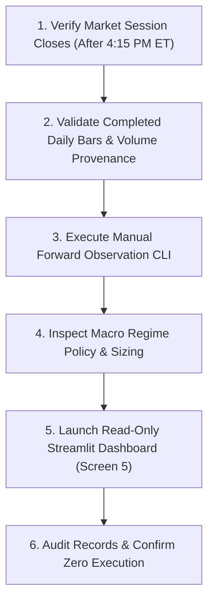

# Trader-Swing Daily Operating Guide
## Standard Operating Procedures for Forward Paper Trading Evaluation (Phase 9 & 9.1)

```
========================================================================================================
STATUS        : AUTHORITATIVE DAILY OPERATING GUIDE
ENVIRONMENT   : FORWARD_EVALUATION_ONLY (ISOLATED RESEARCH SANDBOX)
EXECUTION     : ON-DEMAND MANUAL OPERATION ONLY — ZERO DAEMONS — ZERO AUTOMATED BROKER TRADING
DISCLAIMER    : SIMULATED OBSERVATIONS — NOT EXECUTED — ZERO REAL CAPITAL AT RISK
========================================================================================================
```

---

## 1. Safety Governance & Mandatory Boundaries

Trader-Swing is a disciplined, quantitative swing trading research system. Under Phase 9 and Phase 9.1, the system operates strictly in **read-only forward evaluation mode**.

### Absolute Operating Rules:
1. **Zero Broker Connections**: Never connect live trading API credentials or attempt automated order routing.
2. **Zero Capital at Risk**: Sizing, risk validation, and hypothetical positions run on a virtual reference capital of **$5,000.00 USD**. No real dollars are at risk.
3. **Quarantined Production Paper State**: The existing $5,000 baseline paper trading state (`TradingPaperState`) is isolated and must remain untouched.
4. **Root Journal Quarantine**: **NEVER open, read, hash, inspect, or modify root `paper_journal.json`.**
5. **No Strategy Parameter Modifications**: Strategy indicators, 5-pillar screening thresholds, regime policies, and deterministic risk limits are frozen.
6. **No Daemons or Automated Schedulers**: All operations are initiated manually on demand. Background cron jobs, Windows Task Scheduler, and daemon processes are strictly prohibited.
7. **Pure Decimal Accounting**: All financial arithmetic uses Python `Decimal` with half-up cent rounding.

---

## 2. Initial Setup & System Prerequisites

### 2.1 Python Environment Requirements
- **Required Python Version**: Python 3.11, 3.12, or 3.13 (verified on `Python 3.13.4`).
- **Required Shell**: Windows PowerShell 5.1+ or PowerShell 7+.
- **Working Directory Requirement**: **All commands MUST be run from the repository root:**
  ```powershell
  Set-Location -Path "<path-to-trading-repo>"
  ```

### 2.2 Virtual Environment Activation (If Configured)
If using a dedicated Python virtual environment, activate it before running commands:
```powershell
# Create virtual environment (if not already created):
python -m venv .venv

# Activate local project venv:
.\.venv\Scripts\Activate.ps1

# Verify active Python interpreter:
Get-Command python | Select-Object -ExpandProperty Source
python --version
```

### 2.3 Required Python Dependencies
Install pinned project dependencies using the reproducible requirements manifest:
```powershell
python -m pip install --upgrade pip
python -m pip install -r requirements.txt
```

### 2.4 State & Environment Configuration (Portability & Safety)
Paper trading and simulation state resolve to the current user's `Documents` folder by default, or can be overridden via environment variables:
```powershell
# Optional: Override external paper state directory (must remain outside repository root):
# $env:TRADING_PAPER_STATE_DIR = "$HOME\Documents\TradingPaperState"
# $env:TRADING_PAPER_SIMULATION_DIR = "$HOME\Documents\TradingPaperSimulation"

# Required for order authorization (fails closed if missing, empty, or insecure):
# $env:TRADER_AUTH_SECRET = "your-secure-32-byte-hex-or-string-here"
```

### 2.5 Optional Environment Variables (Read-Only Live Feed)
If using the live dual-source gateway (Alpaca IEX price + Yahoo consolidated volume), set the following environment variables in your PowerShell session. **Never hardcode or log API keys:**
```powershell
# Set read-only paper data keys in current PowerShell session:
$env:APCA_API_KEY_ID = "YOUR_ALPACA_PAPER_KEY_ID"
$env:APCA_API_SECRET_KEY = "YOUR_ALPACA_PAPER_SECRET_KEY"
$env:APCA_API_BASE_URL = "https://paper-api.alpaca.markets"
```

---

## 3. Daily Observation Procedure

Perform this procedure once daily after regular US equity market close.



### Step 1: Check Market Session & Completed Bar Availability
- **Timing**: Run observations **only after 4:15 PM Eastern Time** (allowing 15 minutes after the 4:00 PM close for exchange clearing and consolidated volume reconciliation).
- **Prohibited Windows**:
  - **NEVER** run during market hours (9:30 AM – 4:00 PM Eastern). Bars are forming (`CandleStatus.FORMING`) and will fail closed.
  - **NEVER** run on weekends or NYSE holidays.

### Step 2: Validate Data Provenance & Partition Health
Inspect the latest acquisition manifest to ensure prices originate from completed bars and volume represents the consolidated tape:
```powershell
# Inspect the current daily acquisition manifest:
Get-Content -Path ".planning\data\current_daily\CURRENT_DAILY_MANIFEST.json" | ConvertFrom-Json | Select-Object session_date, acquisition_timestamp, status, total_equities
```
Ensure `status` is `PASSED` and `session_date` matches the intended completed session.

### Step 3: Run the Manual Forward Observation Command
Execute the forward evaluation CLI for the target session:

```powershell
# Option A: Standard Offline Forward Evaluation Simulation
python forward_evaluation_cli.py --mode DAILY --session-date 2026-11-20

# Option B: Controlled Fixture Validation Mode (Deterministic Check)
python forward_evaluation_cli.py --mode FIXTURE --session-date 2026-11-20

# Option C: Direct Current Daily Research Observation Scan
python .agents/skills/trader-swing/observation_workflow.py --current
```

### Step 4: Review Eligible and Rejected Candidates
Inspect the terminal output:
1. **Market Regime**: Verify detected macro regime (`BULLISH`, `SIDEWAYS`, `STRONG_BEARISH`, etc.).
   - If `STRONG_BEARISH`: Confirm that `allow_new_longs = False` and all candidates are defensively suppressed.
2. **Eligible Setups**: If regime permits longs, inspect any setups that passed 5-pillar screening.
3. **Deterministic Sizing**: Review sized shares, stop-loss price, 2R target, and buffered risk ($ \le \$25.00 $).
4. **Rejection Reasons**: Review why non-qualifying candidates failed (e.g. `RVOL_BELOW_MINIMUM`, `BELOW_SMA20`, `REGIME_BEARISH_BLOCKED`).

### Step 5: Review Hypothetical Positions & Exits
If hypothetical positions are active:
- Verify bar-by-bar updates to Maximum Favorable Excursion (MFE) and Maximum Adverse Excursion (MAE).
- Verify stop-loss and take-profit triggers.
- Verify conservative ambiguity resolution: if a candle touches both stop and target, verify it is resolved as `STOP_LOSS_CONSERVATIVE_AMBIGUITY`.
- Verify the 10-bar duration limit (`MAX_HOLDING_PERIOD_EXPIRED`).

### Step 6: Launch and Check the Streamlit Terminal
Open the read-only research terminal in your browser:
```powershell
streamlit run dashboard/app.py
```
1. Open the sidebar navigation and select: **`🔭 Forward Paper Evaluation`** (Screen 5).
2. Confirm the top warning banner is visible:
   `[FORWARD EVALUATION ONLY — SIMULATED OBSERVATIONS — NOT EXECUTED — ZERO REAL CAPITAL AT RISK]`
3. Inspect KPI metric cards:
   - Sessions Evaluated
   - Symbols Screened
   - Eligible Setups
   - Active Hypothetical Positions
   - Closed Hypothetical Trades
   - Net Realized P&L
   - Virtual Equity
4. Inspect the interactive tables:
   - **Active Positions Tab**: Review entry price, stop-loss, target, current price, and MFE/MAE excursions.
   - **Closed Trades Tab**: Review exit reasons, holding period (bars held), gross P&L, fees, and net P&L.
   - **Candidate Observations Tab**: Review granular 5-pillar screening scores.
   - **Audit Trail Tab**: Confirm timestamped events in `audit_events.jsonl`.

### Step 7: Verify File Persistence in Isolated Storage
Confirm evaluation artifacts were saved strictly to the isolated directory:
```powershell
# Check observation records:
Get-ChildItem -Path ".planning\data\forward_evaluation\observations"

# Check active hypothetical positions:
Get-ChildItem -Path ".planning\data\forward_evaluation\positions"

# Check closed hypothetical trades:
Get-ChildItem -Path ".planning\data\forward_evaluation\trades"

# Check session summaries:
Get-ChildItem -Path ".planning\data\forward_evaluation\summaries"
```

### Step 8: Confirm Zero Real or Paper Execution
Confirm that production paper trading state and real broker accounts were untouched:
- Confirm `TradingPaperState` directory has zero modifications today.
- Confirm root `paper_journal.json` was never opened, read, or modified.
- Confirm zero broker order tickets were created.

---

## 4. Weekly Review Procedure

At the end of each trading week (Friday evening or weekend), compile the weekly forward performance summary.

### 4.1 Execute Performance Reporting Command
```powershell
python forward_evaluation_cli.py --report
```

> [!NOTE]
> The CLI does not have a dedicated `--weekly` flag in source code. The authoritative `--report` flag compiles the cumulative performance metrics across all recorded evaluation sessions.

### 4.2 Weekly Review Checklist
Evaluate the following 10 dimensions in the output:
1. **Total Observation Sessions**: Confirm all 5 exchange sessions were observed without missing days.
2. **Candidate Funnel Attrition**: Ratio of total symbols screened vs. passed 5-pillar filters vs. sized.
3. **Eligible Setups Count**: Number of actionable candidate proposals generated during the week.
4. **Active vs. Closed Positions**: Count of open holdings carried into the weekend vs. trades closed.
5. **Win Rate & Wilson Score 95% Confidence Interval**:
   - Inspect `win_rate_pct` and range `[win_rate_ci_lower_pct, win_rate_ci_upper_pct]`.
   - Note the wide confidence interval when sample size is small.
6. **Expectancy & Profit Factor**:
   $$\text{Expectancy} = (\text{Win Rate} \times \text{Avg Win}) - (\text{Loss Rate} \times \text{Avg Loss}) - \text{Avg Fees}$$
   - Verify profit factor is $\ge 1.50$ when trades are closed.
7. **Drawdown Metrics**: Check peak-to-trough dollar drawdown and percentage of virtual capital.
8. **Benchmark Comparison**: Compare strategy equity trajectory against SPY buy-and-hold over the identical 5-day session window.
9. **Regime Distribution**: Review whether market conditions were predominantly bullish, sideways, or bearish, and verify policy enforcement.
10. **Data Quality Warnings**: Review any quarantined tickers or upstream defects logged in `audit_events.jsonl`.

---

## 5. Monthly Review Procedure

At the conclusion of each 4-week observation cycle (approximately 20–22 trading sessions), conduct a comprehensive strategic audit.

### 5.1 Key Assessment Criteria
```powershell
# Generate full cumulative performance assessment:
python forward_evaluation_cli.py --report
```

Evaluate:
1. **Statistical Sample Size Sufficiency ($N \ge 30$)**:
   - Inspect the `Statistical Status` line in the report.
   - If closed trades $N < 30$: **The sample is statistically insufficient.** The verdict must remain strictly **INCONCLUSIVE**. Do not infer strategy edge or profitability from fewer than 30 trades.
   - If closed trades $N \ge 30$: Review whether the Wilson score confidence interval lower bound exceeds 45%.
2. **Performance Consistency Across Regimes**:
   - Did the strategy stay in cash during extended drawdowns or hostile regimes?
   - Did it capture upside during sustained bullish regimes?
3. **Execution Cost & Slippage Realism**:
   - Were $1.00 entry fees and $1.00 exit fees properly amortized?
   - Would realistic bid-ask spread slippage (e.g., $0.05 – $0.10 per share) erode net profitability?
4. **Overnight Gap Risk**:
   - Did any positions experience adverse gap openings below the stop-loss?
   - Did the 1.25x gap-risk sizing buffer adequately protect the portfolio?
5. **Relative Benchmark Alpha**:
   - Did the strategy outperform SPY on a risk-adjusted (Sharpe / Sortino / Max Drawdown) basis?
6. **Inconclusive Evidence Governance**:
   - **Never claim profitability without verified statistical significance.**
   - Continue forward evaluation until sufficient statistical evidence is collected.

---

## 6. Troubleshooting & Safe Recovery

| Issue / Symptom | Root Cause | Safe Recovery Steps |
| :--- | :--- | :--- |
| **1. Missing Market Data** | Daily candle file missing for symbol in `.planning\data\current_daily\`. | 1. Check if symbol was delisted or halted.<br>2. Run `python scripts\acquire_current_daily.py --tickers <SYM>` to re-fetch.<br>3. Fail closed if data remains unavailable. |
| **2. Stale Daily Bars** | Provider returned yesterday's completed bar during today's session. | 1. Compare bar timestamp against current exchange date.<br>2. If session date does not match, exclude ticker from today's screening.<br>3. Never fabricate or carry forward stale candles. |
| **3. Missing Consolidated Volume** | Bar contains IEX-only volume instead of consolidated tape. | 1. Inspect data provenance tag.<br>2. Re-acquire volume via Yahoo consolidated feed.<br>3. If consolidated volume is unavailable, exclude ticker (`UnconsolidatedVolumeError`). |
| **4. Session-Date Mismatch** | Benchmark proxy (SPY) session date differs from equity session date. | 1. Do NOT evaluate session until both proxy and stock datasets are synchronized to the exact same completed session.<br>2. Fail closed. |
| **5. API Rate Limits (HTTP 429)** | Exceeded provider query limits during data acquisition. | 1. The acquisition script enforces minimum 2.5s pacing and exponential backoff [3.0s, 6.0s, 12.0s].<br>2. Wait 15 minutes before re-attempting.<br>3. Never hammer endpoints. |
| **6. Invalid API Credentials** | Alpaca key ID or secret key rejected. | 1. Confirm keys are set in `$env:APCA_API_KEY_ID` and `$env:APCA_API_SECRET_KEY`.<br>2. Verify endpoint is paper (`https://paper-api.alpaca.markets`).<br>3. Never paste keys into chat, files, or Git. |
| **7. Duplicate Observation Error** | `DuplicateObservationError` raised when running evaluation. | 1. Indicates an observation for `(session_date, ticker, mode)` already exists.<br>2. If re-evaluating after a bug fix, pass `force_idempotent_overwrite=True` or use a new session date.<br>3. Prevents duplicate trade proposals. |
| **8. Accounting Reconciliation Failure** | Virtual cash + open basis + realized P&L != initial capital ($5,000.00). | 1. Inspect `trades/` and `positions/` JSON files.<br>2. Confirm fees ($1 in, $1 out) are accounted for.<br>3. Check for binary floating-point rounding errors. Re-verify pure Decimal arithmetic. |
| **9. Dashboard Startup Failure** | Streamlit fails to start or port 8501 is occupied. | 1. Kill stale Streamlit processes: `Get-Process streamlit \| Stop-Process`.<br>2. Start on alternative port: `streamlit run dashboard\app.py --server.port 8502`.<br>3. Verify all imports via `python -m py_compile dashboard\app.py`. |
| **10. Missing Evaluation Records** | Dashboard Screen 5 shows empty tables. | 1. Confirm `.planning\data\forward_evaluation\` exists and contains `FORWARD_EVALUATION_MARKER.json`.<br>2. Verify evaluation CLI has been run at least once.<br>3. Check permissions on `.planning\` directory. |

---

## 7. Safe Shutdown Procedure

To cleanly terminate Trader-Swing operations:
1. **Stop Dashboard Server**: In the PowerShell terminal running Streamlit, press `Ctrl + C`.
2. **Clear Memory Caches**: Streamlit and Python caches clear automatically upon process termination.
3. **Verify File System Integrity**: Confirm no temporary `.tmp_` files remain in `.planning/data/forward_evaluation/`.
4. **Session Environment Cleanliness**: If sensitive environment variables were set, clear them:
   ```powershell
   Remove-Item env:APCA_API_KEY_ID -ErrorAction SilentlyContinue
   Remove-Item env:APCA_API_SECRET_KEY -ErrorAction SilentlyContinue
   ```
