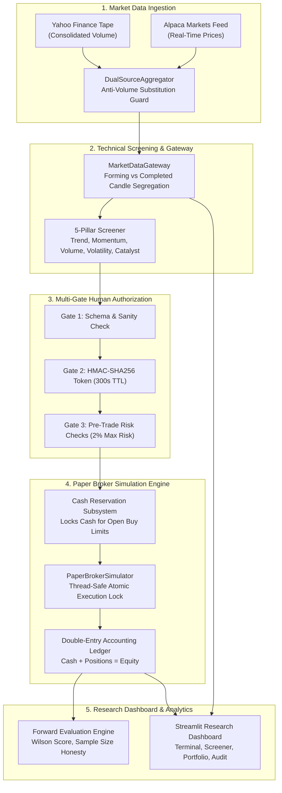

# The Day Trader skill & Trader-Swing Platform

11 Claude skills for day trading: scan thousands of charts, track breaking news, time every entry and exit, and replay every outcome before you risk a dollar.

**Trader-Swing** is an advanced quantitative research and simulated paper-trading platform for US equities. It builds directly upon the modular foundation of the 11 Claude day-trading skills originally developed in the [day-trader-skill](https://github.com/Jakeschincariol/day-trader-skill) project, extending them into a full-featured, offline-reproducible swing trading research, observation, and paper broker simulation system.

> **CRITICAL DISCLAIMER**: Trader-Swing is strictly a research and simulated paper-trading system. It does NOT place live orders or trade with real money. All broker executions run within an isolated in-memory or sandboxed double-entry paper ledger.

---

## Architecture Overview



---

## Repository Structure: Two Distinct Layers

This project organizes quantitative trading functionality into two distinct layers:

1. **Interactive Modular Day-Trading Skills (`trader-*/`)**:
   Located directly at the repository root (`trader-scanner/`, `trader-entry/`, `trader-exit/`, `trader-timemachine/`, `trader-risk/`, `trader-budget/`, `trader-broker/`, `trader-alerts/`, `trader-analyst/`, `trader-news/`, `trader-pelosi/`). These are focused, standalone CLI tools and Claude skills for intraday setups, news tracking, Monte Carlo replays, and individual trade planning.
2. **Automated Swing Trading Subsystem (`.agents/skills/trader-swing/`)**:
   The core programmatic engine of Trader-Swing. Houses the dual-source market data aggregator, real-time `MarketDataGateway`, double-entry accounting ledger with cash reservation, 3-gate HMAC order authorization service, and forward evaluation analytics.

---

## Key Features

1. **Dual-Source Market Data Protection**: Real-time prices from Alpaca with Average Daily Volume (ADV) and Relative Volume (RVOL) exclusively from consolidated US market volume (Yahoo Finance). Exchange-specific volume is never substituted for the consolidated tape.
2. **Forming vs Completed Candle Segregation**: Eliminates lookahead bias by ensuring technical indicators compute exclusively over completed daily sessions, while live forming candles are isolated.
3. **Three-Gate Human Authorization**: Automated orders cannot bypass human approval. Orders require a cryptographically signed HMAC-SHA256 token with a strict 300-second TTL and single-use replay protection.
4. **Double-Entry Paper Accounting & Cash Reservation**: Open buy limit orders immediately lock cash in `reserved_cash_usd`, preventing synthetic margin violations or overdrafts.
5. **Statistical Honesty & Forward Evaluation**: Wilson score confidence intervals and automated sample size warnings (`SAMPLE INSUFFICIENT` for sample sizes under 30 trades).
6. **Read-Only Streamlit Research Dashboard**: A locally hosted terminal for deep-dive technical charts, market screener breadth, portfolio curves, and observation logs.
7. **Original 11 Modular Skills**: 11 focused day-trading skills that can be run as CLI tools or Claude skills.

---

## Prerequisites & Platform Support

- **Primary Supported Platform**: **Windows 10/11** using **Windows PowerShell** (PowerShell 5.1 or PowerShell 7+). Automated onboarding scripts (`setup.ps1`) and task runners (`run.ps1`) are built and tested specifically for Windows PowerShell.
- **Python Version**: Python >= 3.11, <= 3.13 (Python 3.13 recommended).
- **Git**: For cloning and repository management.
- **Linux / macOS Support**: The core Python codebase uses standard cross-platform libraries and can be run on Unix systems via manual virtual environment configuration (see Unix section below).

---

## Windows Quick Start

### 1. Enable Script Execution & Clone Repository
In your PowerShell terminal, allow script execution for the current session:
```powershell
Set-ExecutionPolicy -Scope Process -ExecutionPolicy Bypass
git clone https://github.com/manojzzz12/trading.git
cd trading
```

### 2. Run Automated Setup
Run the setup script to create the virtual environment (`.venv`), install dependencies, and generate your `.env` configuration:
```powershell
.\setup.ps1
```

### 3. (Optional) Ingest Baseline Market Data
Market data CSVs are excluded from Git to keep the repository lightweight. The dashboard handles missing market data gracefully with clean default empty states. If you wish to populate baseline market data for the 50-stock curated universe, run:
```powershell
.\.venv\Scripts\python.exe scripts/acquire_current_daily.py
```

### 4. Launch the Research Dashboard
```powershell
.\run.ps1 dashboard
```
Open your web browser to `http://localhost:8501`.

---

## Linux / macOS Manual Setup

While Windows PowerShell is the primary supported automation environment, Unix developers can run Trader-Swing using standard Python virtual environment tooling:

```bash
# 1. Create and activate virtual environment
python3 -m venv .venv
source .venv/bin/activate

# 2. Install dependencies
pip install -r requirements.txt

# 3. Initialize configuration
cp .env.example .env
# Edit .env and set TRADER_AUTH_SECRET to a 32-character hex key:
python3 -c "import secrets; print(secrets.token_hex(16))"

# 4. Launch Streamlit dashboard
streamlit run dashboard/app.py
```

---

## Runner Commands (`run.ps1`)

The `run.ps1` script provides simple, one-line commands for all platform functions on Windows:

```powershell
# Launch the Streamlit research dashboard (http://localhost:8501)
.\run.ps1 dashboard

# Run the forward paper trading evaluation performance report
.\run.ps1 eval

# View historical forward evaluation summaries
.\run.ps1 summary

# Run automated forward evaluation batch for the latest session
.\run.ps1 batch

# Run the automated test suite (1,186+ tests, ~2.5 minutes)
.\run.ps1 test

# Run the daily pre-market chart scanner
.\run.ps1 scan

# Show help menu
.\run.ps1 help
```

---

## Environment & Configuration

Copy `.env.example` to `.env` (handled automatically by `setup.ps1` on Windows):
```powershell
Copy-Item .env.example .env
```

Key variables configured in `.env`:
- `TRADER_AUTH_SECRET`: Mandatory 16+ byte cryptographically secure secret for signing HMAC order authorization tokens.
- `ALPACA_API_BASE_URL`: Defaults to `https://paper-api.alpaca.markets` (Paper trading only).
- `ALPACA_API_KEY_ID` & `ALPACA_API_SECRET_KEY`: Optional Alpaca keys for real-time market data streaming.
- `SEC_USER_AGENT`: User-Agent header for SEC EDGAR filing requests (e.g. `ResearchApp User<user@example.com>`).

### Personal Paper Journal Storage Location
To ensure that personal financial records are never accidentally committed to source control, Trader-Swing isolates paper journals outside the repository tree:
- **Default Paper State Location**: `Path.home() / "Documents" / "TradingPaperState"` (`C:\Users\<username>\Documents\TradingPaperState` on Windows).
  - Override via: `TRADING_PAPER_STATE_DIR` environment variable.
- **Default Simulation State Location**: `Path.home() / "Documents" / "TradingPaperSimulation"`.
  - Override via: `TRADING_PAPER_SIMULATION_DIR` environment variable.

For detailed configuration documentation, see [docs/CONFIGURATION.md](docs/CONFIGURATION.md).

---

## The Eleven Original Skills

| Command | Skill Name | Purpose |
| :--- | :--- | :--- |
| `/trader-scanner` | Chart Scanner | Scans thousands of charts for opening-range breakouts, flags, and bounces. |
| `/trader-news` | News Monitor | Tracks breaking news and SEC 8-K filings on watchlist tickers. |
| `/trader-entry` | Entry Timer | Watches setups bar by bar and alerts the moment an entry triggers. |
| `/trader-exit` | Exit Planner | Sets deterministic stop-loss and take-profit targets before entry. |
| `/trader-timemachine` | Time Machine | Replays trade outcomes 10,000 times using historical 5-minute bars. |
| `/trader-risk` | Risk Manager | Evaluates trades against account risk limits (max loss, position caps). |
| `/trader-budget` | Budget Manager | Sizes share quantities to fit strict dollar risk budgets. |
| `/trader-broker` | Order Executor | Builds formatted tickets for human review and paper execution. |
| `/trader-alerts` | Price Alerts | Monitors price thresholds, stops, and closing bell flat-by times. |
| `/trader-analyst` | Earnings Analyst | Reads 10-Q and 10-K filings straight from SEC EDGAR. |
| `/trader-pelosi` | Pelosi Tracker | Parses public Congressional Periodic Transaction Reports (PTRs). |

### Installing into Claude

The 11 modular skills can be installed into Claude directly from the upstream project registry:

Paste this into Claude:

```
https://github.com/Jakeschincariol/day-trader-skill

install skill
```

Or as a plugin in Claude Code:

```
/plugin marketplace add Jakeschincariol/day-trader-skill
/plugin install day-trader-skill@day-trader-skill
```

---

## Running Individual Tools (CLI)

All tools run with standard-library Python or through `.venv`:

```powershell
# Chart scanner: US universe and pre-market setups
.\.venv\Scripts\python.exe trader-scanner/scan.py daily

# News monitor: Headlines and SEC 8-Ks
.\.venv\Scripts\python.exe trader-news/news.py --tickers TSLA --hours 12

# Entry timer: Watch setup
.\.venv\Scripts\python.exe trader-entry/entry.py check TSLA --setup orb

# Exit planner: Compute stop and target
.\.venv\Scripts\python.exe trader-exit/exit.py plan --stop or-mid --target 1R

# Time machine: 10,000 Monte Carlo replays
.\.venv\Scripts\python.exe trader-timemachine/timemachine.py run

# Position sizing: Size to dollar risk
.\.venv\Scripts\python.exe trader-budget/size.py

# Pre-trade risk check
.\.venv\Scripts\python.exe trader-risk/check.py

# Paper broker ticket
.\.venv\Scripts\python.exe trader-broker/ticket.py show

# SEC company facts
.\.venv\Scripts\python.exe trader-analyst/facts.py AAPL
```

---

## Testing & Quality Assurance

Trader-Swing includes a comprehensive test suite covering accounting invariants, HMAC token authorization, order state transitions, and broker simulation:

```powershell
.\.venv\Scripts\python.exe -m pytest tests/ -q
```

All 1,186+ tests execute deterministically offline using sanitized fixtures, achieving a 100% pass rate (1,186 passed, 1 skipped, 0 failed).
- **Execution Time**: The complete full test suite runs in approximately **2.5 to 3 minutes** (167 seconds).

---

## Project Documentation

- [docs/ARCHITECTURE.md](docs/ARCHITECTURE.md) - Component design, data flow, and invariants.
- [docs/CONFIGURATION.md](docs/CONFIGURATION.md) - Environment variables and risk configuration.
- [docs/TROUBLESHOOTING.md](docs/TROUBLESHOOTING.md) - Common Windows setup and runtime solutions.
- [docs/IMPLEMENTATION_HISTORY.md](docs/IMPLEMENTATION_HISTORY.md) - Complete phase audit and milestone history.

---

## Limitations

- **Simulated Paper Trading Only**: This software does not place real-money orders. Broker connectors default to paper accounts.
- **US Equities Only**: Designed for US common stocks and ETFs (SPY, QQQ, and large-cap liquid equities). No crypto, forex, options, or futures.
- **No Intraday HFT**: The system operates on completed daily bars and 5-minute bars. It is not designed for high-frequency trading.
- **Free Data Caveats**: Yahoo Finance endpoints are unofficial and may experience rate limits or network latency.

---

## Fine print

**Not financial advice.** This software reads public market data and computes arithmetic. It does not know your personal financial situation and cannot predict market movements. Most individuals who trade lose money. Decide for yourself and consult a licensed financial professional before risking capital.

**Human authorization required.** Automated orders cannot execute without human review. Every order must pass schema checks, risk limits, and an HMAC approval token before reaching the paper simulation engine.

**Simulation is not prediction.** The Time Machine and paper broker simulate hypothetical scenarios based on historical bars. Future market conditions can differ substantially from past observations.

---

## License

MIT License. See [LICENSE](LICENSE) for details.
