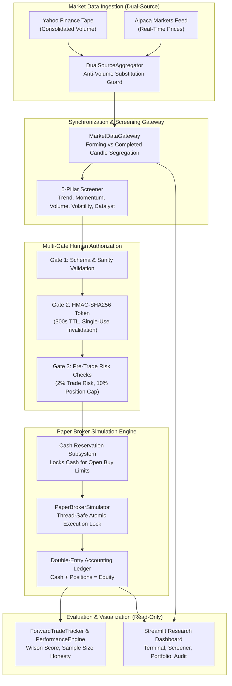

# Trader-Swing System Architecture

Trader-Swing is a modular, systematic swing-trading research, observation, and paper-broker simulation platform built for US equities. It is designed from the ground up for strict safety, deterministic risk management, and offline reproducibility.

> **CRITICAL SYSTEM BOUNDARY**: Trader-Swing is strictly a research and simulated paper-trading system. It does NOT execute live financial orders or trade with real capital.

---

## 1. High-Level System Architecture

The following diagram illustrates the component architecture, data isolation boundaries, and operational flow:



---

## 2. Core Architectural Principles & Invariants

### 1. Dual-Source Data Segregation & Anti-Volume Substitution
- **Consolidated Volume Protection**: Free exchange-specific feeds (such as Alpaca IEX) capture only a minor fraction of the total US market volume. Trader-Swing enforces that Average Daily Volume (ADV) and Relative Volume (RVOL) calculations derive solely from the consolidated tape (Yahoo Finance).
- **Fail-Closed on Divergence**: If price feeds fail or volume provenance is compromised, the pipeline halts immediately (`VolumeSubstitutionError`) rather than operating on degraded or synthetic estimates.

### 2. Forming vs. Completed Candle Segregation
- To eliminate lookahead bias and inaccurate technical signals during active market sessions, the `MarketDataGateway` strictly partitions data:
  - `FORMING` candles represent the currently active, unclosed session bar.
  - `COMPLETED` candles represent finalized historical daily bars.
  - Technical indicators (EMA, SMA, ATR, RSI) compute exclusively over completed session bars.

### 3. Three-Gate Human-in-the-Loop Authorization
Automated or algorithmic scripts cannot submit orders directly to the paper broker simulator:
1. **Gate 1 (Schema & Sanity)**: Validates positive share counts, tick sizes, non-zero prices, and allowed tickers.
2. **Gate 2 (HMAC Signed Approval Token)**: Every order requires a cryptographically signed HMAC-SHA256 token generated with `TRADER_AUTH_SECRET`. Tokens expire after strictly 300 seconds (5 minutes) and are permanently marked as used upon verification to prevent replay attacks.
3. **Gate 3 (Deterministic Risk Constraints)**: Enforces hard mathematical limits:
   - Max 2% capital risk per trade ($R$).
   - Max 10% portfolio position concentration cap.
   - Zero synthetic margin, short selling, or options.

### 4. Double-Entry Accounting with Cash Reservation
- Submitting a buy limit order immediately locks $\text{shares} \times \text{limit\_price}$ in `reserved_cash_usd`.
- Available purchasing power is measured strictly as $\text{Cash} - \text{Reserved Cash}$.
- Prevents race conditions, double-allocation of capital, and negative balance anomalies during concurrent execution.

### 5. Honest Forward Performance Evaluation
- Forward performance is tracked via `ForwardTradeTracker` and evaluated using `ForwardPerformanceEngine`.
- Statistical honesty: Metrics automatically display `SAMPLE INSUFFICIENT` when closed trades $< 30$.
- Calculates Wilson score confidence intervals for true win rate estimation.
- Evaluates test fixtures separately from genuine daily records via fail-closed whitelist isolation (`DAILY` / `LIVE` data modes only).

---

## 3. Component Directory Layout

```
├── .agents/skills/trader-swing/   # Core business logic and trading subsystems
│   ├── accounting.py             # Double-entry ledger and balance sheet enforcement
│   ├── authorization_service.py  # 3-Gate order authorization coordinator
│   ├── authorization_token.py    # HMAC-SHA256 token generator & single-use validator
│   ├── cash_reservation.py       # Cash reservation manager for open limit orders
│   ├── dual_source_aggregator.py # Aggregator combining price and consolidated volume
│   ├── forward_performance.py    # Wilson score and statistical metrics engine
│   ├── forward_trade_tracker.py  # Forward position tracker & mark-to-market engine
│   ├── market_data_gateway.py    # Real-time synchronization & candle lifecycle manager
│   ├── order_lifecycle.py        # Order models & state machine transitions
│   ├── paper_broker_simulator.py # Thread-safe paper matching engine
│   ├── paper_storage.py          # Isolated JSON storage manager for paper state
│   ├── rate_limiter.py           # Token-bucket rate limiter with burst floor pacing
│   ├── risk.py                   # Pre-trade risk constraint checks & position sizing
│   └── providers/                # Market data connectors (Alpaca, Yahoo Finance)
├── dashboard/                    # Read-only Streamlit research dashboard
│   ├── app.py                    # Main dashboard application
│   ├── charts.py                 # Candlestick, volume, and portfolio charts
│   └── data_loader.py            # Cached, read-only data loader
├── docs/                         # System documentation
│   ├── ARCHITECTURE.md           # System architecture (this document)
│   ├── CONFIGURATION.md          # Environment variables & configuration runbook
│   ├── TROUBLESHOOTING.md        # Common issues and solutions
│   └── IMPLEMENTATION_HISTORY.md # Comprehensive milestone and phase audit archive
├── tests/                        # 42 unit, integration, and UAT test suites
├── forward_evaluation_cli.py     # Operator CLI for forward setup tracking & reports
├── run_forward_evaluation.py     # Batch runner for forward paper evaluations
├── setup.ps1                     # Automated Windows setup script
└── run.ps1                       # Automated Windows command runner
```
